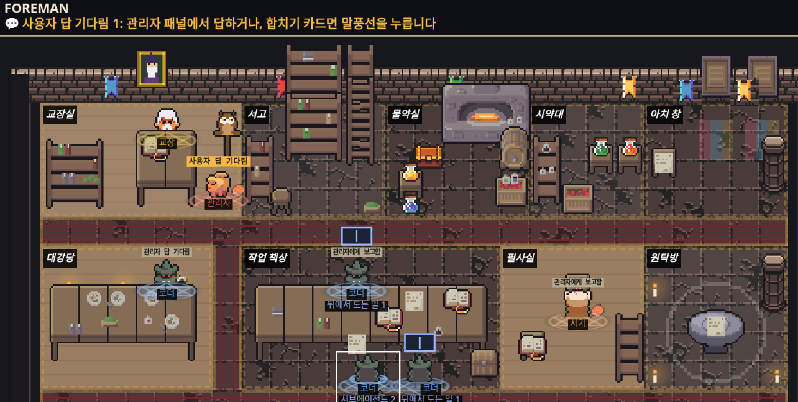
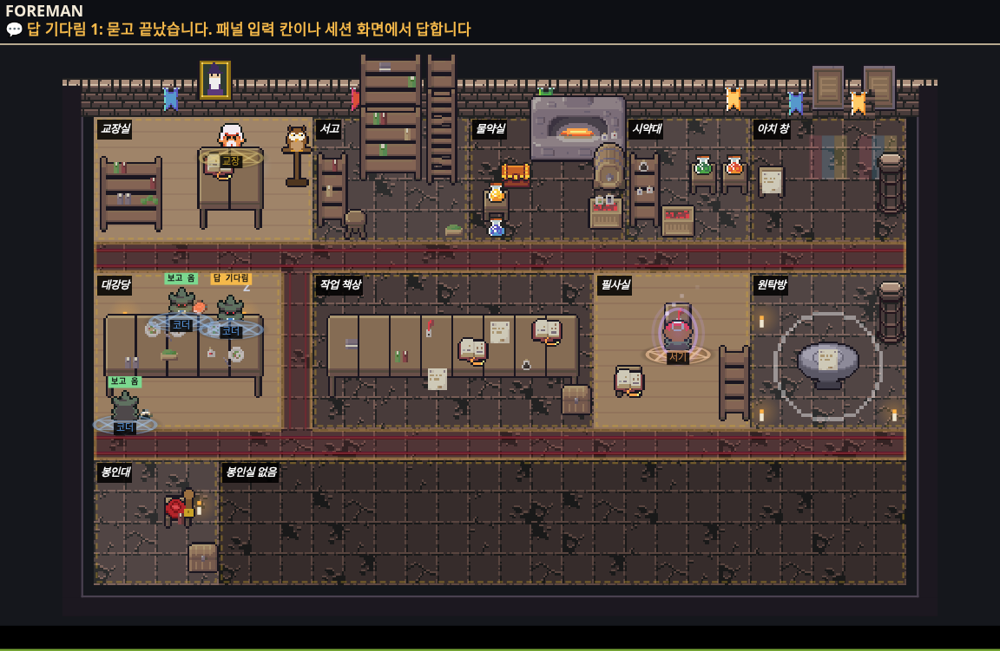
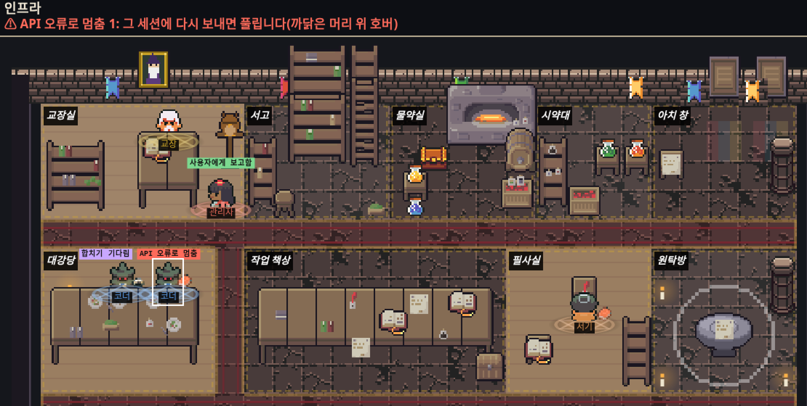
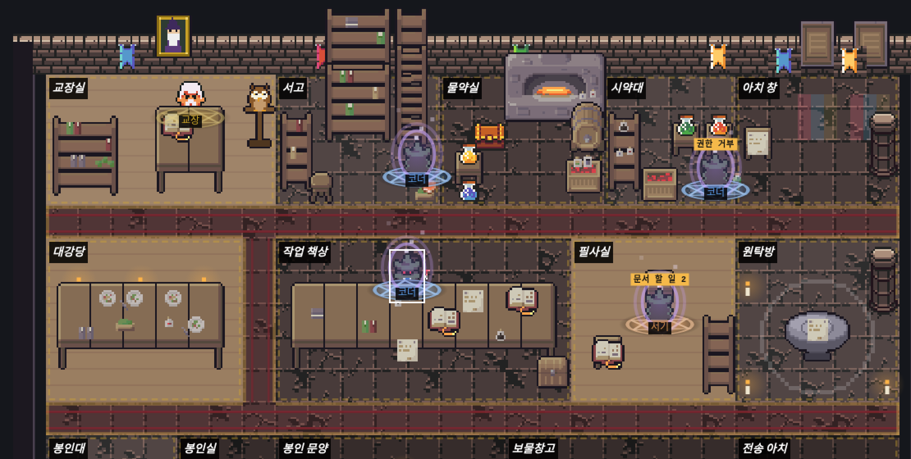
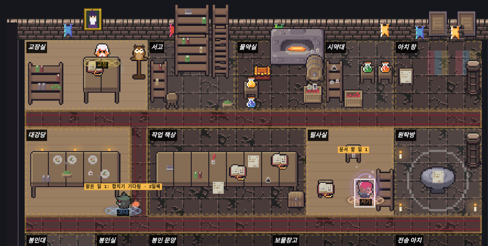
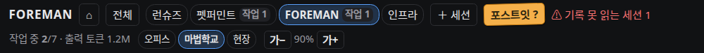

<!--
다루는 곳: bridge/static/js/overhead.js, bridge/static/js/render.js, bridge/static/js/office.js, bridge/static/js/store.js, bridge/api/dashboard.py, bridge/uiver.py, bridge/ingest_health.py
읽은 커밋: 46b1678
-->
# 머리 위 표시와 띠

> 이 글은 사람이 손대야 할 일이 생겼을 때 지도 위 캐릭터 머리와 방 머리줄, 화면 맨 위에 뜨는 표시를 다룹니다.

**세션이 사람의 답을 기다리거나, 보고를 올리거나, 막혀 멈췄을 때 그 캐릭터 머리 위에 짧은 글이 뜨고 방 머리줄에 무엇을 하면 풀리는지가 한 줄로 뜹니다. 화면 자체가 낡았거나 기록이 막혔을 때도 맨 위에 띄웁니다.**

세션이 여럿 돌면 사람이 지금 어디를 봐야 하는지가 가장 중요합니다. 세션이 묻고 끝났는데 아무도 답하지 않으면 그 세션은 조용히 멈춰 있게 됩니다. 이 화면은 사람 몫인 일을 캐릭터 머리 위에 붙여, 지도를 훑기만 해도 누가 사람을 기다리는지 보이게 합니다. 글의 색으로 무게도 가릅니다. 노랑은 답해야 하는 것, 초록은 읽기만 하면 되는 것, 빨강은 막혀 멈춘 것, 보라는 합치기를 기다리는 것, 흐린 회색은 사람 몫이 아닌 것입니다 [code:bridge/static/js/render.js] [docs:10_office_design.md].

## 관리자에게만 사람 몫을

작업 세션(코더, 서기, 디자이너)의 보고와 물음은 먼저 그 프로젝트의 관리자 세션에게 갑니다. 관리자가 사람에게 올릴 것을 골라 올리면, 그 관리자 머리 위에 「사용자 답 기다림」(노랑)이나 「사용자에게 보고함」(초록)이 뜹니다. 사람은 관리자 하나와만 이야기하면 됩니다. 작업 세션 머리 위에는 관리자에게 넘긴 것만 작고 흐리게 「관리자에게 보고함」, 「관리자 답 기다림」으로 남아, 그 세션이 지금 무엇을 기다리는지만 알려 줍니다 [log:overhead_marks_20261113.md] [log:merge_wait_to_manager_20261113.md].

보고는 그 관리자 패널을 열어 읽으면 사라집니다. 물음에는 번호(#3058 같은)가 붙어 있고, 사람이 그 번호를 넣어 답하면 사라집니다. 번호 없이 다른 얘기로 넘어가면 물음이 조용히 사라지지 않고 관리자 머리 위에 「아직 안 본 물음 N」으로 남습니다. 관리자 패널 위쪽 띠에 그 물음들이 한 줄씩 보이고, 읽은 것은 [봤다]를 눌러 하나씩 지웁니다. 끝난 물음은 목록에 올리지 않아서, 목록이 쌓여 아무도 안 읽게 되는 일이 없습니다 [code:bridge/api/dashboard.py] [code:bridge/static/js/render.js] [log:foreman-8_escalate_number_20261117.md]. 작업방(worktree, 같은 저장소를 따로 꺼낸 작업 폴더)에서 일을 마친 세션의 합치기 카드가 사람 승인을 기다릴 때도 관리자 머리 위 「사용자 답 기다림」으로 올라오고, 그 말풍선을 누르면 해당 세션 패널의 [세션 정리] 탭이 바로 열립니다(→ 「합치기 카드와 코더 창」).

![FOREMAN 방 윗부분과 관리자 패널입니다. 교장실의 관리자 머리 위에 노란 「아직 안 본 물음 2」가 떠 있고, 오른쪽 관리자 패널(세션 980) 위쪽 띠에 「아직 안 본 물음 2: 번호 없이 다른 입력으로 넘어간 물음입니다. 읽고 [봤다]를 누릅니다.」와 물음 #3, #4가 한 줄씩, 줄마다 [봤다] 단추가 있습니다 〔시연 재생, 세션과 물음 글은 시연용〕](img/02_overhead_unseen.png)

관리자에게 넘기는 길이 켜지지 않은 프로젝트이거나 넘기기에 실패했으면, 작업 세션 머리 위에 사람용 글이 직접 뜹니다. 묻고 끝났으면 「답 기다림」(노랑), 묻지 않고 일을 마쳤으면 「보고 옴」(초록)입니다. 브리지는 작업 세션의 턴이 끝난 뒤 30초 동안 넘기기를 기다렸다가, 넘긴 기록이 없으면 사람에게 띄웁니다 [code:bridge/api/dashboard.py] [log:coder_report_mark_20261111.md].

## 막혀 멈춘 세션

세션이 사람 손 없이는 더 나아가지 못할 때도 머리 위에 뜹니다. **권한 거부**(노랑)는 CC 자체 권한 검사가 어떤 도구를 막아 세션이 멈춘 경우입니다. 이것은 FOREMAN의 승인 카드로 오지 않는 막힘이라, 호버 글에 어떤 도구가 왜 막혔는지와 그 세션에 허용하거나 다른 방법을 지시해야 풀린다는 것을 적습니다. **API 오류로 멈춤**(빨강)은 마지막 턴이 API 오류로 끝나고 그 뒤 새 입력이 없는 경우입니다. 서버 상태로는 쉬는 세션과 똑같아 보이기 때문에 따로 표시하지 않으면 쉬는 줄 알고 지나칩니다. 그 세션에 다시 보내면 풀리고, 30분 넘게 그대로면 텔레그램으로 한 번 더 알립니다 [log:screen_api_error_bar_20261113.md].

**합치기 기다림**(보라)은 관리자 머리 위로 올리지 못한 합치기 카드에만 작업 세션 자신의 머리 위에 뜹니다. 끝 신호가 오지 않아 끝났는지 모르는 턴은 머리 위에 빨간 「…」으로, 세션이 쉬면서 뒤에서 도는 명령을 기다릴 때는 어두운 상자 안에서 도는 막대 「| / - \」로 그립니다.

한 사람에게 여러 일이 겹치면 머리 위 글씨는 하나만 띄웁니다. 순서는 권한 거부, API 오류로 멈춤, 답 기다림, 사용자 답 기다림, 아직 안 본 물음, 합치기 기다림, 사용자에게 보고함, 보고 옴, 관리자에게 넘긴 것입니다. 막힌 것이 먼저이고, 눌러야 끝나는 것이 읽기만 하면 되는 것보다 먼저입니다. 나머지는 캐릭터 호버와 방 머리줄에 남습니다 [code:bridge/static/js/render.js].

## 쌓는 방식

머리 위 표시는 캐릭터를 덮지 않고 머리 위로 쌓습니다. 머리 바로 위에 글씨 카드, 그 위에 동작 카드(빨간 「…」, 도는 막대, 승인 대기를 뜻하는 테마 깃발)를 올립니다. 위가 막혀 자리가 없으면 조금 들어 올리거나 옆에 붙이고, 그래도 안 되면 줄이고, 끝내 안 되면 같은 색의 점으로 바꿉니다. 이때 글은 호버와 방 머리줄에 그대로 남습니다. 몸 옆이나 발밑으로는 내려가지 않습니다. 걷는 동안에는 자리를 붙잡아 표시가 흔들리지 않습니다 [code:bridge/static/js/overhead.js] [log:overhead_stack_20261113.md] [log:name_pin_20261114.md].

## 자리에 붙는 말풍선

어떤 표시는 캐릭터가 아니라 자리에 붙습니다. 방의 일이라 그 자리에 누가 있든 없든 떠야 하기 때문입니다. 서기 자리에는 서기에게 맡길 문서 일이 쌓이면 「문서 할 일 N」이, 미뤄 둔 포스트잇이 많이 쌓이면 「포스트잇 쌓임」이 뜨고, 누르면 서기실 창이 열립니다(→ 「서기실」, 「포스트잇」). 코더 자리에는 그 방 코더에게 맡길 일이 있으면 「맡길 일 N」이, 쉬게 한 일만 남았으면 「맡은 일 N: 합치기 기다림」이 뜨고, 누르면 코더 창이 열립니다. 감독실의 교장 머리 위 「시작할 일 N」은 시작을 기다리는 자동 제안(→ 「교장 계획 창과 감독실」), 출하 라인 담당 머리 위 「대기 N」은 나갈 차례를 기다리는 커밋입니다 [log:crew_merge_20261113.md].

## 방 머리줄과 [전체] 지도

한 방을 크게 볼 때는 방 위 머리줄에 경고만 한 줄씩 띄웁니다. 승인 대기, 질문, 권한 거부, API 오류로 멈춤, 답 기다림, 사용자 답 기다림, 파이프라인 실패, 배포 대기, 빌드 알림 끊김 의심 같은 것이고, 줄마다 무엇을 어디서 하면 풀리는지를 함께 씁니다. 머리 위 글이 작아 놓치더라도 이 줄은 놓치기 어렵습니다 [code:bridge/static/js/office.js].

[전체] 지도에서는 방이 작아 머리 위에 글 대신 같은 색의 점만 찍고, 방 카드에 「멈춤: 사용자 답 기다림 1」, 「멈춤: API 오류 1」처럼 그 방이 왜 멈췄는지를 씁니다. 지금 보고 있지 않은 방의 일이 묻히지 않게 하려는 것입니다.

![[전체] 지도입니다. FOREMAN 방 카드에 「멈춤: 사용자 답 기다림 1」, 인프라 방 카드에 「멈춤: API 오류 1」(빨강), 머리줄에 「🔀 합치기 대기 2」가 있습니다 〔시연 재생, 세션은 시연용〕](img/02_overhead_map.png)

화면 맨 위 머리줄에도 모든 방을 합친 경고가 버튼으로 뜹니다. 「❗ 승인 대기 N」, 「❓ 질문 N」, 「🔀 합치기 대기 N」을 누르면 해당 세션 패널이 열립니다(합치기 대기는 가장 오래된 카드부터).

## 화면이 낡았을 때: 새로 고침 띠

브리지를 고쳐 다시 띄워도, 이미 열려 있는 브라우저 탭은 처음 받은 옛 화면 코드로 계속 돕니다. 새 버튼을 만들었는데 사람의 탭에는 안 보이고 아무도 모르는 일이 생길 수 있습니다. 그래서 브리지는 화면 파일(js, css, html)의 이름과 크기, 고친 시각으로 짧은 지문을 만들어 화면에 보내고, 화면은 처음 받은 지문과 달라지면 맨 위에 「화면 코드가 바뀌었습니다. 새로 고쳐야 바뀐 기능이 보입니다.」 띠와 [새로 고침] 버튼을 띄웁니다. 저절로 새로 고치지는 않습니다. 입력 칸에 쓰던 글이 사라지기 때문입니다 [code:bridge/uiver.py] [code:bridge/static/js/store.js].

![새로 고침 띠입니다. 맨 위 가운데의 노란 띠와 [새로 고침] 버튼이 보입니다 〔시연 재생, 띠는 실제 화면 코드의 지문 비교 함수에 다른 지문을 넣어 띄웠습니다〕](img/02_overhead_refresh.png)

## 기록이 막혔을 때: 적재 막힘

화면은 브리지가 세션 기록 파일을 읽어 데이터베이스에 쌓은 것으로 그립니다. 그 적재가 막히면 화면은 멈춘 세상을 계속 보여 주게 됩니다. 실제로 한 세션의 적재가 같은 자리에서 실패를 되풀이했는데 로그에만 남아 몇 시간 아무도 몰랐던 일이 있었습니다 [log:stage2_transcript_result.md]. 지금은 브리지가 30초마다 적재 상태를 보고, 한 파일이 5분 넘게 같은 자리에서 실패하거나 기록을 읽는 감시가 2분 넘게 돌지 않으면 텔레그램으로 알리고 풀리면 회복 알림을 보냅니다 [code:bridge/ingest_health.py] [c:8ff353b]. 화면 머리줄에는 같은 때 「⚠ 기록 못 읽는 세션 N」 또는 「⚠ 화면 갱신 멈춤」이 빨갛게 뜨고, 마우스를 올리면 어느 세션이 몇 분째 몇 번 실패했는지와 오류가 보입니다.

적재 막힘과 회복 알림은 하루 묶음을 기다리지 않고 바로 갑니다. 이 글 앞쪽의 머리 위 표시 가운데 관리자가 사람에게 올린 물음과 보고도 텔레그램에 갑니다. 물음은 바로, 보고는 묶음을 켠 프로젝트면 하루 한 번(21:00) 모아서 보냅니다(→ 「텔레그램 알림」).

[기술문서: 화면](../notion/14_screen.md)
