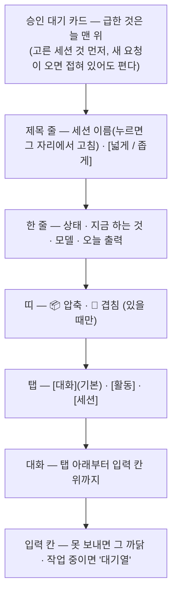
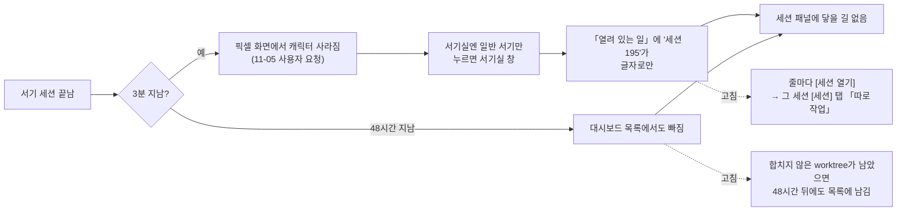

# 패널과 화면 문장 — 어떻게 쓰게 만들었나

> 이 글은 FOREMAN 화면을 사람이 실제로 쓰게 만든 판단들 — 옆 패널의 배치, 버튼을 늘 보일지 접을지 가른 기준, 화면에 뜨는 문장의 규칙, 막히거나 틀어진 것을 화면이 스스로 알리게 한 장치 — 을 다룬다.

**픽셀 화면이 "지금 무슨 일이 있나"를 보여 준다면, 옆 패널은 "그래서 무엇을 할까"를 하는 곳이다. 패널은 대화를 주인공으로 두고, 버튼은 실제로 누른 이력으로 늘 보일 것과 접을 것을 갈랐다. 화면 글은 "~습니다"로 쓰고, 툴팁은 "무엇 — 한 줄"로 쓴다. 화면이 조용히 길을 숨기거나 틀린 모습을 보인 일은 고장으로 보고 고쳤다.** 클래식 대시보드와 픽셀 화면은 같은 그리기 함수를 쓴다 [log:stage10_office_result.md] [log:stage11_handoff_result.md].

![패널을 넓게 펴고 끝난 세션의 [대화] 탭을 연 모습 — 오른쪽 위 말풍선이 사람의 입력, 아래 초록 띠 카드가 CC의 답(마크다운 목록 · 굵은 제목), 맨 아래는 보낼 수 없는 까닭("세션이 끝났습니다")](img/02_ui_convo.png)

픽셀 화면을 어떻게 그렸는지는 → 「픽셀 오피스 — 그 화면을 어떻게 만들었나」. 승인 · 입력이 서버에서 어떻게 도는지는 → 「에이전트 관제 — 상태 · 승인 · 입력」.

## 1. 문제 — 보이는 것과 쓸 수 있는 것은 다르다

- 첫 화면은 세션마다 카드 한 장인 대시보드였다. 모든 정보가 있었지만 **"어디를 눌러야 하나"는 사람이 기억해야 했다** [log:stage6_dashboard_result.md]
- 픽셀 화면이 생기며(11-05) 옆 패널에 승인 · 대화 · 입력 · 인계 · 세션 조작이 차례로 붙었다. 기능이 붙을 때마다 버튼이 늘었다 [log:stage10_office_result.md] [log:stage11_handoff_result.md]
- 사용자가 짚은 것들은 모두 "기능은 있는데 못 쓴다"였다
  - "버튼이 너무 많고 뭔지 모르겠어" [log:stage11_session_tab_result.md]
  - "끝내기 누르고, 3분 안에 합치기를 또 찾아 눌러야 해" [log:stage11_worktree_result.md]
  - 글씨를 한 번 키운 뒤에도 "아직 작다" [c:dd1b138]
- 그리고 이 프로젝트가 있는 이유와 같은 종류의 문제가 화면에도 있었다. **화면이 틀린 모습을 보이거나 길을 숨기면, 사람은 그것을 모른 채 지나간다** — 끝난 세션의 [합치기]가 그랬다(4-1)

## 2. 판단 — 무엇을 고르고 무엇을 버렸나

| 고른 것 | 버린 것 | 이유 | 근거 |
|---|---|---|---|
| 패널을 캔버스 **옆**에 세운다(펴고 접으면 무대가 줄고 늘어난다) | 캔버스 위에 덮는 창 | 덮으면 캐릭터가 가려져 "지금 무슨 일"이 안 보인다. 터미널도 같은 원칙 — 펴면 화면 전체가 그만큼 줄어든다 | [log:stage10_office_result.md] |
| 대화가 주인공 — 탭 아래부터 입력 칸 위까지 전부 대화 | 정보 · 활동 · 대화를 한 판에 나란히 | 패널에서 가장 오래 하는 일이 "CC가 뭐라 했나 읽기"다. 나머지는 탭으로 | [c:1540471] [log:stage11_handoff_result.md] |
| 버튼은 **누른 횟수**로 가른다(늘 보임 / 「더보기」 / 접힌 칸) | 기능별로 묶어 다 보이기, 쓰지 않는 버튼 지우기 | 지우면 드물게 필요한 순간에 대신할 길이 없다. 접으면 평소엔 조용하고 필요할 때 있다 | [log:stage11_session_tab_result.md] |
| 접힌 칸은 **사람이 할 일이 있을 때만** 저절로 연다 | 늘 열기 / 늘 닫기 | 늘 열면 다시 버튼이 많아 보이고, 할 일이 있는데 닫혀 있으면 조용히 묻힌다 | [log:stage11_session_tab_result.md] |
| 알림은 **막지 않고 띠로** 보인다(압축 · 겹침) | 입력을 막는 확인 창 | 판정이 틀릴 수 있는 알림이다. 막으면 헛알림 하나가 일을 멈춘다 | [log:overlap_alert_20261106.md] |
| 클래식과 픽셀이 **같은 그리기 함수 · 같은 CSS** | 화면마다 따로 그리기 | 한쪽만 고쳐져 어긋나는 일이 없다 | [log:stage10_office_result.md] |
| 사람이 붙인 세션 이름이 **어디서나** 이긴다 | CC가 붙이는 자동 제목 | 자동 제목은 대화가 흘러가며 바뀐다. 사람이 이름을 붙였으면 그 이름으로 찾는다 | [log:ui_font_title_20261106.md] |

## 3. 구조 · 흐름

### 3-1. 패널 — 대화가 주인공

- **말풍선** — 사람의 글은 오른쪽 말풍선(강조색), CC의 답은 왼쪽 카드(초록 띠), 서브에이전트 결과 · 완료 알림 · 다른 세션의 글은 점선의 작은 글 [log:stage11_handoff_result.md]
- **스크롤 따라가기** — 아래를 보고 있으면 새 답을 따라 내려가고, 위를 읽고 있으면 그대로 두고 [새 답 ↓]만 띄운다. 보내면 아래로 [c:1540471]
  - 대화는 **내용이 바뀔 때만** 다시 그린다. 전에는 10초마다 · 이벤트마다 통째로 그려 읽던 자리와 고른 글자가 날아갔다 [log:stage11_handoff_result.md]
  - 그래서 시각은 "n분 전"이 아니라 시계로 쓴다 — "n분 전"은 매번 다시 그려야 맞는다 [log:stage11_handoff_result.md]
- **넓게 / 좁게** — 좁게(기본 360px, 창의 40%까지)는 픽셀을 볼 때, 넓게(창의 50%, 72%까지)는 대화를 읽을 때. 제목 줄 버튼이나 모서리 두 번 누르기로 오가고, 각각 끌어서 바꾼 너비를 따로 기억한다 [log:stage11_handoff_result.md]
- **긴 답** — 처음엔 14줄 · 1,400자를 넘으면 접었다. 읽으려면 매번 눌러야 해서 100줄 · 1만 2천 자로 올렸다. 그때 포먼 대화 38개 중 접힌 것은 1개였다 [c:e505cdd] [log:stage11_handoff_result.md]
  - 펼친 긴 글의 [접기]는 글 끝까지 따라 내려오고, 접을 때 글 머리가 화면 위로 사라졌으면 머리로 데려온다 [log:stage11_handoff_result.md]
- **마크다운** — CC의 답은 표 · 목록 · 코드블록이 많다. 처음 쓴 가벼운 변환이 표와 목록을 읽지 못해 `|` · `-`가 그대로 보였다 → 블록 단위 파서로 바꾸자 포먼 대화에서 표 9 · 목록 87 · 코드블록 2가 그려지고 날 `|` 줄은 0이 됐다 [c:3b1e7ad] [log:stage11_handoff_result.md]
- **작업 중에 보낸 글** — CC가 일하는 중에 보낸 글은 새 턴이 아니라 열린 턴에 끼어든다. 패널이 턴의 첫 프롬프트만 보여 줘 이 글이 아예 안 보였다 → 프롬프트 다음에 "나 · 작업 중에 보냄" 말풍선으로 [c:f132fe0] [log:stage11_handoff_result.md]
- **[활동] 탭** — 도구 호출 한 줄씩. 누르면 그때 트랜스크립트에서 입력과 결과 본문을 읽어 온다(본문은 DB에 넣지 않는다) [log:stage11_handoff_result.md]

### 3-2. [세션] 탭 — 실제로 누른 이력으로 가른다

[세션] 탭에는 인계 · 세션 조작 · 문서 정리 · 세션 정보 · 토큰 · 승인 이력이 정리 없이 한 판에 있었다. 사용자의 "버튼이 너무 많고 뭔지 모르겠어"를 받고, 무엇을 지울지 먼저 정하지 않고 **브리지 접속 로그와 DB(`summary` · `session_action`)로 실제로 누른 횟수를 셌다** [log:stage11_session_tab_result.md].

| 버튼 | 누른 횟수 | 한 일 |
|---|---|---|
| 새로 띄우기 | 17 | 늘 보임 |
| 세션 끝내기 | 16 | 늘 보임 |
| 요약하고 끝내기 | 5 | 늘 보임, 맨 앞 |
| 지금 요약 | 1 | 늘 보임(사용자: 괜찮다) |
| 요약 고치기 | 1 | 버튼 줄에서 빼 요약 카드 머리의 작은 [고치기]로 |
| 요약 통째로(인계 1판) | 0 | **뺐다** — 설계가 이미 "써 본 뒤 뺀다"였다. API는 남김 |
| 죽은 세션 요약 받기 · 압축 요약에서 | 0 | 그대로 — 끝난 세션에서만 보이고, 그때 없으면 대신할 길이 없다 |
| 작업 중단 · 일시정지 · 다시 시작 | 각 1 | [더보기 ▾] 안으로 |
| 문서 정리 두 가지 | 각 1(시험) | 이름을 바꾸고 접힌 칸으로 |

![끝난 세션의 [세션] 탭 — 「인계」와 「세션」은 늘 보이고, 「넘기기 전 정리」 · 「세션 정보 · 토큰」 · 「승인 이력」은 접혀 있다. 접힌 칸 머리에 요약 한 줄(모델 · 오늘 출력)이 보인다](img/02_ui_session_tab.png)

- 순서: 한 줄(프로젝트 · 경로) → **인계**(늘 보임) → **세션**(늘 보임) → 넘기기 전 정리(접힘) → 세션 정보 · 토큰(접힘, 머리에 모델 · 오늘 출력) → 승인 이력(접힘) [c:d74b596] [log:stage11_session_tab_result.md]
- 접힌 칸은 **승인할 목록 · 쓰기 확인 실패 · 도는 점검**이 있을 때만 저절로 열리고, 머리에 "승인할 목록이 있습니다" 같은 힌트가 뜬다. 사람이 열고 닫으면 그대로 둔다 [log:stage11_session_tab_result.md]
- 처음 만든 「더 ◂」는 CSS(`display:inline-flex`) 때문에 접힌 상태에서도 안이 보여 눌러도 달라지는 것이 없었다 → [더보기 ▾] 버튼으로 바꾸고, 누를 때만 안의 버튼을 그린다 [c:b88c0d3] [log:stage11_session_tab_result.md]
- 이름은 두 번 바꿨다. 「옮길 것 뽑기 · 잃은 것 보기」 → 「남길 것 찾기 · 잃은 것 찾기」 → 「대화에서 정한 것 문서에 적기 · 압축으로 잊은 지시 · 결정 찾기」(이름 + 설명 줄 + 짧은 버튼), 칸 이름은 서기실의 문서 정리와 헷갈리지 않게 「넘기기 전 정리」 [c:1bf2a65]
- 이름을 바꿀 때는 화면만이 아니라 확인 창 · 텔레그램 · 서버 거부 사유 · 세션에 보내는 요청 머리까지 같이 바꿨다. 같은 것을 곳마다 다르게 부르면 사람이 둘을 다른 것으로 안다 [log:stage11_session_tab_result.md]

### 3-3. 화면 글 규칙

사용자 지시(11-05)로 화면 글을 한꺼번에 고치고 [c:85870ce] [log:stage11_handoff_result.md], 같은 날 프로젝트 규칙 파일에 넣었다 [c:d19a1ca]: **"화면에 뜨는 글(툴팁 · 안내 · 확인 창 · 결과 · 서버 거부 사유)은 "~습니다"로, 툴팁은 "무엇 — 한 줄 설명"으로 짧게"**.

- **"~습니다"** — 서버가 거부할 때 돌려주는 사유도 화면에 뜨므로 같은 규칙이다. 문서 · 로그는 반말 평서문(-다)으로 갈린다 [docs:style_guide.md]
- **툴팁 "무엇 — 한 줄"** — 처음 툴팁은 도구 목록 · 판별 명령까지 적어 길었다 → "테스트 실행 — 테스트를 돌리는 곳입니다." 꼴로 줄였다 [log:stage11_handoff_result.md]
  - 툴팁은 하나의 구조로 모았다(`tip.js`) — 캔버스의 이름표 · 캐릭터 · 출하 라인과 HTML 버튼이 같은 모양 · 지연(350ms) · 위치를 쓰고, 색 · 글꼴은 테마 이름표(양피지 · 사인판 · 안전 표지판)를 따른다. 브라우저 기본 툴팁은 끈다 [c:3b1e7ad] [log:stage11_handoff_result.md]
  - [세션] 탭을 정리할 때 모든 버튼 · 칸 이름에 툴팁을 달았다. 빠져 있던 것 — [요약을 확인했습니다 — 세션 끝내기] · [취소] · [요약 없이 시작] — 을 채워 툴팁 없는 버튼 0개 [log:stage11_session_tab_result.md]
- **확인 창** — 누르기 전에 알아야 할 것을 적는다: 무엇을 하는지, 무엇이 드는지(돈 · 시간 · 토큰), 되돌릴 수 있는지. 예(이 글을 쓰며 코드에서 옮겼다)
  - "압축으로 잊은 것 찾기 — 압축 구간마다 사람이 한 말을 뽑아 claude -p로 판정합니다. 프롬프트 20개당 약 0.4달러 · 1.5분이 들고, 끝나면 알림이 갑니다."
  - "끝난 세션을 잠깐 불러 요약을 받습니다. 그 세션의 맥락을 다시 읽느라 토큰을 씁니다."
  - "…의 Notion 페이지를 휴지통으로 보냅니다(30일 안에 Notion에서 되살릴 수 있습니다)."
  - 비슷해 보이는 버튼은 확인 창 문구로도 가른다 — 끝내기 / 일시정지 / 작업 중단 [log:stage11_handoff_result.md]
- **결과는 짧게, 잘못됐을 때만 길게** — 입력을 보내면 "보냈습니다."(8초 뒤 사라짐), 잘못됐을 때만 이유와 할 일. 내부 동작(기록 확인 등)은 말하지 않는다 [log:stage11_handoff_result.md]
- **못 하는 이유를 숨기지 않는다** — 입력 칸은 보낼 수 없으면 까닭(tmux 밖 · 멈춤 · 프로세스 없음)을, CC가 일하는 중이면 "대기열로 들어간다"를 미리 보인다 [log:stage6_dashboard_result.md]

### 3-4. 보이게 · 알리게 하는 장치

판정 자체는 다른 글이 다룬다. 여기서는 **화면에서 어디에, 어떤 모양으로** 나오는지만 모았다.

| 장치 | 언제 | 화면 | 막나 | 자세히는 |
|---|---|---|---|---|
| 📦 압축 띠 | 2번째 압축부터 "넘어갈 때", 4번째부터 "늦었음" | 패널 띠 + 캐릭터 옆 📦, [압축으로 잊은 것 찾기] · [나중에](다음 압축까지 숨김) | 안 막음 | → 「압축 손실을 재고 메우기」 [c:f005221] |
| 🔁 겹침 띠 | 사람 입력이 같은 프로젝트의 살아 있는 다른 세션 요청과 드문 낱말로 겹칠 때 | 패널 띠 "세션 N「이름」이 HH:MM부터 비슷한 일을 하고 있습니다. 겹친 낱말: …", [세션 N 보기] · [나중에] | 안 막음 | 아래 [c:4c9ca85] [log:overlap_alert_20261106.md] |
| 승인 카드 | CC가 되돌릴 수 없는 명령을 하려 할 때 | 패널 맨 위, 무엇을 대상으로 하는지 한 줄 요약. 새 요청이 오면 접힌 패널도 편다. 머리말 "❗ 승인 대기 N" | 사람이 답할 때까지 | → 「에이전트 관제 — 상태 · 승인 · 입력」 [c:4ced99a] [log:stage10_office_result.md] |
| 읽을 곳 확인 | 인계를 받은 새 세션이 「읽을 곳」을 실제로 Read했나 | 인계 칸 "읽을 곳 N/M 읽음 — 안 읽음: …" + [안 읽은 곳 다시 보내기] | 안 막음 | → 「압축 손실을 재고 메우기」 [c:0aabfc5] |
| 인계 뒤 바뀐 것 | 인계를 쓴 뒤 worktree가 없어졌거나 · 합쳐졌거나 · 새 커밋 · 읽을 곳 파일 변경 · 스키마 잠금 주인이 바뀌었을 때 | [새로 띄우기] 미리보기 위 「⚠ 인계 뒤 바뀐 것 N」(없으면 ✓ 한 줄), 받은 세션의 「읽을 곳」 아래 「바뀐 것」 | 안 막음 — 넣는 글 맨 앞에 붙는다 | [c:7185b45] [log:handoff_verify_20261106.md] |
| 끝 신호 없는 턴 | CC가 일하지 않는데 턴이 열린 채 남았을 때(Esc 중단 등) | 카드에 "⚠ 끝 신호 없는 턴(n시간째)" | — | [c:3587985] [log:stage6_dashboard_result.md] |

- 「인계 뒤 바뀐 것」은 이 세션 앞의 세션이 실제로 겪은 일에서 나왔다. 받은 인계의 「지금 상태」(미합침 · worktree · 잠금 주인)가 받을 때 이미 셋 다 틀려 있었다. 사용자: "조용한 고장이랑 같은 모양이니까 기계가 하는 게 맞아." [log:handoff_verify_20261106.md] [log:overlap_alert_20261106.md]
- 겹침 띠의 판정은 드문 낱말 점수다 — 식별자 2점 · 영문 1점 · 한글 0점(보여 주기만), 3점부터 알린다. 지난 30일 사람 요청 949개를 다시 돌려 헛알림이 가장 적은 기준을 골랐고(30일 알림 수 32 → 18 → 11건으로 다듬음), 남은 11건은 대부분 실제로 같은 실험을 여러 세션이 나눠 하던 겹침이었다 [log:overlap_alert_20261106.md]. 세션을 띄우기 전에 겹침을 막는 쪽은 → 「포먼 디스패처 — 같은 일을 하는 세션을 알아채기」
- 공통 규칙 셋
  - **판정이 틀릴 수 있는 알림은 막지 않는다** — 띠와 [나중에]
  - **[나중에]는 영원히가 아니다** — 압축 띠는 다음 압축까지, 겹침 띠는 120분 [c:f005221] [log:overlap_alert_20261106.md]
  - **같은 표시를 두 경로로** — 패널 띠와 텔레그램(겹침 · 압축), 패널과 캐릭터 옆 📦. 화면을 안 보고 있어도 안다
- 머리말 프로젝트 버튼에도 점을 단다 — 승인 대기는 노랑 깜빡, 안 본 새 답은 파랑. 지금 보지 않는 방의 일이 묻히지 않게 [c:e505cdd] [log:stage11_handoff_result.md]

### 3-5. 같은 코드, 여러 화면 — 클래식 · 터미널 · 미리보기

- **클래식 대시보드(`/classic`)** — 승인 카드 · 대화 · 활동 · 세션 정보 · 파이프라인 · 승인 이력을 `render.js`의 함수로 내보내고, 픽셀 패널과 클래식이 같이 쓴다. CSS도 `panel.css` 하나 [log:stage10_office_result.md] [c:e60c5a8]
  - 클래식에만 남은 것: 모든 세션 카드를 한 화면에 나란히, 카드마다 지금 도구 · 응답 미리보기를 동시에 — 픽셀은 고른 한 세션만 자세히 [log:stage10_office_result.md]
  - 옮기는 김에 두 화면 모두에 있던 버그를 고쳤다: 연결이 끊기면 "끊김" 표시가 숨었다(덮개 창 클래스 `.down`이 연결 표시의 `conn down`과 이름이 같았다) [log:stage10_office_result.md]
- **터미널 패널** — 사람이 직접 쳐야 하는 명령(sudo 등)을 CC가 부탁하면 아래 접이식 터미널이 저절로 펴지고 명령이 미리 채워진다. 비밀번호 자리는 비운다. 셸은 브라우저 안의 ttyd + tmux, 친 명령은 마스킹해 기록한다 [c:3035e31] [log:stage7_terminal_result.md]
  - 픽셀 화면에서도 같은 패널이고, 펴면 화면 전체가 그만큼 줄어든다(덮지 않는다) [log:stage10_office_result.md]
  - 쿠키 · Origin 검사 · 소켓 같은 보안 판단은 → 「배치와 보안 판단」
- **worktree 화면 미리보기** — 따로 작업(worktree) 세션이 화면 파일을 고치면, 원본 브리지를 다시 띄우지 않고 그 화면을 본다. 패널 「따로 작업」의 [미리보기 열기]가 빈 포트에 미리보기 서버를 띄운다 — 화면 파일은 worktree에서, 데이터(HTTP · WS)는 지금 브리지에서. 화면 머리에 "미리보기 · cc/<이름>" 띠 [c:a572d13] [log:stage11_worktree_result.md]
  - 미리보기 탭에서 [미리보기 닫기]를 누르면 그 탭을 띄운 서버가 꺼져, 탭이 "끊김"인 채 조용히 남았다. 사용자는 메인 브리지까지 죽은 줄 알았다 → 미리보기 탭이 5초마다 자기 서버를 보고, 두 번 응답이 없으면 화면을 덮어 "미리보기 서버가 꺼져 이 탭은 끊겼습니다 … 메인 브리지는 그대로 돕니다"와 [원본 화면 열기]를 보인다. 미리보기 탭 안에서 닫으려 하면 먼저 묻는다 [c:b81ad19] [log:stage11_worktree_result.md]

## 4. 겪은 문제와 풀이

### 4-1. 화면이 길을 숨겼다 — 끝난 세션의 [합치기]

worktree 세션은 끝난 뒤 사람이 [합치기]를 눌러야 브랜치가 원본에 들어간다. 포트폴리오 첫 두 편을 쓴 서기 세션 둘이 끝난 뒤, **[합치기]가 어디에도 보이지 않았다** [log:portfolio_publish_20261106.md].

- 서버 쪽 조건은 맞았다 — "worktree 있음 · 살아 있지 않음 · 커밋 안 된 변경 없음". [합치기]를 그릴 조건도 맞았다. **그 패널에 닿을 길이 없었다** [log:portfolio_publish_20261106.md]
  1. 끝난 세션은 끝나고 3분 뒤 픽셀 화면에서 사라진다 — 끝난 세션이 화면에 계속 서 있다는 사용자 요청으로 만든 것이다 [log:stage11_handoff_result.md]
  2. 살아 있는 서기 세션이 없으면 서기실에는 일반 「서기」가 서고, 누르면 세션 패널이 아니라 서기실 창이 뜬다. 그 창은 열린 일을 "세션 195"라는 글자로만 보였다 [log:portfolio_publish_20261106.md]
  3. 끝난 지 48시간이 지나면 대시보드 목록에서도 빠진다 [log:portfolio_publish_20261106.md]
- 앞서 같은 문제를 반쯤 풀어 둔 것이 있었다. 사용자의 "끝내기 누르고, 3분 안에 합치기를 또 찾아 눌러야 해" 뒤에, 살아 있는 worktree 세션의 끝내기를 [끝내고 합치기] · [끝내고 버리기] · [그냥 끝내기(나중에 정함)] 셋으로 나눴다. [끝내고 합치기]는 **끝내기 전에** 커밋 안 된 변경을 보고 막는다 — 끝낸 뒤에 알면 그 세션에게 커밋을 시킬 수 없다 [c:b81ad19] [log:stage11_worktree_result.md]
  - 그러나 이미 끝난 세션에는 이 세 갈래가 없다. 끝난 뒤 합치는 길은 「따로 작업」의 [합치기] 하나뿐인데, 그 길의 입구가 막혀 있었다 [log:portfolio_publish_20261106.md]
- 고친 것: 서기실 「열려 있는 일」 줄마다 [세션 열기](그 세션의 [세션] 탭 「따로 작업」 — diff · [합치기] · [버리기]), 합치지 않은 worktree 폴더가 남은 세션은 48시간이 지나도 목록에 남김 [c:29cac59]
- 배운 것: 화면을 깔끔하게 하려고 무언가를 치우면, **그것에 걸려 있던 할 일의 길도 같이 치워지는지** 봐야 한다. 조용히 망가지는 모양이 서버와 같다

### 4-2. "끝남"이 "멈춤"처럼 보였다

- [세션 끝내기]를 눌렀는데 캐릭터가 얼어붙은 것처럼 보였다. 실제로는 제대로 끝났다(프로세스 사라짐, DB 상태 DORMANT) [log:stage11_handoff_result.md]
- 원인은 그림이었다. 끝난 세션의 "푸른 유령"과 멈춘(Ctrl+Z) 세션의 "회색 돌"이 둘 다 얼어붙은 모습이었다 [log:stage11_handoff_result.md]
- 고친 것: 끝난 세션은 원래 색 그대로 흐리게(0.35) + 이름 뒤 "· 끝남", 멈춘 세션은 "· 멈춤". **그림만으로 상태를 말하지 않고 글자를 붙였다** [c:85870ce] [log:stage11_handoff_result.md]

### 4-3. 사람 이름이 이긴다

- 처음 대시보드는 모든 세션을 "포먼"으로 보였다 — 카드 제목이 캐릭터 이름이었고, 그때는 모든 세션이 포먼 캐릭터에 묶여 있었다 → CC가 대화를 보고 붙이는 제목으로 갈랐다 [c:0706c90] [log:stage6_dashboard_result.md]
- 그 자동 제목은 대화가 흘러가며 바뀐다. 사람이 붙이는 이름(`custom_title`)을 따로 두고, 패널 제목을 누르면 그 자리에서 고친다(Enter 저장 · Esc 취소 · [자동 제목]으로 되돌리기) [c:3b1e7ad] [log:stage11_handoff_result.md]
- 그래도 "이름이 자동 제목으로 돌아간다"는 보고가 왔다. 조사해 보니 DB의 사람 이름(21개)은 지워진 적이 없었고, CC가 다시 짓는 제목(ai-title 12,053줄)은 다른 칸만 고쳤다. 돌아간 것처럼 보인 까닭은 둘이었다 [log:ui_font_title_20261106.md]
  1. **자동 제목만 쓰던 화면이 다섯 곳 남아 있었다** — 터미널 목록, 커밋 알림 · 출하 라인 커밋 목록(세 곳), 인계의 원 세션 표시 [log:ui_font_title_20261106.md]
  2. **인계 · 정전 뒤 새로 띄운 세션은 새 행이라 이름이 없었다** [log:ui_font_title_20261106.md]
- 고친 것: 다섯 곳 모두 "사람 이름, 없으면 자동 제목"으로. 인계로 띄울 때 이름을 따로 주지 않으면 원 세션의 사람 이름을 물려받는다(이름을 주면 그것이 이긴다). 시험은 "자동 제목이 두 번 바뀐 뒤에도 사람 이름 그대로, 인계로 승계" [c:e0c933c] [log:ui_font_title_20261106.md]

### 4-4. 다시 그리기가 사람의 손을 지웠다

패널은 데이터가 바뀌면 다시 그린다. 그때마다 **사람이 한 것**이 지워졌다.

- 대화를 10초마다 통째로 그려 읽던 자리와 고른 글자가 날아갔다 → 내용이 바뀔 때만 그린다(3-1) [log:stage11_handoff_result.md]
- 사람이 접거나 편 칸(`
`)이 주기적으로 다시 그려질 때 원래대로 돌아갔다 → 사람이 바꾼 상태를 열쇠별로 기억해 다시 그려도 그대로(`render.js keep`). 서기실 창 셋, [세션] 탭의 검토 자세히 · 커밋 · 응답 원문 · 요약 이력, 승인 카드의 명령 전체, 클래식의 종료된 세션, 터미널 출력 [c:fff0e59]
- 원칙: **화면이 스스로 바꾸는 것(새 답 · 할 일이 생긴 칸 열기)과 사람이 바꾼 것이 부딪치면 사람이 이긴다** — 접힌 칸을 저절로 여는 것도 사람이 한 번 열고 닫으면 멈춘다(3-2)

### 4-5. 읽기 좋게 — 글씨를 두 번 키웠다

- 1차: 대화 13.5 → 14.5px, 본문 14 → 15, 작은 버튼 12 → 14, 탭 13 → 15, 툴팁 12.5 → 14. 캔버스 위 글씨도 — 구역 이름표 10 → 12px, 캐릭터 이름 11 → 13px, 현장 카드 11 → 13px. 캐릭터 · 가구 크기는 그대로 [c:e0c933c] [log:ui_font_title_20261106.md]
- 2차("아직 작다"): 대화 14.5 → 15.5px, 탭 · 버튼 · 세션 정보 · 라벨 · 머리말 · 툴팁 · 이름표 · 캐릭터 이름 · 현장 카드 +2px. 방 위 공간이 모자라면 현장 카드에서 Opus 비율 · 최근 사용량 줄을 뺀다 [c:dd1b138]
- 키우면 다른 곳이 깨진다. 그래서 키울 때마다 세 테마 × 세 창 크기(1920 · 1366 · 1024)를 `tools/screen.py`로 찍어 가려짐 · 말풍선 겹침 · 페이지 오류가 0인지 봤다 [log:ui_font_title_20261106.md] [c:dd1b138]
  - 좁은 창에서 패널 머리 `⇤ 넓게`가 두 줄로 꺾였다 → 줄바꿈 금지
  - [세션] 탭 「읽을 곳」의 긴 경로가 패널 밖으로 밀렸다 → 줄바꿈 [log:ui_font_title_20261106.md]
  - 서기의 "할 일 N" 말풍선은 방 좌표 크기로 그려 줌만큼(2.5~3배) 20px 넘게 커졌다 → 화면 11px로 고정 [log:ui_font_title_20261106.md]
- 사람 이름이 구역 이름표나 다른 이름과 겹치면 비켜 그린다(발밑 → 아래 · 옆 · 머리 위). 붐비면 둘 다 이름 끝부분만. 점검 방법은 → 「픽셀 오피스 — 그 화면을 어떻게 만들었나」 [c:f4c3d1a] [log:portfolio_publish_20261106.md]
- 브라우저 가로 · 세로 스크롤바가 생긴다는 보고 — 헤드리스에서는 재현되지 않아, 바깥 틀이 넘칠 수 없게 막는 쪽으로 고쳤다(`overflow:hidden`, 높이를 `100dvh - 터미널 높이`로) [c:2489692] [log:stage11_handoff_result.md] [log:stage11_worktree_result.md]

### 4-6. 화면이 틀린 말을 한 작은 일들

- **"연결 전"은 터미널 상태가 아니었다** — 터미널 패널이 "연결 전"에서 안 넘어간다는 보고. 브라우저가 캐시의 옛 `store.js`를 써서 새 `terminal.js`가 오류를 냈고, 그 뒤의 대시보드 연결이 아예 시작되지 않았다. "연결 전"은 대시보드 WS의 상태 표시였다 → 화면 파일에 `Cache-Control: no-cache`, 연결을 먼저 시작하고 패널은 `try`로 [c:8f53b18] [log:stage7_terminal_result.md]
- **ACTIVE가 10시간째** — "CC가 바쁘거나 열린 턴이 있으면 작업 중"이라는 규칙 때문에, Esc로 곧바로 끊은 턴이 열린 채 남아 그 세션이 10시간째 작업 중으로 보이고 오래전 도구가 "지금 하는 일"로 보였다 → CC가 직접 적는 상태를 기준으로, 끝 신호 없는 턴은 숨기지 않고 따로 표시 [c:3587985] [log:stage6_dashboard_result.md]
- **시험용 인계 요약이 기본으로 골라져 있었다** — [+ 세션] 창이 가장 최근 요약을 미리 골라 둔 채 열렸고, 그게 시험용이었다 → 기본은 빈 칸("— 세션을 골라 주세요 —"), 고르면 넣을 글을 미리 보인다. 넣을 요약이 없으면 그 선택지를 끄고 까닭을 적는다 [c:8b24a75] [log:stage11_handoff_result.md]

## 5. 결과 · 숫자

| 무엇 | 값 | 근거 |
|---|---|---|
| 기간 | 11-02 카드 대시보드 → 11-05 픽셀 옆 패널 · 대화가 주인공 → 11-06 [세션] 탭 정리 · 글씨 · 길 찾기 | [c:7d6118c] [c:1540471] [c:d74b596] |
| [세션] 탭을 가른 근거 | 누른 횟수 — 새로 띄우기 17 · 끝내기 16 · 요약하고 끝내기 5 · 1판 0 | [log:stage11_session_tab_result.md] |
| 뺀 버튼 | 1개(인계 1판 고르기, 누른 적 0). 나머지는 접거나 옮김 | [log:stage11_session_tab_result.md] |
| 툴팁 없는 버튼([세션] 탭) | 0개 | [log:stage11_session_tab_result.md] |
| 대화 글씨 | 13.5 → 15.5px(두 번) | [log:ui_font_title_20261106.md] [c:dd1b138] |
| 사람 이름이 지는 화면 | 5곳 → 0 | [log:ui_font_title_20261106.md] |
| 마크다운 | 포먼 대화에서 표 9 · 목록 87 · 코드블록 2, 날 `|` 줄 0 | [log:stage11_handoff_result.md] |
| 긴 답 접힘 | 포먼 대화 38개 중 1개(100줄 · 1만 2천 자 기준) | [log:stage11_handoff_result.md] |
| 글씨 키운 뒤 점검 | 세 테마 × 1920 · 1366 · 1024 — 가려짐 0 · 말풍선 겹침 0 · 페이지 오류 0 | [log:ui_font_title_20261106.md] |

- 확인 창(`confirm`)은 화면 코드에 12곳이다 — 이 글을 쓰며 셌다(11-06)
- 이 글의 사진은 `tools/screen.py`로 찍었다(마법학교 · 1920×1080). 찍을 때 가려짐 · 이름 겹침 · 소품 · 페이지 오류 모두 0이었다

## 6. 한계 · 다음

- **화면으로 확인하지 못한 것이 남아 있다**
  - [세션] 탭 정리는 처음엔 가짜 DOM으로만 그려 봤고, 실제 화면은 사용자가 보고 확인했다("그 외 세션 탭은 괜찮아") [log:stage11_session_tab_result.md]
  - 「인계 뒤 바뀐 것」 패널 표시는 찍어 보지 않았다 — [새로 띄우기]를 눌러야 나온다 [log:handoff_verify_20261106.md]
  - 서기실 [세션 열기]는 열린 서기 일이 없을 때 만들어 화면으로 보지 못했다(다음 서기 일이 첫 사례) [log:portfolio_publish_20261106.md]
- **알림 띠의 빈틈**
  - 겹침 띠는 브리지 메모리에만 있어 브리지를 다시 띄우면 사라진다(기록은 DB에 남는다). 픽셀 화면(캐릭터)에는 표시하지 않았다 [log:overlap_alert_20261106.md]
  - 실제 겹침으로 띠 · 텔레그램이 나간 적은 아직 없다 — 시험과 지난 기록 다시 돌리기로만 [log:overlap_alert_20261106.md]
  - [+ 세션] 창에서 인계로 띄울 때는 「인계 뒤 바뀐 것」을 띄우기 전에 볼 수 없다(넣는 글에는 붙는다) [log:handoff_verify_20261106.md]
- **남은 겹침 1건** — 오피스 1024 폭에서 서기 둘이 나란히 있을 때 둘째 이름이 이름표에 5% 걸친다. 가까이에 안 겹치는 자리가 없다 [log:portfolio_publish_20261106.md]
- **휴대폰 폭** — 760px 아래에서 패널이 아래 판으로 바뀌게는 만들었지만, 실제 휴대폰으로 쓰는 흐름은 따로 다듬지 않았다 [log:stage6_dashboard_result.md] [log:stage10_office_result.md]
- 다음: 버튼을 누른 이력은 이번엔 접속 로그와 DB를 손으로 맞대 셌다. 화면 동작을 기록으로 남겨 두면, 다음 정리 때 같은 근거를 기계로 낼 수 있다
