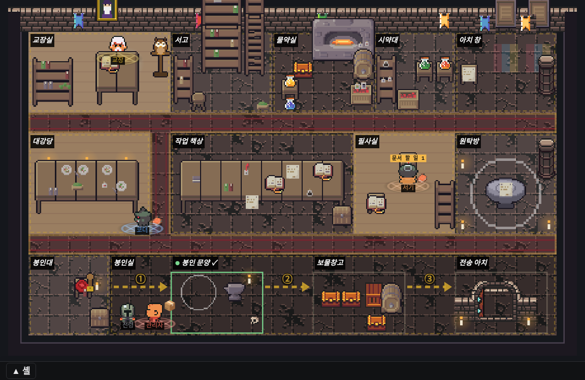
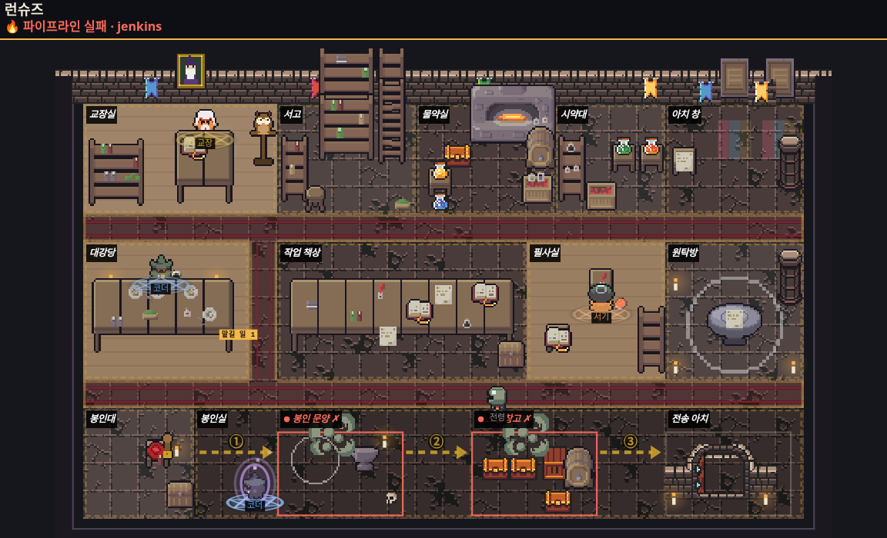
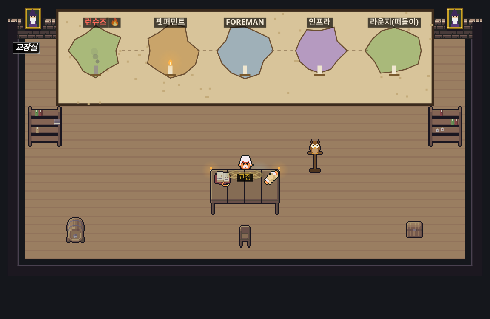

<!--
다루는 곳: bridge/pipeline.py, bridge/api/webhooks.py, config/pipeline.toml, bridge/static/js/grid.js, bridge/static/js/office.js
읽은 커밋: 5e0f7c5
-->
# 출하 라인

> 이 글은 현장(프로젝트 방) 아래쪽 띠에 그려지는 출하 라인, 곧 커밋이 빌드, 이미지, 배포로 넘어가는 길을 다룹니다.

**서버에 배포되는 앱에서 AI 세션이 커밋을 올리면, 그 커밋이 빌드, 이미지, 배포 가운데 어디까지 와 있는지가 방 아래 띠에 바로 보입니다. 어느 단계에서 깨졌는지, 빌드가 시작조차 안 됐는지도 같은 자리에 뜹니다.**

런슈즈처럼 서버에 배포되는 앱은 커밋 하나가 여러 단계를 거쳐야 사용자에게 닿습니다. 먼저 Jenkins(코드를 받아 시험하고 빌드하는 서버)가 커밋을 빌드하고, 그 결과를 컨테이너 이미지(앱과 실행 환경을 한 덩어리로 묶은 것)로 만들어 Harbor(이미지를 보관하는 저장소)에 올립니다. 그다음 ArgoCD(클러스터에 무엇이 떠 있어야 하는지 맞춰 주는 배포 도구)가 새 이미지를 서버에 내보냅니다. 이 세 곳은 각자 자기 화면이 있어서, 보통은 커밋한 뒤 Jenkins 화면, Harbor 화면, ArgoCD 화면을 차례로 열어 봐야 내 커밋이 어디쯤 있는지 압니다. FOREMAN은 이 세 곳이 보내는 알림을 커밋 하나로 꿰어서, 그 커밋을 만든 AI 세션이 일하는 방 아래쪽에 한 줄로 그립니다. 커밋한 세션, 지금 도는 빌드, 배포 결과가 같은 화면에 있으니 세 화면을 오가지 않아도 됩니다 [code:bridge/pipeline.py] [log:stage8_cicd_result.md].

## 세 단계와 배포 담당

출하 라인은 빌드해 내보내는 앱의 방 맨 아래에 있고, 왼쪽부터 ① 빌드, ② 이미지, ③ 배포 세 칸이 화살표로 이어집니다. 이름은 테마마다 다릅니다. 오피스 테마에서는 「배포 파이프」 아래 빌드 모니터, 저장소, 배포 보드이고, 마법학교에서는 봉인실의 봉인 문양, 보물창고, 전송 아치, 현장 테마에서는 출하장의 검수대, 팔레트, 트럭입니다. 이름표에 마우스를 올리면 그 칸이 실제로 무엇인지(Jenkins 빌드, Harbor 이미지, ArgoCD 배포)와 지금 상태가 한 줄로 뜹니다. 이름표 자체에는 점 하나와 기호 하나만 붙습니다. 진행 중이면 「…」, 끝났으면 ✓, 실패면 ✗, 사람이 배포를 눌러 줘야 하는 상태면 ⏸입니다. 점 색도 같은 뜻을 따라 바뀌어서, 글을 읽지 않고 색만 봐도 어느 칸까지 왔는지 보입니다 [code:bridge/static/js/office.js] [code:bridge/static/js/grid.js].

이 라인에는 배포 담당 캐릭터 한 명이 삽니다. 평소에는 라인 맨 앞 자기 자리에 서 있다가 새 빌드가 보이면, 그 커밋을 만든 세션의 캐릭터가 걸어와 일감을 건넵니다. 그 뒤 배포 담당이 지금 진행 중인 단계 앞으로 걸어가서 기다리고, 그 단계가 끝나면 다음 단계로 옮겨 갑니다. 배포까지 성공하면 잠깐 배포 칸 앞에 머물다 제자리로 돌아가고, 실패하면 깨진 단계 앞에 30분 동안 서 있습니다. 한 방에 빌드가 여럿 겹치면 가장 오래된 것을 맡고 나머지는 대기로 셉니다. 사람은 배포 담당이 어디 서 있는지만 봐도 지금 그 프로젝트의 빌드가 어디쯤인지 알 수 있습니다 [code:bridge/static/js/office.js].

빌드할 것이 없는 방도 있습니다. 인프라 방과 FOREMAN 방입니다. 이 두 방은 방 아래 띠에 테마의 출하 이름 뒤에 「없음」만 적히고(오피스 테마는 「배포 파이프 없음」, 마법학교는 「봉인실 없음」, 현장 테마는 「출하장 없음」) 세 칸과 배포 담당을 그리지 않습니다. 그 이름표에 마우스를 올리면 줄이 없는 까닭이 방마다 따로 뜹니다. 인프라 방은 빌드해 내보내는 앱이 아니라 클러스터와 서버를 다루는 곳이라서이고, FOREMAN 방은 「이미지를 만들지 않고 작업 폴더에서 바로 도는 앱이라 빌드 → 이미지 → 배포 줄이 없습니다. 바뀐 코드는 저장소에 올려 두는 것으로 끝납니다.」입니다. 빈 라인이 늘 「기록 없음」으로 남아 고장처럼 보이지 않게 하려는 것입니다 [code:bridge/static/js/office.js].

## 커밋 하나로 잇는다

세 단계가 한 줄로 이어지는 바탕은 커밋 SHA(커밋마다 붙는 고유 번호)입니다. FOREMAN은 같은 서버에 있는 프로젝트 저장소를 20초마다 보면서 새 커밋과 push를 찾습니다. 커밋 시각 바로 전에 어떤 AI 세션이 `git commit` 명령을 실행했다면 그 커밋은 그 세션의 것으로 붙습니다. Jenkins는 빌드를 시작하고 끝낼 때 어느 커밋을 빌드했는지 알려 오고, Harbor 이미지는 커밋 번호 앞 12자리를 태그로 쓰며, ArgoCD는 배포한 이미지의 태그를 알려 줍니다. 그래서 세 곳의 알림이 모두 같은 커밋 번호로 모입니다. 빌드 하나가 커밋 여러 개를 한꺼번에 담는 일도 흔한데, 이때는 앞 빌드와 이번 빌드 사이에 들어간 커밋을 모두 이번 빌드에 묶습니다 [code:bridge/pipeline.py] [code:config/pipeline.toml].

알림을 받는 쪽은 브리지(FOREMAN의 서버 프로그램) 본체와 따로 연 전용 입구입니다. 이 입구는 웹훅(다른 서버가 일이 생겼을 때 정해 둔 주소로 보내는 알림) 경로만 열고, 클러스터 쪽 망에서 온 요청만, 별도 토큰을 가진 요청만 받습니다 [code:bridge/api/webhooks.py]. Jenkins에 FOREMAN이 직접 물어보는 방식은 쓰지 않았습니다. 그렇게 하려면 Jenkins 로그인 토큰이 필요한데 그 토큰은 배포 경로 전체를 여는 열쇠라서, Jenkins 쪽 빌드 스크립트가 알림을 보내 주는 방식을 골랐습니다 [log:stage8_cicd_result.md] [c:3af65b8].

## 실패 표시

어느 단계가 실패하면 세 군데에 함께 나타납니다. 그 방을 보고 있으면 방 머리에 「🔥 파이프라인 실패 · jenkins」처럼 빨간 줄이 붙고, 깨진 단계 이름표가 ✗와 빨간 테두리로 바뀌며, 배포 담당은 그 단계 앞에 서 있습니다. 실패는 바뀌는 순간에 한 번 텔레그램으로도 나갑니다(→ 「텔레그램 알림」). 늦게 도착한 「진행 중」 알림이 이미 끝난 결과를 덮지 않도록, 한 번 성공이나 실패로 끝난 단계는 다시 진행 중으로 되돌리지 않습니다 [code:bridge/pipeline.py] [code:bridge/static/js/office.js].

다른 방을 보고 있을 때도 놓치지 않도록 감독실(모든 현장을 한눈에 보는 맨 위 화면)의 현황판에도 같은 판단이 쓰입니다. 그 현장 칸 테두리가 빨갛게 바뀌고 이름 옆에 🔥, 칸 안에 ✕가 뜹니다. 현황판 칸을 누르면 그 현장으로 바로 갑니다 [code:bridge/static/js/office.js].

배포가 끝나지 않고 남는 경우도 따로 봅니다. 펫퍼민트처럼 배포를 사람이 ArgoCD에서 눌러야 하는 앱은 빌드가 끝나도 배포가 저절로 일어나지 않습니다. 이것은 실패가 아니라 「⏸ 배포 대기: ArgoCD에서 Sync를 눌러야 올라갑니다」로 노랗게 보이고, 그 줄을 누르면 ArgoCD의 그 앱 화면이 열립니다. 반대로 배포가 시작됐는데 끝 알림이 오지 않으면 FOREMAN이 10분 뒤 ArgoCD 상태를 직접 읽어 닫고, 30분이 지나도 끝나지 않으면 「배포가 끝나지 않습니다」로 알립니다. 끝 알림이 영영 오지 않은 옛 배포가 「진행 중」으로 남아 담당을 붙잡지 않도록, 화면도 2시간이 지난 진행 중 기록은 진행 중으로 치지 않습니다 [code:bridge/pipeline.py] [code:config/pipeline.toml] [c:aa3cf1f] [log:retro_20261105_foreman.md].

## 빌드 알림 없음

알림을 받아서만 그리는 화면은 알림이 오지 않으면 아무것도 그리지 않습니다. 그러면 「빌드가 없었다」와 「빌드는 있었는데 알림이 안 왔다」, 「Jenkins가 죽어서 빌드가 시작조차 안 됐다」가 화면에서 똑같이 조용해 보입니다. 그래서 출하 라인은 알림을 기다리기만 하지 않고, push를 기준으로 빠진 알림을 직접 찾습니다. push가 보인 뒤 3분 안에 빌드 시작 알림이 없으면 방 머리에 노란 「⚠ 빌드 알림 늦음」이 붙고, 17분(웹훅이 빠져도 Jenkins가 15분마다 새 커밋을 가서 보는 폴링 안전망에 2분을 더한 값)이 지나도 없으면 빨간 「⚠ 빌드 알림 없음」으로 바뀌면서 텔레그램으로 「Jenkins 확인」을 보냅니다. 빌드는 시작했는데 35분이 지나도 끝 알림이 없을 때도 따로 알립니다 [code:bridge/pipeline.py] [code:config/pipeline.toml].

같은 생각으로 Jenkins, Harbor, ArgoCD 자체가 살아 있는지도 1분마다 확인합니다. 세 번 연달아 응답이 없으면 화면에 응답 없음으로 표시하고, 다섯 번(5분) 연달아 없으면 텔레그램으로 한 번 알린 뒤 다시 살아나면 한 번 더 알립니다. 이 알림은 프로젝트마다가 아니라 서버 종류마다 한 번입니다. Jenkins 하나를 두 프로젝트가 함께 쓰기 때문입니다. 정전 뒤 Jenkins가 죽어 있었는데 화면 표시 하나 말고는 아무 알림도 없던 일이 있어서 넣은 것입니다. 웹훅으로 시작하던 빌드가 연달아 두 번 느린 폴링으로 시작하면, 방 머리에 「⚠ 빌드 알림 끊김 의심」을 띄우고 텔레그램으로 「웹훅 끊김 의심」을 보냅니다 [code:bridge/pipeline.py] [c:a6f3884] [log:infra_20261106_jenkins-harbor-after-outage.md].

[기술문서: 출하 라인](../notion/12_pipeline.md)
