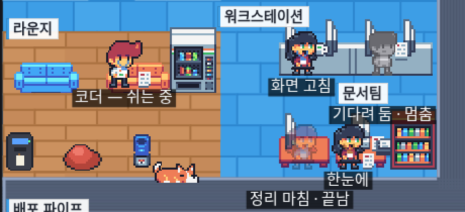
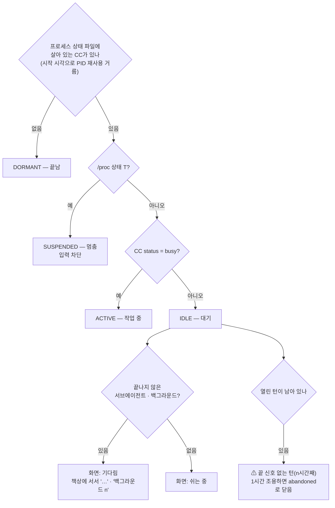
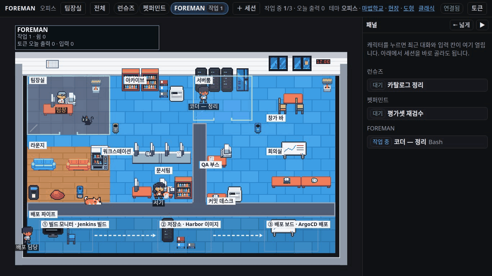
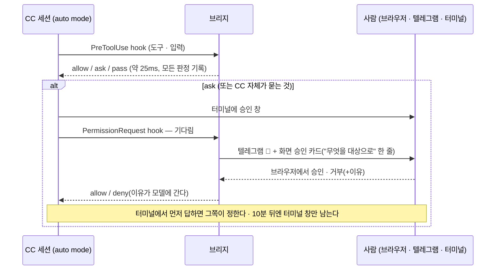
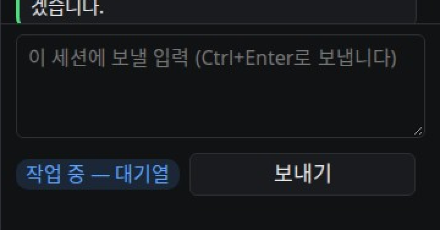
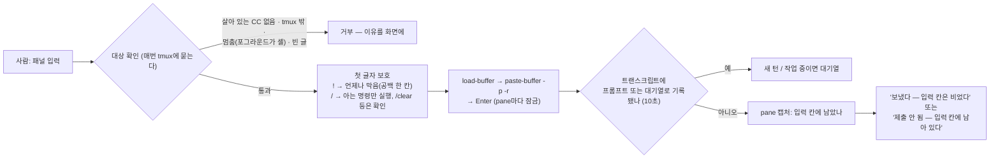

# 에이전트 관제 — 상태 · 승인 · 입력

> 이 글은 밖에서 Claude Code 세션의 상태를 어떻게 판정하고, 무엇을 사람에게 묻고(승인), 사람이 쓰던 그 세션에 말을 어떻게 넣는지를 다룬다.

**CC 내부는 고치지 않고, CC가 밖에 남기는 흔적(hook · 트랜스크립트 · 프로세스 상태 파일 · `/proc`)만으로 상태를 판정하고 승인을 가로채고 입력을 넣는다.** 상태는 "열린 턴"이 아니라 CC가 직접 적는 busy/idle로 정한다. 승인은 "위험해 보이는 것"이 아니라 "사람이 실제로 거부할 만한 것"만 묻는다. 입력은 tmux 붙여넣기로 넣고, 트랜스크립트에 실제로 기록됐는지 확인한다. 세 가지 모두 처음 설계에서 실측으로 한 번씩 바뀌었다 [log:stage6_dashboard_result.md] [log:stage5_approval_result.md] [log:stage3_inject_result.md].

전체 구조는 → 「한눈에 — FOREMAN이 무엇인가」, 트랜스크립트 적재 · 턴 경계 판정의 상세는 → 「관찰 파이프라인 — 조용한 고장을 잡는다」, 인계 글을 넣는 과정은 → 「압축 손실을 재고 메우기」에 있다.

## 1. 문제 — 왜 필요했나

한 서버에서 CC 세션 여럿이 auto mode로 돈다. 사람이 브라우저 한 화면에서 이것들을 다루려면 세 질문에 답해야 했다.

| 질문 | 어려운 점 |
|---|---|
| 이 세션은 지금 **일하나 · 기다리나 · 멈췄나 · 끝났나** | CC는 상태를 알려 주는 API가 없다. 멈춘 프로세스(Ctrl+Z)는 아무것도 쓰지 못해 "쉬는 중"과 똑같이 보인다 [c:1f8c538] |
| 사람이 **무엇을 봐야 하나** | auto mode 분류기가 운영 명령을 그냥 통과시켜 왔다 — 20일에 런슈즈 git push 79 · kubectl 변경 60 · docker 정지 · 삭제 67 [log:stage5_approval_result.md]. 반대로 다 물으면 흐름이 끊긴다 |
| 사람 말을 **그 세션에** 어떻게 넣나 | 사람이 터미널에서 쓰던 세션과 같은 맥락이어야 한다. 별도 headless 세션을 쓰면 "내가 보는 것"과 실제가 달라진다 [c:1f8c538] |

공통 제약: CC 바이너리는 바꿀 수 없다. 그래서 FOREMAN이 쓸 수 있는 것은 CC가 남기는 것뿐이다.
- hook — 프롬프트 제출 · 도구 호출 전 · 승인 창 · 턴 종료 · 세션 종료 때 CC가 부르는 스크립트
- 트랜스크립트 — CC가 대화를 한 줄씩 쓰는 JSONL 파일
- 프로세스 상태 파일 — CC가 프로세스마다 적는 `sessions/<pid>.json`(세션 id · 시작 시각 · busy/idle)
- `/proc/<pid>/stat` — 커널이 보는 프로세스 상태(멈춤 `T`)

## 2. 판단 — 무엇을 고르고 무엇을 버렸나

| 영역 | 고른 것 | 버린 것 | 이유 | 근거 |
|---|---|---|---|---|
| 상태 | 프로세스가 살아 있으면 **CC가 적는 status**(busy → 작업 중) | "열린 턴이 있으면 작업 중" | 첫 응답 전에 Esc로 끊은 턴은 끝 신호가 하나도 없다. 그 턴 때문에 한 세션이 10시간 "작업 중"으로 보였다 | [log:stage6_dashboard_result.md] [c:3587985] |
| 멈춤 | `/proc` 상태 문자 `T`만 근거 | 트랜스크립트 공백으로 추정 | 1시간 넘는 공백 53곳 중 복귀 기록이 있는 곳 0 — 공백으로는 멈춤과 쉼을 가를 수 없다 | [c:1f8c538] |
| 기다림 | 서버 상태 값은 4개 그대로, **화면에서만** "기다림"으로 그림 | 상태 값 추가 | 정렬 · 끝 신호 없는 턴 표시 · 입력 판단이 IDLE/ACTIVE를 본다. 값을 늘리면 그 판단들이 흔들린다 | [log:stage10_background_waiting_result.md] |
| 승인 기준 | **사람이 실제로 거부할 만한 것**만 ask | 위험해 보이는 것은 모두 ask | 승인 이력 65건 중 실제 작업에서 거부는 0건 — 소음은 진짜 경고도 Yes로 누르게 만든다 | [log:stage5_approval_result.md] [c:87ed97b] |
| 규칙 밖 | `pass` — 브리지는 정하지 않고 CC의 원래 판단에 맡김 | 규칙에 없으면 ask | 20일 도구 호출 약 9,700건 중 사람이 누른 승인은 18건. 규칙 밖을 다 물으면 수천 건이 된다 | [log:stage5_approval_result.md] |
| 승인 답 | 브라우저 · 터미널 · 시간 초과(10분) 중 **먼저 온 것** | 브라우저에서만 답하기 | 브리지가 기다리는 동안에도 터미널 승인 창은 떠 있고, 터미널에서 먼저 답하면 바로 진행된다(실측). 브리지가 죽어도 사람은 막히지 않는다 | [log:stage5_approval_result.md] |
| 입력 | tmux **괄호 붙여넣기 + Enter**를 사람이 쓰는 그 pane에 | 화면 긁기, headless 세션 | TUI 화면은 제어 문자가 섞인다. 같은 세션이라야 맥락이 같다 | [log:stage3_inject_result.md] [c:e5ce9d7] |
| 첫 글자 보호 | `/` · `!` 앞에 공백 한 칸 | 폭 없는 공백(U+200B) | 폭 없는 공백은 Enter가 먹지 않아 글이 입력 칸에 남았고 다음 입력과 합쳐졌다 | [log:stage3_inject_result.md] |
| 제출 실패 | 실패로 알리되 **입력 칸을 비우지 않음** | 자동으로 비우고 다시 보내기 | 같은 pane에 사람이 쓰던 초안을 지울 수 있다 | [log:stage3_inject_result.md] |
| 멈춤 · 되살리기 | Ctrl+Z · `fg` **키를 보냄** | `kill -STOP` / `-CONT` | 셸이 멈춘 작업을 배경으로 돌려서, 밖에서 CONT를 보내면 터미널을 읽는 순간 다시 멈춘다 | [log:stage11_handoff_result.md] |

## 3. 구조 · 흐름

### 3-1. 상태 판정

- 상태는 2초마다 보고 바뀐 것만 WebSocket으로 보낸다. 정지 · 소멸 · busy/idle은 이벤트로 오지 않기 때문이다 [log:stage6_dashboard_result.md]
- **턴은 신호 하나로 닫지 않는다.** Stop hook · 트랜스크립트의 기록 · 프로세스 소멸 중 먼저 온 것이 닫고, 무엇이 닫았는지(`closed_by`)를 남긴다. Esc 중단에는 Stop hook이 불리지 않고, 창이 닫히면 트랜스크립트에 종료 기록이 없다 [log:stage2_transcript_result.md] [log:stage4_notify_result.md]
- 끝난 세션은 원래 색 그대로 흐리게 3분 남았다가 화면에서 빠지고, 멈춘 세션은 회색으로 계속 보인다 [log:stage11_handoff_result.md]

### 3-2. 승인 — hook 두 개로 가로채기

- **hook의 `ask`는 auto mode에서도 승인 창을 띄운다** — 공식 문서로 확인하고, 실제 세션에서 우리 ask 26건이 모두 창으로 떴다 [c:a449682]. 이 한 가지가 "auto mode는 그대로, 되돌릴 수 없는 것만 사람이 본다"는 설계의 받침이다
- **브리지가 꺼져 있으면 hook은 아무것도 내지 않는다** — CC가 원래대로 정한다. 허용 쪽으로 새지 않는다 [log:stage5_approval_result.md]
- 묻는 것: 통째로 지우기(`/` · 홈 · 프로젝트 하나 · 볼륨 하나), 운영 DB 날리기, 재부팅 · VM 파괴, git 이력 날리기 · 강제 push, 비밀 파일을 밖으로 보내기, 데이터 볼륨 · PVC · 네임스페이스 삭제 등 12개 규칙 [log:stage5_approval_result.md]
- **실행과 글자를 가른다.** 같은 `rm -rf`라도 셸 · 해석기가 실행하면 묻고, 파일 · 커밋 메시지에 저장되거나 검색어로만 쓰이면 통과한다 [c:6cffabb]
  - 계기: 승인 시스템을 만들다 그 시스템이 자기를 막았다. 규칙 파일에 위험한 명령의 모양을 적는 것, 커밋 메시지에 "kubectl apply"를 쓰는 것이 세 번 연속 걸렸다 [c:6cffabb]
  - 받는 쪽을 본다: `cat > notes.md <<'EOF'`의 본문은 통과, `bash <<'EOF'`의 본문은 검사, 그 파일을 나중에 `bash x.sh`로 돌리면 그때 파일 내용을 검사
- 승인 창에는 명령 전체 대신 대상 한 줄을 붙인다 — 예: `rm -rf → …/volumes (기존 디렉토리, 파일 418개)`. 파일 수는 0.3초 안에서만 센다(hook은 4초 안에 답해야 한다) [c:4ced99a]
- 프로젝트마다 `enforce`(판정을 돌려준다) / `observe`(기록만). 다른 두 프로젝트는 observe로 시작했다 — 실행 중인 세션에 다음 도구 호출부터 바로 걸리기 때문이다 [log:stage5_approval_result.md]

### 3-3. 입력 — 넣고, 들어갔는지 본다

- **멈춘 세션에 넣으면 셸 명령이 된다.** Ctrl+Z로 멈추면 pane의 포그라운드가 셸로 바뀌어, 보낸 글이 그대로 실행된다. 그래서 주입 직전에 pane의 현재 명령을 매번 tmux에 묻는다 — 목록을 그린 뒤 사람이 Ctrl+Z를 눌렀을 수 있다 [log:stage3_inject_result.md]
- **`!`는 언제나 막는다.** 첫 글자 `!`는 CC의 bash 모드라 셸이 실행된다. 이 길이 열리면 승인 정책을 우회한다 [log:stage3_inject_result.md]
- `/`는 처음엔 체크박스로 "명령으로 보내기"를 골랐다. 지금은 화면이 판단한다 — 경로처럼 생긴 것은 글, 아는 명령은 실행, `/clear`처럼 되돌릴 수 없는 것은 확인, 모르면 묻는다 [c:4047a49]
- CC가 일하는 중에 보낸 글은 새 턴이 아니라 진행 중인 턴의 대기열로 들어간다 — 화면은 "나 · 작업 중에 보냄"으로 그 턴 안에 보인다 [c:f132fe0]
- 여러 줄은 CC가 `<pasted_content>` 태그로 감싸 모델에 "붙여넣은 글"로 넘긴다. 사람이 친 글과 신뢰 맥락이 다를 수 있다 [log:stage3_inject_result.md]

## 4. 겪은 문제와 풀이

- **Esc 한 번에 10시간 "작업 중"** [log:stage6_dashboard_result.md] [c:91f4c79]
  - 다른 프로젝트 창에 잘못 붙여넣고 바로 Esc. 첫 응답 전이라 중단 표시 줄도 Stop hook도 없었다. 턴이 열린 채 남았고 "ACTIVE = busy 또는 열린 턴" 규칙 때문에 10시간 작업 중으로 보였다 [log:stage6_dashboard_result.md]
  - 상태를 CC status로 바꾸고, 열린 턴은 "⚠ 끝 신호 없는 턴"으로 따로 보였다 [c:3587985]
  - 1시간 조용하면 `abandoned`로 닫는다. 1시간인 이유: 응답 없이 다음 입력과 합쳐진 턴 66개가 모두 56분 안에 다음 입력을 받았다 — 이것들을 잘못 닫지 않는 값이다 [log:stage6_dashboard_result.md]
- **백그라운드가 도는데 캐릭터가 엎드려 잤다** [log:stage10_background_waiting_result.md] [c:b7cb0d0]
  - 설계에는 "부모가 IDLE이어도 자식은 돈다"고 적어 두고 화면에 만든 적이 없었다. 백그라운드 Bash · Monitor는 아예 추적하지 않았다 [log:stage10_background_waiting_result.md]
  - 끝 알림은 세 자리(턴 사이 사람 줄 · 턴 도중 대기열 · 첨부)로 온다 — 시작 `bg_start` · 끝 `bg_end`를 남기고 같은 끝은 한 번만
  - 같은 날 또 생겼다: TaskStop으로 멈춘 작업에는 끝 알림이 오지 않았다. 답을 다 했는데 "기다림"으로 남았다 → TaskStop · KillShell 결과의 작업 id로 끝을 남긴다 [c:b88c0d3]
- **승인 기준이 두 번 뒤집혔다** [log:stage5_approval_result.md]
  - 처음 목적은 귀찮음 없애기였다. 조사해 보니 auto mode라 20일에 사람이 누른 승인은 19번뿐 — 대신 분류기가 운영 명령을 통과시키고 있었다 → "위험한 것부터 막기"로 틀었다 [log:stage5_approval_result.md]
  - 써 보니 흐름이 계속 끊겼다. 오탐을 패턴 하나씩 고쳤지만(실행과 글자 · mktemp · 스크래치패드 …) 줄지 않았다. 65건 중 거부 0건, 상위 네 성격(49건)이 모두 대상을 보면 위험하지 않은 것이었다 [log:stage5_approval_result.md]
  - 사용자 결정(11-05): "실제로 거부할 만한 것"만. 묻는 규칙이 22개에서 12개로 줄고 오탐 패치 대부분이 필요 없어졌다. 엄격한 장치는 코드에 남기고 설정으로 켠다 [c:87ed97b]
- **비밀 파일 규칙이 조용히 꺼져 있었다** [log:stage5_approval_result.md]
  - 설정 파일(TOML)에서 키 하나를 표 머리말 뒤에 둬서 `bash_secret_readers`가 다른 표에 들어갔고, 0개로 읽혔다. 오류도 경고도 없었다 — 시험이 잡았다 [log:stage5_approval_result.md]
- **승인을 터미널 · 브라우저 둘 다 기록하다 경주** [log:stage5_approval_result.md]
  - 먼저 쓴 쪽이 터미널 결정 값 없이 행을 닫았다 → 결정은 기다리던 쪽 한 곳에서만 쓴다
- **"제출이 확인되지 않았다"인데 실제로는 들어갔다** [log:stage11_handoff_result.md] [c:d283bff]
  - 보낸 글 끝의 줄바꿈을 CC는 다듬어 기록하는데 브리지는 글자 그대로 맞댔다. 맞댈 때 앞뒤 공백을 빼고, 그래도 못 찾으면 pane을 캡처해 입력 칸에 글이 남았는지 본다
- **작업 중 입력이 진행 중인 턴을 닫을 수 있었다** [c:2b26867]
  - 바쁠 때 보낸 글에도 UserPromptSubmit hook이 불린다. 턴이 15초 넘게 열려 있으면 그 hook이 새 턴을 열고 앞 턴을 닫았을 것이다 → 열린 턴이 있으면 대기열 입력으로 기록 [log:stage3_inject_result.md]
- **작업 중에 보낸 내 글이 대화에 안 보였다** [log:stage11_handoff_result.md]
  - 대화 화면이 턴의 첫 프롬프트만 보여 줬다. 대기열 글은 턴이 아니니 처음부터 안 보였다 → 턴마다 대기열 글을 함께 준다

## 5. 결과 · 숫자

| 무엇 | 값 | 근거 |
|---|---|---|
| 하루 승인 창(21일 다시 돌리기, 도구 호출 18,076개) | 런슈즈 10.7 → 0.1 · 펫퍼민트 6.8 → 0.2 · 포먼 26.3 → 1.3 | [log:stage5_approval_result.md] |
| 다시 돌리기에서 남은 ask | 9건, 모두 거부할 만한 것(운영 DB 비우기 4 · 이력 재작성 2 · PVC · 네임스페이스 삭제 3) | [log:stage5_approval_result.md] |
| 좁힌 뒤 실제 사용(11-05 05:51 ~ 11-06 14:33 KST) | 판정 6,491건(enforce 1,870 · observe 4,621), 승인 창 0건, 거부 1건(스키마 잠금 시험) — DB 직접 집계 | [c:87ed97b] |
| 판정 왕복 | 약 25ms(메모리 안) | [log:stage5_approval_result.md] |
| 브라우저 승인 → 실행 · 터미널 먼저 답 | 0.4초 · 3.2초(시험 세션) | [log:stage5_approval_result.md] |
| 입력 API 응답(제출 확인 포함) | 0.5초 | [log:stage3_inject_result.md] |
| 트랜스크립트 줄 → 화면 | 도구 결과 0.13~0.17초 · 도구 호출 0.5~0.8초 | [log:stage2_transcript_result.md] |
| 턴 종료 이유(20일치 처음 적재, 턴 1,075개) | stop 982 · merged 54 · interrupted 30 · session_end 6 · stop_failure 2 | [log:stage2_transcript_result.md] |

- "좁힌 뒤 0건"은 게이트가 죽어서 0인 것이 아니다 — 같은 기간 판정 기록이 6,491건 쌓였고 마지막 기록은 집계 직전이었다. 다만 33시간짜리 숫자라 "하루 1.3"을 확인한 것으로 보기엔 짧다 [c:87ed97b]
- 입력 주입의 첫 글자 · 특수 문자 실측(따옴표 · `$` · 백틱 · 한글 · 3,036자 붙여넣기 · 탭 → 공백 4칸)은 버리는 시험 세션에서 바이트 단위로 맞댔다 [log:stage3_inject_result.md]

## 6. 한계 · 다음

- **다른 두 프로젝트의 승인은 관찰만 한다.** 판정은 기록되지만 막지 않는다. enforce 전환은 사용자 결정으로 미뤄 뒀다 [log:stage5_approval_result.md]
- **해석기 코드 안의 위험은 놓친다.** `python - <<EOF` 본문의 `os.system("rm -rf …")`은 셸 규칙으로 읽지 않는다 — 실데이터에 그런 모양이 없어 받아들였다. 테스트 파일을 빼는 안은 `import` 한 줄로 우회되는 구멍이라 버렸다 [log:stage5_approval_result.md]
- **확인하지 않은 것**
  - hook `allow`가 auto mode 분류기를 건너뛰는지 — 실측 없음, 기대지 않는다 [c:a449682]
  - 서브에이전트의 도구 호출이 같은 승인 경로로 오는지 — 시험 세션으로 따로 보지 않았다 [log:stage5_approval_result.md]
  - CC status의 세 번째 값 `shell`의 뜻 — 처음 "셸 명령 실행 중"이라 적은 것은 틀렸고, 아직 모른다 [log:stage4_notify_result.md]
  - 화면의 [작업 중단](Esc 보내기) — 실측하지 않았다 [log:stage11_handoff_result.md]
- **끝 알림이 오지 않는 다른 길이 있으면 "기다림"이 24시간 남는다.** TaskStop은 막았지만 CC 화면에서 사람이 작업을 끄는 것 · `/clear`는 확인하지 않았다 [log:stage10_background_waiting_result.md]
- **사람이 초안을 쓰던 pane에 주입하면 초안 뒤에 붙는다.** FOREMAN이 띄운 pane에서는 문제가 없지만, 사람과 같이 쓰는 pane은 조심해야 한다 [log:stage3_inject_result.md]
- **tmux 밖에서 도는 세션에는 넣을 수 없다.** 런슈즈는 11-05에 tmux로 옮겼고 [c:f046997], 펫퍼민트는 아직이다
- 같은 일을 하는 세션에 또 지시하는 것을 알아채는 장치(입력 겹침 알림)는 → 「포먼 디스패처 — 같은 일을 하는 세션을 알아채기」 [c:4c9ca85]
