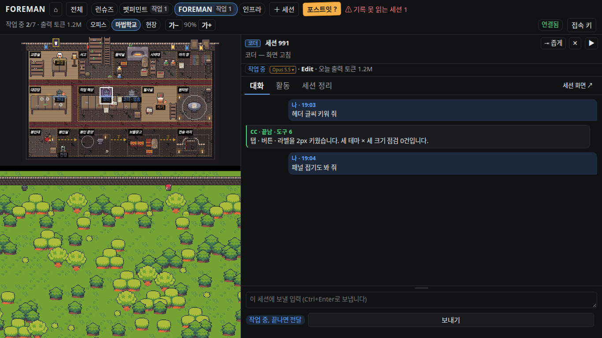

<!--
다루는 곳: bridge/static/js/opanel.js, bridge/static/js/render.js, bridge/static/js/md.js, bridge/static/js/slash.js, bridge/transcript/lookup.py, bridge/inject.py, bridge/api/sessions.py, bridge/api/dashboard.py
읽은 커밋: b97ff43
-->

# 세션 패널: 대화와 활동

> 이 글은 픽셀 화면에서 캐릭터를 눌렀을 때 오른쪽에 열리는 세션 패널의 [대화] 탭, [활동] 탭, 입력 칸을 다룹니다.

**캐릭터 하나는 Claude Code 세션 하나입니다. 캐릭터를 누르면 오른쪽 패널에 그 세션과 나눈 대화가 말풍선으로 열리고, [활동] 탭에서는 그 세션이 실제로 무엇을 읽고 고치고 실행했는지 한 줄씩 보입니다. 맨 아래 입력 칸에 글을 쓰면 그 세션에 바로 들어갑니다.**

![세션 패널을 넓게 펴고 끝난 디자이너 세션의 [대화] 탭을 연 모습입니다. 왼쪽 픽셀 화면은 그대로 보이고, 오른쪽 패널에는 세션 번호와 제목, 상태 한 줄, [대화] [활동] [세션 정리] 탭, 마크다운으로 그린 Claude Code의 답, 맨 아래 입력 칸이 있습니다. 세션이 끝나 입력 칸 아래에 보낼 수 없는 까닭이 나옵니다 〔실제 화면〕](img/04_session_panel_convo.png)

Claude Code는 원래 터미널 창 하나에서 사람과 주고받는 프로그램입니다. 세션이 여러 개 돌면 사람은 창을 하나씩 찾아 들어가 무슨 말을 했는지 읽어야 합니다. 세션 패널은 그 창들을 브라우저 한 곳으로 모읍니다. 픽셀 화면에서 캐릭터를 고르면 패널이 그 세션으로 바뀌고, 다른 캐릭터를 누르면 그 세션의 대화로 넘어갑니다. 패널은 픽셀 화면 위에 덮이지 않고 옆에 서서 무대를 줄이므로, 대화를 읽는 동안에도 다른 캐릭터들이 무엇을 하는지 계속 보입니다. 너비는 픽셀을 볼 때 쓰는 「좁게」와 대화를 읽을 때 쓰는 「넓게」 두 가지이고, 제목 줄 단추나 패널 가장자리를 두 번 눌러 오갑니다 [code:bridge/static/js/opanel.js] [c:1540471].

패널 맨 위에는 그 세션의 승인 대기 카드가 오고(→ 「승인 카드」), 그 아래 제목 줄에 세션 번호, 역할, 제목, 상태(작업 중 · 쉼 · 끝남), 지금 하는 일, 쓰는 모델, 오늘 쓴 출력 토큰이 한 줄로 붙습니다. 그 아래 탭은 [대화], [활동], [세션 정리] 셋이고, 탭 줄 끝의 [세션 화면 ↗]는 그 세션의 실제 Claude Code 창을 띄웁니다(→ 「세션 화면 창」). [세션 정리] 탭의 새 세션으로 옮기기와 끝내기는 다른 편에서 다룹니다.

## 대화 탭: 말풍선과 새 답 따라가기

[대화] 탭은 탭 아래부터 입력 칸 위까지 패널의 거의 전부를 차지합니다. 패널에서 가장 오래 하는 일이 「이 세션이 뭐라고 했나」를 읽는 것이기 때문입니다. 사람이 보낸 글은 오른쪽 말풍선으로, Claude Code의 답은 왼쪽의 초록 띠 카드로 그립니다. 답 카드 머리에는 그 턴이 끝났는지, 도구를 몇 번 불렀는지, 서브에이전트(세션이 일을 나눠 맡기려고 잠깐 띄운 보조 에이전트)를 몇 번 썼는지가 붙고, 답에 이르기 전에 쓴 중간 글은 「중간 글 N」으로 접혀 있습니다. 세션이 일하는 도중에 사람이 보낸 글은 새 턴이 아니라 진행 중인 턴에 끼어들어 가는데, 이것도 그 턴 안에 「작업 중에 보냄」 말풍선으로 보입니다 [code:bridge/static/js/render.js] [c:f132fe0].

Claude Code의 답에는 표, 목록, 코드 블록이 많습니다. 패널은 답을 블록 단위로 읽는 작은 마크다운 변환기로 그려서, `|`나 `-`가 날 글자로 남지 않고 실제 표와 목록으로 보이게 합니다. 아주 긴 답은 일정 길이를 넘으면 접고 [전체 보기 (N자)]로 펼치며, 접을 때 글 머리가 화면 위로 사라졌으면 머리로 데려와 읽던 흐름이 끊기지 않게 합니다 [code:bridge/static/js/md.js] [c:3b1e7ad].

새 답이 올 때 화면이 어떻게 움직이는지도 정해 두었습니다. 맨 아래를 보고 있으면 새 답을 따라 저절로 내려갑니다. 위로 올라가 지난 대화를 읽고 있으면 자리를 그대로 두고, 대신 아래쪽에 [새 답 ↓] 단추만 띄웁니다. 대화는 내용이 실제로 바뀔 때만 다시 그리므로, 읽던 자리나 마우스로 고른 글자가 몇 초마다 날아가지 않습니다. 그래서 답 옆 시각도 「n분 전」이 아니라 시계 시각으로 씁니다. 「n분 전」은 맞게 두려면 계속 다시 그려야 하기 때문입니다 [code:bridge/static/js/opanel.js] [log:stage11_handoff_result.md].

## 활동 탭: 누르면 입력과 결과 본문

[활동] 탭은 세션이 부른 도구를 시각과 함께 한 줄씩 보여 줍니다. 「Bash git diff …」, 「Edit …/opanel.js」, 「Read …」처럼 무엇을 실행했고 어떤 파일을 읽고 고쳤는지가 시간 순서대로 쌓입니다. 줄을 누르면 그 자리에서 펼쳐져 도구에 들어간 입력 전체와 돌아온 결과 본문이 보입니다. Bash는 명령과 그 설명을, Edit는 지운 줄과 넣은 줄을 빨강과 초록으로, Read는 읽은 파일과 범위를 보여 줍니다.

![[활동] 탭에서 Bash 줄 하나를 누른 모습입니다. 명령의 설명(「되돌림 확인과 JS 시험 다시 돌리기」), 실행한 명령 전체, 결과 149자(바뀐 파일 수와 시험 통과 193 · 실패 0), 맨 아래에 읽은 기록 파일과 「비밀값은 가림」이 보입니다 〔실제 화면, 서버 경로 글자는 찍기 전에 「…」로 가림〕](img/04_session_panel_activity.png)

본문은 데이터베이스에 넣지 않습니다. 도구 결과에는 파일 내용이나 명령 출력이 통째로 들어 있어 양이 크고 비밀값이 섞일 수 있기 때문입니다. 대신 줄을 누르는 순간 브리지(FOREMAN의 서버 프로그램)가 Claude Code가 남긴 대화 기록 파일(트랜스크립트)을 끝에서부터 거꾸로 훑어 그 도구 호출을 찾아 읽어 옵니다. 읽어 온 본문은 화면에 내기 전에 토큰이나 비밀번호처럼 보이는 값을 가리고, 펼친 칸 맨 아래에 「비밀값은 가림」과 읽는 데 걸린 시간을 적습니다 [code:bridge/transcript/lookup.py] [code:bridge/api/dashboard.py] [c:1540471].

## 입력 칸: 보내고, 들어갔는지 확인한다

패널 맨 아래 입력 칸에 글을 쓰고 [보내기]나 Ctrl+Enter를 누르면, 브리지가 그 세션이 떠 있는 tmux 창(터미널 하나를 여러 창으로 나눠 띄워 두는 프로그램)에 그 글을 붙여 넣고 Enter를 칩니다. 사람이 그 세션 창에 직접 친 것과 같은 길입니다. 세션이 일하는 중이면 입력 칸 아래에 「작업 중, 끝나면 전달」이 뜨고, 보낸 글은 지금 일이 끝난 뒤 이어서 들어갑니다 [code:bridge/inject.py] [log:stage3_inject_result.md].

보내기 전에는 매번 대상을 다시 확인합니다. 살아 있는 Claude Code 프로세스가 없으면, 사람이 Ctrl+Z로 멈춰 둔 세션이면, tmux 밖에서 도는 세션이면, 그 tmux 창에서 지금 도는 것이 그 세션의 Claude Code가 아니면 아무것도 보내지 않고 까닭을 입력 칸 아래에 「보낼 수 없음」으로 적습니다. 멈춘 세션을 따로 막는 것은, 그 상태에서 글을 넣으면 Claude Code가 아니라 그 아래 셸이 받아 명령으로 실행해 버리기 때문입니다. 사람이 그 세션의 입력 칸에 무언가 치다 만 글이 있을 때도 덮어쓰지 않고 넣지 않습니다. 보낸 뒤에는 10초 동안 대화 기록 파일을 지켜보며 글이 정말 프롬프트로 기록됐는지 봅니다. 기록에서 못 찾으면 그 창 화면을 직접 읽어 글이 입력 칸에 남아 있는지 확인하고, 「제출되지 않았습니다(입력 칸에 글이 남아 있습니다)」와 「제출됐는지 확인하지 못했습니다」를 갈라 알립니다. 보낸 것이 조용히 사라지지 않게 하려는 장치입니다 [code:bridge/inject.py] [code:bridge/api/sessions.py].

## 입력 칸의 `/`와 `!`

Claude Code에서 글 첫 글자 `/`는 명령(예: `/compact`, `/model`)이고, `!`는 셸 명령을 바로 실행하는 bash 모드입니다. 패널은 이 둘을 사람이 고르게 하지 않고 글을 보고 판단합니다 [code:bridge/static/js/slash.js] [c:4047a49].

`/`로 시작하는 글은 경우를 나눕니다. `/api/foo`처럼 경로로 보이거나 여러 줄이면 그냥 글로 보냅니다. `/compact`, `/model`처럼 아는 명령이면 명령으로 실행합니다. `/clear`, `/exit`처럼 대화 맥락이 사라지거나 세션이 끝나는 명령이면 확인 창을 한 번 띄웁니다. 모르는 낱말이면 명령으로 실행할지, 글자 그대로 보낼지 묻습니다. 글로 보낼 때는 앞에 공백 한 칸을 붙여 Claude Code가 명령으로 읽지 않게 합니다.

`!`로 시작하는 글은 셸에서 바로 실행되므로, 승인 카드를 거치지 않는 지름길이 될 수 있습니다. 그래서 브리지가 먼저 그 명령을 승인 규칙에 대 봅니다. 같은 명령을 세션이 실행했다면 사람에게 물었을 명령(통째로 지우기, 강제 push 등)이면 보내지 않고, 「그 세션에 실행해 달라고 맡기면 승인을 묻고 실행합니다」라고 다른 길을 알려 줍니다. 암호를 물어 입력이 멈추는 `sudo`와 여러 줄 명령도 보내지 않습니다. 그 밖의 한 줄 명령은 그대로 실행됩니다. 반대로 사람이 Claude Code 창에서 실수로 공백을 앞에 쳐서 `!` 명령이 실행되지 않고 글로 들어간 경우에는 브리지가 기록에서 찾아 텔레그램으로 알립니다 [code:bridge/inject.py] [log:alerts_denied_xmsg_bang_20261109.md].

[기술문서: 세션 지켜보기와 글 넣기](../notion/03_session.md)
