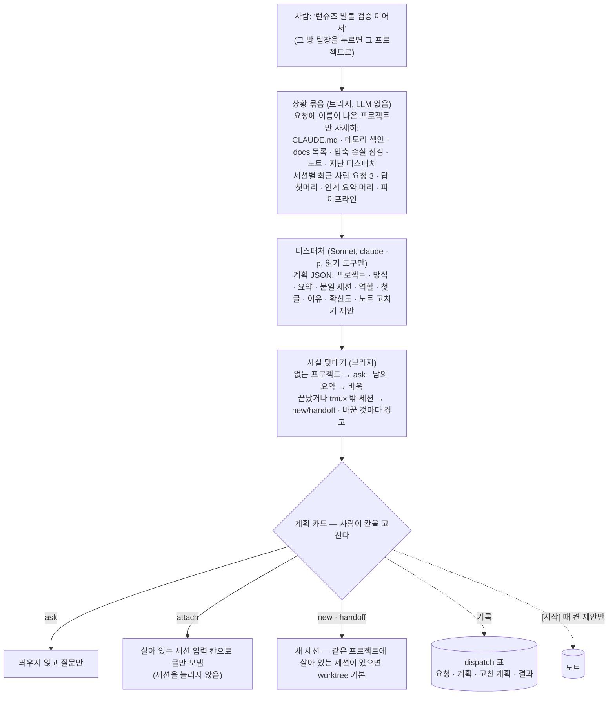
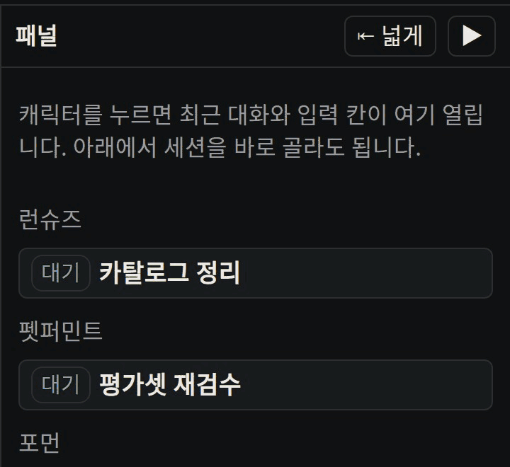

# 디스패처 — 같은 일을 하는 세션을 알아채기

> 이 글은 사람이 "뭘 하려는지"만 말하면 디스패처가 새로 띄울지 · 이어 갈지 · 이미 하는 세션에 붙일지 고르는 판단, 실패가 오면 스스로 계획을 세워 사람에게 묻는 자동 기상, 세션 없이 맥락을 들고 있는 노트, 그래도 같은 일이 겹칠 때 기계로 막는 장치를 다룬다.

**새 세션을 띄우는 판단을 LLM(Sonnet) 한 번 호출로 맡기고, 그 계획을 브리지가 사실과 다시 맞댄 뒤 사람이 승인해야 시작하게 했다. 첫 시도는 같은 일을 이미 하는 세션을 몰라 "새로 띄우기"를 골랐고, 세션마다 최근 사람 요청 3개와 답 첫머리를 넣자 "그 세션에 붙이기"(확신도 0.85)로 바뀌었다. 디스패처는 상주하지 않는다 — 대신 프로젝트마다 크기를 정한 노트를 들고, 실패 이벤트가 오면 계획만 세워 텔레그램 · 화면으로 "[시작]?"을 묻는다. LLM이 못 보는 겹침 — 같은 파일 · 같은 DB 스키마 · 같은 문서 일감 — 은 worktree · 스키마 잠금 · 일감 규칙으로 기계가 막는다.** [log:stage11_foreman_dispatch_result.md] [log:stage11_worktree_result.md] [log:stage12_scribe_result.md] [log:stage14_dispatcher_note_wake_result.md]

이름: 프로젝트는 **FOREMAN**, 이 기능은 **디스패처**다. 화면에서는 감독실 캐릭터가 디스패처의 얼굴이고, 테마마다 이름이 다르다(오피스 팀장 · 마법학교 교장 · 현장 소장). 처음엔 셋 다 "포먼"이라 "런슈즈 포먼"이 무엇을 가리키는지 모호했다 [docs:14_dispatcher_note_wake.md]

## 1. 문제 — 세션이 늘수록 "누가 이미 하고 있나"를 사람이 기억해야 했다

- 한 서버에서 세 프로젝트의 Claude Code 세션이 동시에 돈다 [log:stage4_notify_result.md]. 전체 구조는 → 「한눈에 — FOREMAN이 무엇인가」
- [+ 세션] 창에서 사람이 프로젝트 · 새로/인계 · 어느 인계 요약 · 역할을 다 골랐다 [docs:11_foreman_dispatch.md]
  - 고를 때 필요한 정보(어느 세션이 무엇을 하는 중인지, 어느 요약이 최신인지)는 여러 창에 흩어져 있었다
- 실제로 겹쳤다. 두 세션이 같은 폴더에서 같은 파일을 고쳐, 한쪽은 스타일 파일을 쓰지 못하고 HTML 안에 우회해 넣었다 [log:stage11_foreman_dispatch_result.md] [log:retro_20261105_foreman.md]
  - 사람: "세션 둘이 같은 파일 건드려서 꼬이고 있어" [log:retro_20261105_foreman.md]
- 이것도 이 프로젝트가 잡으려는 **조용한 고장**이다. 같은 일을 두 세션이 하면 아무도 알리지 않고 토큰과 작업이 갈라진다
  - 사용자는 디스패처의 핵심을 이렇게 정리했다: "그게 포먼이 있어야 하는 이유"(그때는 디스패처를 "포먼"이라 불렀다) [c:b2aa8f0]
  - 이 기준도 긴 세션의 압축 요약에서 사라진 결정 중 하나였다. 압축 손실 점검에서 찾아 규칙 파일 맨 위로 옮겼다 [log:foreman_compaction_loss_20261105.md] [c:b2aa8f0] → 「압축 손실을 재고 메우기」

## 2. 판단 — 무엇을 고르고 무엇을 버렸나

| 고른 것 | 버린 것 | 이유 | 근거 |
|---|---|---|---|
| 부를 때만 `claude -p` 한 번 | 늘 떠 있는 디스패처 세션 | 늘 떠 있으면 맥락이 쌓여 결국 압축되고 결정을 잃는다. 한 번씩 부르면 매번 새 맥락이고, 같은 입력 → 같은 기록으로 판단을 다시 볼 수 있다 | [docs:11_foreman_dispatch.md] |
| 이어지는 맥락은 프로젝트별 **노트**(2k 토큰 상한)로 | 상주 세션의 대화 · 매번 빈손 | 상주는 압축 요약에 무엇이 남을지 고를 수 없다. 노트는 무엇이 남을지 사람이 고르는 압축 요약이다. 구조 · 명령은 쌓지 않는다 — CC 메모리 · 문서에 있고, 사본은 원본이 바뀌면 조용히 낡는다 | [docs:14_dispatcher_note_wake.md] |
| 맥락은 브리지가 LLM 없이 모은 "상황 묶음" | 디스패처가 스스로 탐색 | 세션 목록 · 인계 요약 · 파이프라인은 DB에 있다. 그것을 모으는 데 모델을 쓸 이유가 없다. 디스패처에게는 읽기 도구(Read · Grep · Glob)만 준다 | [docs:11_foreman_dispatch.md] [log:stage11_foreman_dispatch_result.md] |
| 출력은 정해진 모양의 계획(JSON) — `new` · `handoff` · `attach` · `ask` | 자유 대화 | 화면이 카드로 그리고, 사람이 칸마다 고치고, 고친 것을 표로 남길 수 있다 | [docs:11_foreman_dispatch.md] |
| 계획을 브리지가 사실과 다시 맞댄다 | 모델 출력을 그대로 실행 | 없는 프로젝트, 다른 프로젝트의 요약, 끝난 세션을 고를 수 있다 | [log:stage11_foreman_dispatch_result.md] |
| **승인 없이는 아무것도 시작하지 않는다** | 확신도가 높으면 자동 시작 | 틀린 계획의 비용을 "그 요청의 토큰"으로 묶는다 | [docs:11_foreman_dispatch.md] |
| 모델은 Sonnet | Opus | 입력 10~25k 토큰짜리 분류 · 작성 일이다. 하루 10번이어도 한 작업 세션이 하루 쓰는 입력보다 훨씬 작다 | [docs:11_foreman_dispatch.md] |
| 같은 파일 · 스키마 겹침은 기계 규칙으로 | 디스패처가 판단 | 어느 파일을 고칠지는 일을 시작해야 안다. 계획 시점의 LLM은 볼 수 없다 | [log:stage11_worktree_result.md] [log:stage12_scribe_result.md] |
| 자동 기상(실패 이벤트 → 세션)은 단계적으로 | 처음부터 자동 | 1단계 사람이 부름 → 2단계 디스패처가 계획만 내고 사람이 누름 → 3단계 읽기 전용 조사 세션 자동. 1 · 2단계를 만들었고, 3단계는 묻지 않고 돌리는 것이라 2단계를 써 본 뒤 정한다 | [docs:11_foreman_dispatch.md] [docs:14_dispatcher_note_wake.md] |
| 감독실 캐릭터는 디스패처의 얼굴(세션 없음) | 캐릭터마다 세션 · 프로젝트마다 디스패처 | 실제로 하는 일이 "판단 한 번"이라 대화가 필요 없다. 디스패처는 하나이고, 방마다 서 있는 팀장은 그 프로젝트 창구다 | [docs:14_dispatcher_note_wake.md] |

## 3. 구조 · 흐름

### 3-1. 계획 한 번이 지나는 길

- 상황 묶음의 파일은 수정 시각(mtime)이 바뀔 때만 다시 읽는다. 바뀌지 않은 앞부분은 프롬프트 캐시가 먹는다 [log:stage11_foreman_dispatch_result.md] [docs:11_foreman_dispatch.md]
- 한국어 프로젝트 이름("런슈즈")도 요청에서 찾도록 화면의 이름 대응표를 같이 쓴다 [log:stage11_foreman_dispatch_result.md]
- 서버 공통 경로 표(클러스터 접속 등)는 요청과 상관없이 **늘** 넣는다 [c:81f9578]
- 확신도가 0.7보다 낮으면 카드가 판단 근거를 펼쳐 둔다. 디스패처에게는 0.6 아래면 `ask`를 생각하라고 지시한다 [log:stage11_foreman_dispatch_result.md]
- 직접 고르기 창은 그대로 남겼다(접어 둠). 디스패처가 틀리거나 호출이 실패하면 쓴다 [docs:11_foreman_dispatch.md]

### 3-2. 감독실 캐릭터 — 디스패처의 얼굴

![펫퍼민트 방의 교장(마법학교 테마) 머리 위에 「제안 1」, 누르면 패널에 [시작]을 기다리는 제안과 그 프로젝트의 노트가 뜬다. 노트는 아직 0줄이다 〔실제 화면 · 11-08 — 제안은 11-06 Jenkins 장애 상황을 〔시험〕으로 다시 넣어 실제 디스패처가 낸 것〕](img/05_dispatcher_proposal.png)

| | 세션 캐릭터 | 감독실 캐릭터 |
|---|---|---|
| 실체 | Claude Code 세션(tmux · 트랜스크립트) | 디스패처. 부를 때마다 `claude -p` 한 번 |
| 하는 일 | 파일 · 명령 | 계획만. 띄우기 · 보내기 · 노트 고치기는 사람이 [시작]을 눌러야 |
| 기억 | 대화 컨텍스트(압축된다) | 노트 |
| 이력 | 트랜스크립트 | `dispatch` 표 |

- 그림만 있던 캐릭터에 디스패처가 실제로 하는 일을 붙였다: 계획을 세우는 동안(`claude -p`가 도는 동안) 책상에서 일하는 동작, [시작]을 기다리는 제안이 있으면 머리 위 「제안 N」, 누르면 말하기 창(그 방이면 그 프로젝트로, 제안이 있으면 그 계획) [docs:14_dispatcher_note_wake.md]
- 패널은 세션 목록 대신 그 프로젝트의 노트 · 지난 디스패치 · 제안을 보인다 — "이 캐릭터가 무엇을 들고 있나"가 보이는 자리다

### 3-3. 노트 — 세션 없이 맥락을 들고 있기

| 쌓는 것 | 쌓지 않는 것 |
|---|---|
| 진행 중인 일 줄기 — 무엇을 · 어느 세션들 · 어디까지 · 남은 것 | 저장소 구조 · 자주 쓰는 명령 · 파일 경로 목록 |
| 사람이 정한 판단 — 사람의 말이나 기록에 근거가 있는 것만 | (CC 메모리 · 규칙 파일 · 문서에 있다. 새 세션이 스스로 읽는다) |
| 지난 디스패치와 사람이 고친 칸 — `dispatch` 표에서 바로 | |

- **줄마다 출처와 확인 시각**(세션 N · 기록 파일 · 디스패치 번호 · 커밋). 상황 묶음에 넣을 때 확인 뒤 바뀐 것을 기계로 붙인다 — 그 세션에 뒤 활동이 있거나, HEAD가 움직였거나, 출처 파일이 없어졌으면 `⚠`. 낡은 줄이 사실처럼 들어가는 것이 이 노트의 조용한 고장이라서다 [docs:14_dispatcher_note_wake.md]
- **상한 약 2000토큰.** 진행 중인 일 먼저 · 최근 확인한 것부터 넣고, 넘친 줄은 지우지 않고 접는다(패널에 「접힘」) [docs:14_dispatcher_note_wake.md]
- **고치기는 디스패처가 제안, 사람이 승인.** 계획에 노트 고치기 제안(더하기 · 바꾸기 · 내리기 · 아직 맞음)이 체크 칸으로 붙고, [이대로 시작]을 누를 때 켠 것만 같은 트랜잭션으로 반영한다. 바꾼 줄은 이력으로 남는다 [docs:14_dispatcher_note_wake.md]

### 3-4. 자동 기상 2단계 — 실패가 부르고 사람이 누른다

![교장을 누르면 뜨는 계획 창 — 맨 위에 「실패 이벤트가 부른 제안입니다」와 알림 글, 아래에 디스패처가 낸 계획(펫퍼민트 · 점검 · 읽기 전용 · 새로 시작)과 넣을 첫 글. [이대로 시작]을 눌러야 시작한다 〔실제 화면 · 11-08 — 11-06 Jenkins 장애 상황을 〔시험〕으로 다시 넣은 것〕](img/05_dispatcher_plan.png)

- 계획을 못 세우면 그것도 텔레그램으로 알린다. 하루 상한에 닿으면 그날 한 번 알린다. 알림을 보내는 쪽(파이프라인 · 적재 감시)은 이 단계가 실패해도 영향이 없다 [docs:14_dispatcher_note_wake.md]
- 시험(11-06 Jenkins 무응답 상황을 〔시험〕으로): 실제 디스패처가 약 18초 만에 "펫퍼민트 · 점검 · 읽기 전용 · 새 세션, 확신도 0.7"을 냈다. 같은 실패를 보는 살아 있는 세션이 없다는 것과, 〔시험〕 표시 · 마지막 빌드가 모두 성공이라 "지금도 죽어 있는지부터 확인하라"를 첫 글에 적었다. 텔레그램과 화면 제안까지 나갔다 [log:stage14_dispatcher_note_wake_result.md]

### 3-5. 겹침을 막는 세 겹

| 겹 | 무엇을 막나 | 누가 판단 | 어떻게 |
|---|---|---|---|
| 붙이기(`attach`) | 같은 **일**을 두 세션이 | 디스패처(LLM) + 브리지가 세션 생존 확인 | 새로 띄우지 않고 그 세션에 보낼 글만 만든다 |
| 따로 작업(worktree) | 같은 **파일**을 같은 폴더에서 | 브리지(기계) | 같은 프로젝트에 살아 있는 세션이 있으면 새 세션은 기본으로 git worktree · 자기 브랜치. 끝난 뒤 사람이 [합치기](rebase → fast-forward, push 안 함) |
| 스키마 잠금 | 같은 **DB 스키마**를 두 갈래에서 | 브리지(기계) | 마이그레이션 파일 · 명령을 처음 쓴 세션이 잠금을 갖고, 다른 세션의 같은 시도는 도구 실행 전 hook에서 거부 |
| 문서 일감 규칙 | 같은 **문서 일감** · 같은 파일 일감 · 프로젝트당 셋째 | 브리지(기계) | 합치거나 버리기 전까지 일감이 "열려 있음". 서버와 화면 버튼이 같은 판단을 쓴다 |

근거: [log:stage11_foreman_dispatch_result.md] [log:stage11_worktree_result.md] [log:stage12_scribe_result.md]

- worktree는 서로를 못 본다. 그래서 **충돌은 합칠 때** 드러난다. rebase가 멈추면 되돌리고 충돌 파일 목록을 보여 준다 — 사람이 모르는 채 반쯤 합쳐진 상태로 남지 않게 했다 [log:stage11_worktree_result.md]
- worktree에는 원본의 가상환경 · 비밀 파일 · `node_modules` · Claude Code 메모리를 링크로 잇는다. 시험 세션이 원본 메모리 색인의 첫 줄을 그대로 말했다 [log:stage11_worktree_result.md]
- 이 글도 worktree 서기 세션이 쓰고, 사람이 [합치기] 전에 diff를 본다. 합치기가 검토 관문이다 [log:stage12_scribe_result.md]

## 4. 겪은 문제와 풀이

### 4-1. 같은 일을 하는 세션을 몰랐다 — 제목만으로는 모자랐다

- 같은 요청 "런슈즈 발볼 검증 이어서"로 두 번 불렀다 [log:stage11_foreman_dispatch_result.md]
  - 1차(상황 6.2k자, 약 20초): `new`(확신도 0.8 — DB 기록). 세션 156이 이미 그 일을 하고 있는 줄 몰랐다 [log:stage11_foreman_dispatch_result.md]
  - 세션마다 최근 사람 요청 3개와 각 답의 첫머리를 넣은 뒤(11.4k자, 약 19초): `attach 156`, 확신도 0.85 [log:stage11_foreman_dispatch_result.md]
    - 남은 켤레 수(43켤레)와 돌고 있는 타이머를 근거로 들었다 [log:stage11_foreman_dispatch_result.md]
    - 메모리 · 압축 손실 목록에서 지켜야 할 것을 보낼 글에 옮겼다
- 원인: 세션 제목 · 상태만으로는 "이어 하기"와 "새로 하기"를 가를 수 없었다. 사람이 최근에 무엇을 시켰는지가 결정적이었다 [log:stage11_foreman_dispatch_result.md]
- 사람: "'156이 이미 그 일 하고 있다'를 알아챈 게 핵심이야" [log:retro_20261105_foreman.md]
- 런슈즈 세션에는 실제로 보내지 않았다. 판단만 확인했다 [log:stage11_foreman_dispatch_result.md]

### 4-2. 프롬프트가 디렉터리로 먹혔다

- 첫 호출이 1초 만에 실패했다. 추가 디렉터리 옵션 뒤에 프롬프트를 인자로 주자 그것도 디렉터리로 읽혀 "입력이 없다"는 오류가 났다 [log:stage11_foreman_dispatch_result.md]
- 프롬프트를 표준 입력으로 보내도록 바꿨다. 실패는 계획 카드 대신 "직접 고르기"로 넘어가고, 오류는 dispatch 표에 남는다 [docs:11_foreman_dispatch.md]

### 4-3. 규칙 파일을 줄이자 판단이 바뀌는지

- 규칙 파일(CLAUDE.md)을 83줄 → 58줄로 줄이며 경로 · 구조 표를 운영 문서로 옮겼다. 디스패처가 그 표에 기대고 있었는지 확인이 필요했다 [c:5cd15f9]
- 정리 전 · 뒤 규칙 파일만 바꿔 같은 요청 둘을 다시 돌렸다(기록은 남기지 않음). 방식 · 프로젝트 · 역할이 전후 같았다 [log:stage12_scribe_result.md]
- 대신 **정리 전부터 있던 빈틈**이 보였다. 요청에 다른 프로젝트 이름만 나오면 FOREMAN 저장소의 규칙 파일을 읽지 않아, 클러스터 접속 명령이 첫 글에서 빠졌다 → 서버 공통 경로 표를 늘 넣었다. 다시 돌리니 첫 글에 들어갔다 [c:81f9578] [log:stage12_scribe_result.md]

### 4-4. 동시에 시킨 두 문서 일감

- 사람이 「CLAUDE.md 정리」와 「나중에 할 일 정리」를 같이 눌렀다. "이러면 안 되는 거면 막아주고" [log:stage12_scribe_result.md]
- 이번에는 둘 다 worktree였고 고친 파일이 겹치지 않아 둘 다 충돌 없이 합쳐졌다 [log:stage12_scribe_result.md]
- 하지만 같은 파일을 고치는 두 일이 열려 있으면 뒤의 합치기가 rebase 충돌로 멈춘다. 그래서 **허용하되 셋을 막는다**: 같은 일 · 같은 파일을 고치는 일(일감마다 고치는 파일 목록) · 프로젝트당 둘 넘게 [c:d537dcf]
  - 셋째를 막는 이유는 검토 빚이다. 문서 초안은 사람이 diff를 하나씩 보고 합친다 [log:stage12_scribe_result.md]

### 4-5. 합치기를 잊으면 브랜치가 조용히 남는다

- 끝낸 뒤 [합치기]를 따로 찾아 눌러야 했다. 사람: "끝내기 누르고, 3분 안에 합치기를 또 찾아 눌러야 해" [log:stage11_worktree_result.md]
- worktree 세션의 끝내기를 세 갈래로 나눴다: 끝내고 합치기 · 끝내고 버리기 · 그냥 끝내기 [c:b81ad19]
  - 끝내고 합치기는 **끝내기 전에** 커밋 안 된 변경을 본다. 끝낸 뒤에 알면 그 세션에게 커밋을 시킬 수 없다
- 합치지 않은 worktree가 남은 세션은 48시간이 지나도 목록에서 사라지지 않게 했다 [c:29cac59]

### 4-6. 디스패처가 이틀 동안 조용히 죽어 있었다

- 노트를 붙이고 다시 부르자 바로 실패했다: `claude를 띄우지 못했습니다: [Errno 2]` [log:stage14_dispatcher_note_wake_result.md]
- 원인: 11-06 정전 뒤 브리지를 systemd 사용자 서비스로 옮기면서 PATH에 Claude Code 실행 파일이 있는 폴더를 넣지 않았다. 그날부터 디스패처와 인계 요약(둘 다 `claude -p`)이 같은 상태였는데, 그 사이 아무도 부르지 않아 드러나지 않았다 [log:stage14_dispatcher_note_wake_result.md]
  - 세션 띄우기는 tmux 셸이 PATH를 다시 잡아서 멀쩡했다 — 그래서 더 안 보였다
- PATH를 고치고, **브리지가 뜰 때 실행 파일을 찾아보고 없으면 텔레그램으로 알리게** 했다. 부를 때까지 모르는 고장을 부르기 전에 알리는 쪽으로 옮긴 것이다. 자동 기상이 계획을 못 세운 경우도 같은 이유로 알린다 [docs:14_dispatcher_note_wake.md]

## 5. 결과 · 숫자

| 무엇 | 값 | 근거 |
|---|---|---|
| 디스패치 호출 | 5건(11-05). 실패 1(4-2) · 계획만 3 · 시작 1. 11-08 시험 3건 더 — PATH 실패 1(4-6) · 사람 요청 1(`ask`, 16.7초) · 자동 기상 1(18초) | DB `dispatch` 표, [log:retro_20261105_foreman.md] [log:stage14_dispatcher_note_wake_result.md] |
| 사람이 계획을 고친 것 | 1건, 제목만. 프로젝트 · 방식 · 역할 · 읽기 전용은 그대로 | [log:retro_20261105_foreman.md] |
| 한 번 부르는 시간 | 약 9~22초(4건) | DB `dispatch` 표 |
| 상황 묶음 크기 | 6.2k자 → 11.4k자(세션별 최근 요청 추가) | [log:stage11_foreman_dispatch_result.md] |
| 같은 일 판단 | `new` 0.8 → `attach 156` 0.85 | [log:stage11_foreman_dispatch_result.md] |
| 시작 경로 시험 | 읽기 전용 점검 세션이 plan 모드로 떠 첫 글에 바르게 답함 | [log:stage11_foreman_dispatch_result.md] |
| worktree 세션 · 합치기 · 버리기 | 15개 · 8번 · 4번(11-06 기준) | DB `character_session` · `session_action` |
| 스키마 잠금 시험 | 다른 세션의 마이그레이션 쓰기가 거부되고 파일이 생기지 않음 | [log:stage11_worktree_result.md] |
| 시험 | worktree 5 · 끝내고 합치기 5 · 문서 일감 겹침 1 · 노트(제안 맞추기 · 반영 · 이력 · ⚠ · 접기) · 자동 기상(한 번만 · 하루 상한 · 실패 알림) | [log:stage11_worktree_result.md] [log:stage12_scribe_result.md] [log:stage14_dispatcher_note_wake_result.md] |
| 노트 | 0줄(11-08) — 시험한 두 계획 모두 노트 제안이 없었다. 사람이 정한 판단은 이미 CC 메모리에 있어 겹쳐 쌓지 않았다 | DB `foreman_note` 표 |

- 정직하게: 디스패처의 **정확도는 아직 재지 못했다.** 호출이 5건뿐이고 그중 3건이 같은 요청이다. 설계에 적은 "요청 문장 10개로 사람이 기대하는 답과 비교"는 하지 않았다 [docs:11_foreman_dispatch.md] [log:retro_20261105_foreman.md]
- 새 세션 대부분은 디스패처가 아니라 직접 고르기 · 서기실 버튼으로 떴다. worktree · 일감 규칙 같은 기계 쪽 장치가 더 많이 쓰였다(위 표)

## 6. 한계 · 다음

- **표본이 작다.** 디스패처를 더 써서 `dispatch` 표에 "디스패처 계획 → 사람이 고친 칸"을 쌓고(이제 그 목록이 다음 호출에 들어간다), 자주 틀리는 유형이 보이면 상황 묶음 · 지시문을 고친다 [docs:11_foreman_dispatch.md]
- **붙이기 판단은 최근 요청 3개에 기댄다.** 오래전에 시작해 최근 요청이 다른 이야기로 흐른 세션은 놓칠 수 있다 [log:stage11_foreman_dispatch_result.md]
- **worktree는 원본의 커밋된 상태에서 갈라진다.** 원본에 커밋 안 된 변경이 있으면 새 세션에는 없다 [log:stage11_worktree_result.md]
- **같은 파일 겹침은 합칠 때에야 드러난다.** 문서 일감은 고칠 파일을 미리 알아 막지만, 코딩 세션은 미리 알 수 없다 [log:stage12_scribe_result.md]
- **노트가 실제로 쌓인 모습은 아직 없다.** 노트가 쌓인 뒤 디스패처 판단이 달라지는지 봐야 한다 [docs:14_dispatcher_note_wake.md]
- **자동 기상 2단계는 실제 실패로 돈 적이 없다.** 시험 한 번뿐이다. 3단계(묻지 않고 띄우기)는 2단계 제안이 몇 주 동안 맞는지 보고 정한다 [docs:14_dispatcher_note_wake.md]
- **텔레그램에서 바로 [시작]은 없다.** 브리지는 텔레그램을 보내기만 해서, 링크로 화면(로그인 뒤)을 연다 [docs:14_dispatcher_note_wake.md]
- **런슈즈 화면 미리보기는 나중이다.** worktree 화면 미리보기는 FOREMAN에만 있다 [log:stage11_worktree_result.md]
