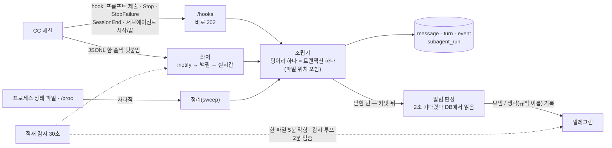
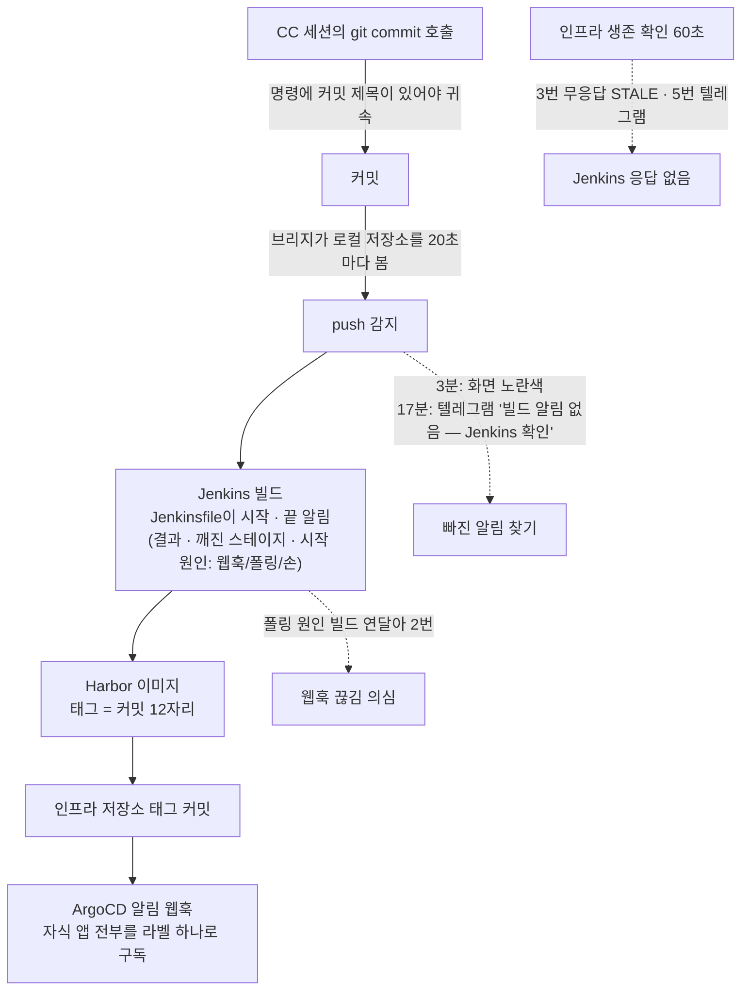

# 관찰 파이프라인 — 조용한 고장을 잡는다

> 이 글은 Claude Code 세션이 남기는 흔적(hook · 트랜스크립트)을 DB에 쌓고 턴의 시작과 끝을 판정하는 방법, 그리고 커밋 → 빌드 → 배포를 한 줄로 이어 "알림이 안 온 것"까지 알리게 한 방법을 다룬다.

**관찰하는 쪽이 조용히 멈추면 아무것도 보이지 않는다. 그래서 적재는 신호 하나에 기대지 않고(hook · 트랜스크립트 · 프로세스 소멸 중 먼저 온 것), 막히면 스스로 알리게 했다. CI/CD는 각 도구가 FOREMAN에 알리게 하되, 알림이 빠진 것을 push 기록과 맞대 "빌드 알림 없음 — Jenkins 확인"으로 다시 알린다.** 이 원칙들은 대부분 설계에서 나오지 않았다. FOREMAN 자신의 적재가 1시간 반 넘게 조용히 막혔고, 정전 뒤 Jenkins가 죽었는데 세 감시 경로가 모두 조용했던 일에서 나왔다 [log:stage2_transcript_result.md] [log:infra_20261106_jenkins-harbor-after-outage.md].

전체 구조는 → 「한눈에 — FOREMAN이 무엇인가」, 세션 상태 판정 · 승인 · 입력은 → 「에이전트 관제 — 상태 · 승인 · 입력」에 있다.

## 1. 문제 — 망가졌는데 아무도 몰랐다

- 호스트 서비스 하나가 10-01부터 567,740번 다시 시작했다. 감시는 "웹훅 + 응답 확인"뿐이라 "죽지 않고 계속 다시 뜨는" 상태는 어디에도 걸리지 않았다 [log:infra_20261102_milvus-port-forward.md] [log:01_kickoff_result.md]
  - 사용자가 정한 이 프로젝트의 존재 이유가 여기서 나왔다 — 「조용한 고장을 잡는다」. 새 기능마다 "막히면 스스로 알리나"를 묻는 기준이 됐다 [log:foreman_compaction_loss_20261105.md]
- 턴 종료 알림은 **모델이** 규칙 파일(CLAUDE.md)의 지시를 읽고 셸 스크립트를 부르는 방식이었다. 같은 기간 런슈즈 75회 · 펫퍼민트 14회 — 빠진 것인지 규칙대로 안 보낸 것인지 구분할 수 없었다 [log:01_kickoff_result.md] [log:stage4_notify_result.md]
- CC는 트랜스크립트를 기본 30일 뒤 지운다. 기록을 남기는 곳이 따로 없었다(보존 기간은 120일로 늘렸다) [log:01_kickoff_result.md]
- CI/CD 도구는 각자 자기 구간만 안다. 실제 설정을 읽어 보니 GitHub → Jenkins는 2분 폴링, ArgoCD는 3분 폴링이었다. 운영 도구가 접근 제어 뒤에 있어 GitHub 웹훅이 있어도 닿지 못했다 [log:stage8_cicd_result.md]
  - push했는데 빌드가 안 돈 것은 아무도 알려 주지 않는다. 알림이 안 오는 것과 빌드가 없는 것이 똑같이 보인다 [log:stage8_cicd_result.md]

## 2. 판단 — 무엇을 고르고 무엇을 버렸나

| 고른 것 | 버린 것 | 이유 | 근거 |
|---|---|---|---|
| 트랜스크립트를 inotify + 파일 위치(offset) 이어 읽기, 같은 파일인지는 inode, 중복은 줄 id(uuid) UNIQUE | 주기적으로 전체 다시 읽기 | 한 파일이 561MB였다. 파일은 덧붙이기만 하고 회전하지 않는다. 바이트의 76%가 대화와 무관한 API 요청 기록이라 바이트 단계에서 먼저 거른다 | [log:01_kickoff_result.md] [log:stage2_transcript_result.md] |
| 턴 종료 = 신호 합집합. 먼저 온 신호가 닫고, 무엇이 닫았는지(`closed_by`)와 이유(`end_reason`)를 남김 | Stop hook 하나로 판정 | Esc 중단은 29건 중 15건만 종료 기록이 있었고, 창이 닫힌 세션은 5건 모두 없었다 | [log:01_kickoff_result.md] |
| 순서는 파일에 쓰인 순서 | timestamp로 정렬 | 49,454줄 중 4,975줄이 앞 줄보다 이른 timestamp였다 | [log:01_kickoff_result.md] |
| 토큰은 API 메시지 id 단위로 | 줄 단위로 더하기 | 한 메시지가 여러 줄로 나뉘고 줄마다 같은 usage가 붙는다(2,970/2,970). 줄로 더하면 부풀려진다 | [log:01_kickoff_result.md] |
| 도구 결과 본문은 저장하지 않음(길이 · 오류 여부, 오류면 앞 300자) | 다 저장하고 마스킹 | 형식을 모르는 비밀은 마스킹이 못 잡는다. 원문은 트랜스크립트에 남는다 | [log:stage2_transcript_result.md] |
| 알림은 브리지가 턴이 닫힌 **커밋 뒤** 규칙으로 보냄. **안 보낸 것도 규칙 이름과 함께 기록** | 모델이 판단해 보냄 | "왜 안 왔지"에 규칙 이름으로 답할 수 있다. 턴 · 종류마다 한 번(UNIQUE) — 신호가 둘 와도, 브리지가 다시 떠도 두 번 보내지 않는다 | [log:stage4_notify_result.md] |
| hook은 바로 202, 적재는 뒤에서. 스크립트는 2초 제한 · 늘 종료 코드 0 | hook 안에서 처리 | 브리지가 꺼져 있어도 CC는 그대로 돈다 | [log:stage2_transcript_result.md] |
| Jenkins는 **Jenkinsfile이 FOREMAN에 알림** | FOREMAN이 Jenkins API 조회 | 조회 토큰이 사실상 관리자 권한이었다(아래 4-6). "새도 되는 비밀의 무게"로 골랐다 | [log:stage8_cicd_result.md] [c:3af65b8] |
| 알림 누락은 **토큰 없이** 보정 — 로컬 저장소 push와 맞대기 | 알림만 믿기 | Jenkinsfile 문법 오류 · 에이전트 안 뜸 · 웹훅 유실이면 알림 자체가 안 온다 | [log:stage8_cicd_result.md] |
| 빌드 알림이 빌드를 깨지 않게: 연결 3초 · 전체 5초, 실패는 무시, post 맨 끝, 예외도 삼킴 | 그냥 curl 한 줄 | 처음에 API 조회를 고른 이유("기존 파이프라인을 건드리지 않는다")를 조건으로 바꿔 지켰다 | [log:stage8_cicd_result.md] |

## 3. 구조 · 흐름

### 3-1. 적재 — CC가 남기는 흔적에서 DB까지

- 덩어리 하나를 트랜잭션 하나로 쓰고 파일 위치도 같은 트랜잭션에 넣는다. 커밋되지 않은 줄은 다시 읽히고, 다시 읽어도 uuid · 메시지 id · 프롬프트 id가 유일해 같은 결과가 된다 [log:stage2_transcript_result.md]
- 백필 중에는 화면에 내보내지 않는다. 5만 개를 브라우저에 쏟지 않으려고 [log:stage2_transcript_result.md]
- 마스킹: `.env.*`의 비밀 이름 키 값과 알려진 토큰 모양을 가린다. 처음엔 비밀이 아닌 사용자 이름까지 가려서, 정확값 마스킹은 이름이 비밀인 키만으로 좁혔다 [log:stage2_transcript_result.md]

### 3-2. 턴 판정 — 무엇이 턴을 열고 닫나

턴의 열쇠는 CC가 user 줄마다 적는 `promptId`다. 한 턴의 user 줄(프롬프트 · 도구 결과 · 중단 표시 · 압축 요약)이 모두 같은 값을 갖는다 [log:stage2_transcript_result.md].

| 열림(`origin`) | 무엇 | 알림 |
|---|---|---|
| `human` | 사람 입력 | 보낸다(프로젝트별 최소 시간 규칙) |
| `task_notification` | 백그라운드 서브에이전트 · 명령의 완료 알림 | 개별로 안 보내고 "모두 끝남" 묶음 판정만 |
| `subagent_message` | 서브에이전트의 결과 전달 | 〃 |
| `handoff` · `handoff_in` | 인계 → 「압축 손실을 재고 메우기」 | 턴 알림은 생략(인계 알림은 따로) |

| 닫힘(`end_reason`) | 신호 | 비고 |
|---|---|---|
| `stop` | Stop hook 또는 트랜스크립트의 턴 시간 기록 | 먼저 온 것 |
| `interrupted` | 트랜스크립트의 중단 표시 | Esc에는 Stop hook이 불리지 않는다 — 시험 세션에서 확인 |
| `stop_failure` | StopFailure hook(API 오류) | 오류 첫 줄을 알림에 |
| `session_end` · `process_lost` | SessionEnd hook / 프로세스 소멸 | hook을 받던 세션이 사라지면 `process_lost` |
| `merged` | 모델 활동 없이 다음 입력과 함께 처리됨 | 알리지 않는다 |
| `abandoned` | 끝 신호 없이 1시간 조용함 | 첫 응답 전 Esc의 흔적 |

근거: [log:stage2_transcript_result.md] [log:stage4_notify_result.md] [c:91f4c79]

- CC가 바쁠 때 들어온 입력은 새 턴이 아니라 대기열 기록으로 들어간다. 이것을 턴으로 세지 않는다 [log:stage2_transcript_result.md] [c:2b26867]
- hook이 트랜스크립트보다 먼저 온다. Stop hook이 마지막 응답 줄보다 먼저 닿아서, 알림은 2초 기다리고 응답 첫 줄은 hook이 실어 온 마지막 메시지를 먼저 쓴다 [log:stage4_notify_result.md]

### 3-3. CI/CD 인과 체인 — 커밋 SHA로 잇는다

- 연결고리는 커밋 SHA다. 빌드 하나가 커밋 여럿을 묶으므로 push 머리 H는 "H이거나 H를 조상으로 가진 커밋의 빌드 알림"이 오면 채워진 것으로 본다 [log:stage8_cicd_result.md]
- 받는 쪽은 별도 리스너로, 웹훅 경로만 · 클러스터 VM 망 IP만 · 별도 토큰으로 받는다. 브리지 본체는 로컬에만 열려 있다 [log:stage8_cicd_result.md]
- 펫퍼민트는 배포(Sync)를 사람이 누른다. 그래서 OutOfSync는 실패가 아니라 "Sync 대기"로 따로 보인다 [log:stage8_cicd_result.md]
- 실패 알림은 "실패로 바뀔 때 한 번"이다. 늦게 온 진행 중 알림이 끝난 상태를 덮지 않는다 [log:stage8_cicd_result.md]

## 4. 겪은 문제와 풀이

### 4-1. FOREMAN 자신의 적재가 조용히 막혔다

- 11-03 06:48부터 펫퍼민트 세션 하나의 적재가 같은 덩어리에서 실패를 되풀이했다(로그 104회, 08:25 재시작 때까지). 3.38MB 중 661바이트까지만 들어가 이 세션의 대화가 화면 · 알림 판정에 없었다. 8단계 작업 중 브리지 로그를 보다 우연히 찾았다 [log:stage2_transcript_result.md]
- 원인: 앞 세션의 기록을 복사해 시작한 세션(resume · fork)이었다. CC가 앞 세션 줄을 uuid 그대로, 프롬프트 id는 뺀 채 새 파일 앞에 붙였다. 조립기가 그 줄로 새 턴을 열다 원래 세션 턴의 uuid와 부딪혔다 [log:stage2_transcript_result.md]
- 원인보다 **안전장치가 없던 것**이 문제였다 [log:stage2_transcript_result.md] [c:8ff353b]

| | 전 | 후 |
|---|---|---|
| 한 파일 실패 | 그 자리에서 잠듦 — 다른 모든 파일도 밀림 | 그 파일만 미루고 다른 파일은 계속 |
| 다시 시도 | 파일을 처음부터 | 실패한 덩어리부터 |
| 같은 자리 3번 실패 | 그대로 | 줄마다 SAVEPOINT — 실패한 줄만 버리고 알림 |
| 6번 | 영원히 | 결정적 오류면 그 덩어리를 건너뛰고 알림. DB 끊김 · 시간 초과는 건너뛰지 않는다(기다리면 돌아온다) |
| 알림 | 없음(로그뿐) | 한 파일 5분 막힘 · 감시 루프 2분 멈춤 → 텔레그램, 풀리면 회복 알림. 화면 머리에 같은 띠 |

### 4-2. 시험은 통과했는데 틀렸다 — 행 수만 비교했다

- 처음부터 다시 읽을 때 지나가는 옛 줄을 메모리의 "가장 최근 열린 턴"(지금 진행 중인 턴)에 붙였다. 옛 턴 시간 기록이 지금 턴을 닫아 끝난 시각이 시작보다 앞섰다 [log:stage2_transcript_result.md]
- 첫 중복 시험은 행 수만 봐서 통과했다. **턴 상태를 비교**하도록 바꾸자 바로 재현됐다. 고친 뒤 실데이터 1,071개 턴의 종료 이유 · 출처 · 시각 · 소요 시간이 다시 읽기 전후로 같았다 [log:stage2_transcript_result.md]

### 4-3. 이상해 보이는 숫자가 누락은 아니었다

- 신호 없이 안 닫힌 턴 54건을 "신호 누락"으로 봤다. 열어 보니 전부 모델 활동이 0 — 완료 알림 46 · 다른 세션 메시지 5 · 사람 3이 응답 없이 다음 입력과 함께 처리된 것이었다 → `merged`로 나눴다 [log:stage2_transcript_result.md]
- "다른 세션이 보낸 메시지"로 분류한 143턴이 **전부 자기 서브에이전트**의 결과 전달이었다. 문장 모양이 세 가지라 글자로는 못 가르고, 보낸 쪽 id가 그 세션의 서브에이전트인지로 갈랐다. 다시 적재하지 않고 마이그레이션으로 고쳤다 [log:stage4_notify_result.md]

### 4-4. 알림이 조용히 안 나가던 길 셋

- **판정이 커밋 전을 읽었다.** 트랜잭션 안에서 판정을 예약해, 기다림 0인 시험에서 "아직 안 닫힘"으로 조용히 끝났다 → 닫힌 턴을 모았다가 커밋 뒤에 부른다 [log:stage4_notify_result.md]
- **완료 알림 턴이 안 닫히면 "모두 끝남" 묶음이 영영 안 나갔다** → 묶음 판정을 서브에이전트가 끝나는 신호 쪽으로 옮겼다 [log:stage4_notify_result.md]
- **몇 주 묵은 "실행 중" 서브에이전트 7개**가 묶음을 막을 뻔했다(옛 CC는 끝 표시를 남기지 않았다) → 30분 넘게 기록이 없으면 `stale` [log:stage4_notify_result.md]

### 4-5. 실패 이유를 남기지 않는 것도 조용한 고장이다

- DB를 다시 시작하자 브리지가 영영 복구되지 않았다. 재시작 뒤 인증 방식이 바뀌며 필요한 패키지가 빠져 있었다. 첫 기동 때는 드러나지 않아 DB 포함 시험도 통과했다 — **재시작 시험이 아니면 못 잡았다** [log:stage1_bridge_db_result.md]
- 그때 상태 확인 응답은 `down` 한 단어였다. 브라우저 WebSocket 인증 실패도 이유 없이 끊었다 → 상태가 바뀔 때 원인을 한 번 로그로, 인증 실패는 받은 길이(값은 아님)를 로그에 남기게 했다 [log:stage1_bridge_db_result.md]
- 처음 불일치의 정확한 원인은 당시 기록이 없어 끝내 확정하지 못했다. 그 뒤 만든 거절 경로(hook 토큰 · 승인)는 처음부터 이유를 남긴다 [log:stage1_bridge_db_result.md]

### 4-6. 설계를 실제 설정에 맞춰 뒤집었다 — 두 번

- 처음엔 웹훅을 새로 붙이는 쪽으로 설계했다. 떠 있는 Jenkins · ArgoCD 설정을 읽어 보니 전 구간이 폴링이었고 웹훅은 닿을 수 없었다 → 읽기 조회로 되돌렸다 [log:stage8_cicd_result.md] [c:2853a28]
- 조회 토큰을 만들기 직전에 그 토큰이 무엇을 여는지 다시 따졌다 [log:stage8_cicd_result.md]
  - Jenkins는 "로그인하면 전체 권한"이고 권한 플러그인이 없었다 — 읽기 전용 토큰을 만들 수 없다 [log:stage8_cicd_result.md]
  - 그 토큰으로 스크립트 콘솔 · 저장된 자격 증명 · 인프라 저장소 쓰기 키까지 닿는다. 런슈즈는 자동 배포라 **"읽기용" 토큰이 빌드 → 레지스트리 → 클러스터 배포 경로 전체의 열쇠**였다
  - Jenkinsfile 알림의 토큰은 새도 FOREMAN에 가짜 빌드 이벤트를 넣는 정도다 → 알림 방식으로 뒤집었다 [c:3af65b8]
- 시험 중 실제로 그 토큰이 도구 출력에 섞여 들어왔다. DB는 도구 결과의 길이만 저장해 값이 들어가지 않았고, 피해 범위가 작아 급하지 않게 바꿀 수 있었다. 교체는 받는 쪽을 맨 끝에 두어 틈 없이 했다 [log:stage8_cicd_result.md] [c:8efb8cd]

### 4-7. "배포 진행 중"이 이틀 남았다

- revision 없이 온 ArgoCD 진행 중 알림이 따로 행을 만들고, 성공 알림은 진짜 revision 행으로 갔다. 그 행은 끝 알림이 영영 오지 않았다 [log:retro_20261105_foreman.md]
- ArgoCD 앱 하나는 한 번에 하나씩 동기화한다. 그래서 나중 결과가 오면 그보다 먼저 시작한 진행 중 행을 `stale`로 닫는다. Jenkins는 빌드가 겹칠 수 있어 하지 않는다 [c:aa3cf1f]

### 4-8. 정전 뒤 Jenkins가 죽었는데 세 경로가 모두 조용했다

- 11-06 정전 뒤 Jenkins 파드가 init 단계에서 계속 실패했다 [log:infra_20261106_jenkins-harbor-after-outage.md]

| 경로 | 그날 실제 | 빈틈 |
|---|---|---|
| 인프라 생존 확인 | STALE — 로그 한 줄 + 화면 상태뿐 | 텔레그램 없음. 24시간 뒤 퇴장하면 화면에서도 사라짐 |
| 빠진 알림 찾기 | 아무 일 없음 | push가 있어야만 돈다 |
| 웹훅 끊김 감지 | 해당 없음 | 빌드가 돌아야 판정한다 |

- 인프라 **종류마다** 5번(5분) 연달아 무응답이면 텔레그램 한 번, 회복 때 한 번. 퇴장할 때도 알린다. 빌드 알림 없음 경고에 "Jenkins 자체가 N분째 응답 없음"을 덧붙인다 [c:a6f3884]
  - 프로젝트마다가 아니라 종류마다: Jenkins 하나를 두 프로젝트가 쓴다 [log:infra_20261106_jenkins-harbor-after-outage.md]
  - 5번: STALE(3번)보다 늦게. Jenkins 설정 반영 재시작(실측 42초)에 울리지 않게 [log:infra_20261106_jenkins-harbor-after-outage.md]
- 브리지 자신도 정전 뒤 자동으로 뜨지 않았다(손으로 띄우던 방식). 사용자 단위 서비스로 바꿨다. 밀린 7개 파일 · 12줄은 기동 뒤 백필로 0.3초에 따라잡았다 [log:infra_20261106_systemd-bridge.md]

## 5. 결과 · 숫자

| 무엇 | 값 | 근거 |
|---|---|---|
| 전체 적재(트랜스크립트 1.4GB, 파일 222개) | 17.3~17.9초, 최대 메모리 146MB | [log:stage2_transcript_result.md] |
| 처음부터 다시 읽기 | uuid 중복 0, 턴 1,071개 상태 전후 같음 | [log:stage2_transcript_result.md] |
| 보존 | 20일치 1.4GB → DB 약 90MB | [log:stage2_transcript_result.md] |
| 줄 기록 → 화면 | 도구 결과 0.13~0.17초, 도구 호출 0.5~0.8초 | [log:stage2_transcript_result.md] |
| 마스킹 | 비밀값 5개가 든 행 0 | [log:stage2_transcript_result.md] |
| 쌓인 턴(10-12 ~ 11-06) | 1,508개 — 사람 995 · 완료 알림 270 · 서브에이전트 결과 205 · 기타 38 | DB `turn` 표(11-06) |
| 턴을 닫은 신호 | 트랜스크립트 1,132 · hook 366 · 정리 8 · 열림 2 | DB `turn` 표(11-06) |
| 종료 이유 | stop 1,360 · merged 99 · interrupted 36 · session_end 7 · stop_failure 2 · abandoned 2 | DB `turn` 표(11-06) |
| 턴 종료 → 텔레그램 | 평균 3.3초, 최대 4.4초(기다림 2초 포함) | [log:stage4_notify_result.md] |
| 턴 알림 판정(11-02 ~ 11-06) | 보냄 216 · 생략 182, 서브에이전트 묶음 보냄 26 — 생략은 모두 규칙 이름이 남음 | DB `notification` 표(11-06) |
| push → 빌드 시작 알림(검증 빌드 2개) | 펫퍼민트 25초 · 런슈즈 23초. 웹훅 전에는 Jenkins 폴링만으로 최대 2분 | [log:stage8_cicd_result.md] |
| 빌드 기록(11-03 ~ 11-06) | Jenkins 18건 모두 성공 · 모두 웹훅 원인, ArgoCD 성공 27 · stale로 닫음 1 · 열림 1 | DB `build` 표(11-06) |
| 커밋 → 세션 귀속 | 8단계 때 66개 모두 제목 일치(짐작 0). 지금 런슈즈 72/75 · 펫퍼민트 15/34 | [log:stage8_cicd_result.md], DB `git_commit` 표(11-06) |
| 빌드 알림 시험 빌드 2개 | 빌드 로그에 토큰 0번, 알림 실패 0 | [log:stage8_cicd_result.md] |

- 정직하게: **적재 막힘 · 빌드 실패 · 빌드 알림 없음 · 웹훅 끊김 · Jenkins 무응답 경고는 11-06까지 한 번도 울리지 않았다**(`notification` 표에 그 종류 0건). 실제 장애로 검증된 적이 없고 시험으로만 확인했다 [log:stage2_transcript_result.md] [log:infra_20261106_jenkins-harbor-after-outage.md]
  - Jenkins 무응답 알림은 Jenkins가 되살아난 뒤(브리지 로그상 STALE 12:33 → 회복 12:41)인 12:49 브리지 재기동으로 켜졌다 [log:overlap_alert_20261106.md]
- 펫퍼민트 커밋 귀속이 낮은 까닭은 이번에 따지지 않았다

## 6. 한계 · 다음

- **처음 사례(재시작 루프)를 잡는 감시는 아직 없다.** 호스트 서비스 · 컨테이너의 재시작 횟수 추세를 보는 설계와 이벤트 종류만 있고 폴링 코드는 만들지 않았다 [log:01_kickoff_result.md]
- **클러스터 안의 다른 파드가 죽은 것은 못 본다.** 생존 확인은 웹 주소만 본다. 호스트에서 클러스터를 조회하는 길부터 필요하고, 그 토큰의 무게를 따져야 한다 [log:infra_20261106_jenkins-harbor-after-outage.md]
- **빠진 알림 찾기 · 인프라 무응답 상태는 메모리에 있다.** 브리지를 다시 띄우면 다시 센다 — 재시작 직전 push는 놓친다. 다른 PC에서 GitHub에 바로 push하면 보지 못한다 [log:stage8_cicd_result.md]
- **hook 이벤트는 다시 만들 수 없다.** 파생 데이터를 지우고 트랜스크립트에서 다시 만들면 hook으로 닫힌 턴이 정리 신호로 닫힌다. 그래서 hook을 설치한 뒤로는 전체 재구성을 하지 않는다 [log:stage2_transcript_result.md]
- **ArgoCD 웹훅 끊김은 직접 보지 못한다.** 인프라 커밋 → 반영이 3분 가까이로 늘어나는 것이 간접 신호일 뿐이다 [log:stage8_cicd_result.md]
- **11-06 기준 펫퍼민트 ArgoCD "진행 중" 행 하나가 11-03부터 열려 있다**(DB `build` 표). 그 뒤 펫퍼민트 배포 알림이 없어 4-7의 닫기 규칙이 돌 기회가 없었다 [c:aa3cf1f]. 화면에 어떻게 보이는지는 이번에 보지 않았다
- **서브에이전트 출력 토큰은 믿을 수 없는 값으로 둔다.** 트랜스크립트의 값이 응답 시작 때 값으로 보이고 hook에도 없다 [log:01_kickoff_result.md]
- 이 글에는 화면 사진이 없다. 파이프라인 줄을 찍으면 다른 프로젝트의 커밋 제목이 같이 나와 이번에는 찍지 않았다
