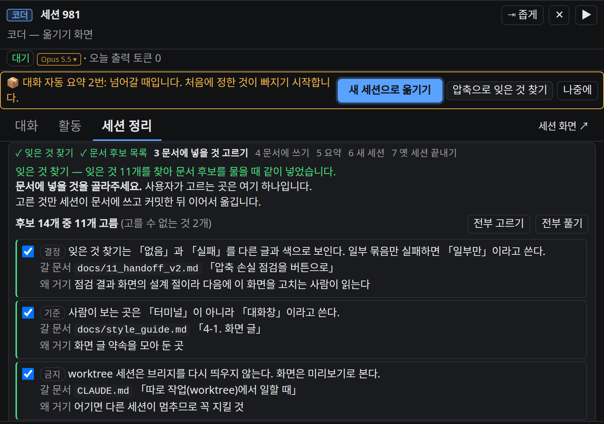
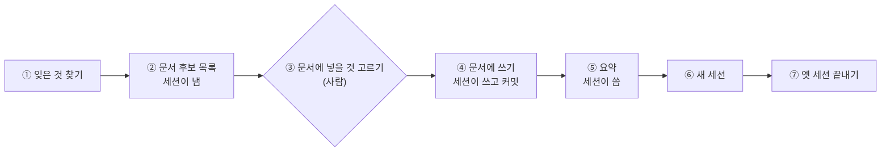
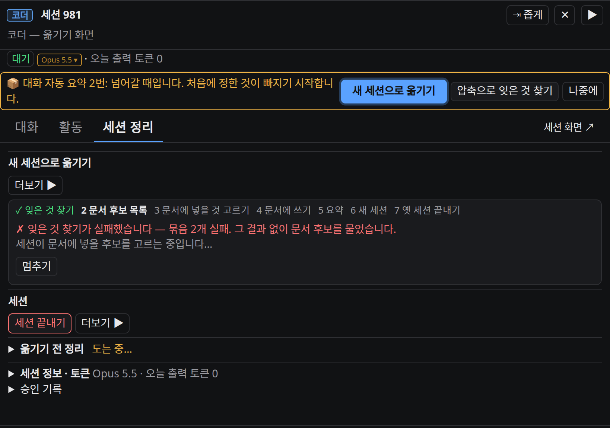
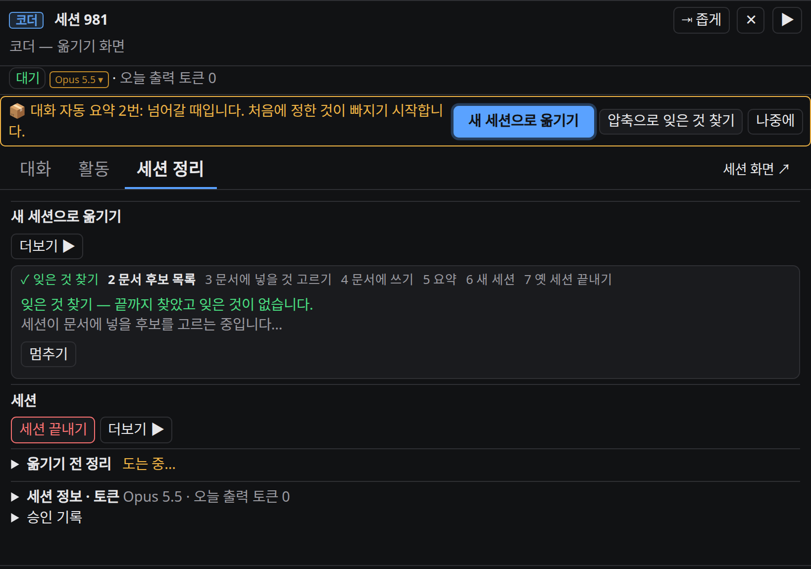

<!--
다루는 곳: bridge/static/js/handoff.js, bridge/static/js/moveflow.js, bridge/static/js/losscheck.js, bridge/static/js/promote.js, bridge/handoff.py, bridge/api/handoff.py, bridge/losscheck.py, bridge/promote.py, bridge/pointers.py, config/handoff.toml
읽은 커밋: fb7121b
-->

# 세션 정리: 인계와 옮기기

> 이 글은 대화가 무거워진 세션을, 정해 둔 것을 잃지 않고 새 세션으로 넘기는 「새 세션으로 옮기기」 화면을 다룹니다.

**단추 하나를 누르면 브리지가 잊은 것 찾기, 문서 후보 받기, 요약, 새 세션 띄우기, 옛 세션 끝내기까지 차례로 이어 갑니다. 사람이 멈춰서 하는 일은 「무엇을 문서에 남길지 고르기」 하나입니다.**

Claude Code는 대화가 길어지면 앞부분을 요약으로 줄이고(자동 압축) 그 요약만 들고 일을 이어 갑니다. 이 압축을 몇 번 거치면 처음에 사람이 정해 준 금지, 기준, 결정이 조용히 빠집니다. 세션은 잊었다는 사실을 스스로 알리지 않으니, 사람이 같은 말을 다시 할 때까지 아무도 모릅니다 [log:handoff_v2_result.md]. 이 화면은 그런 세션을 끝내고 같은 자리에 새 세션을 띄우되, 잊은 것은 먼저 찾아 문서에 적고, 새 세션에는 짧은 요약과 「먼저 읽을 곳」을 넘겨 실제로 읽었는지까지 확인합니다. 무엇을 잃는지 잰 이야기와 이렇게 고른 까닭은 기술문서에 있고, 여기서는 화면이 무엇을 해 주는지만 다룹니다.

## 언제 옮길지 알려 주는 띠

세션이 압축을 두 번째 거치면 패널 맨 위에 노란 띠 「대화 자동 요약 2번: 넘어갈 때입니다」가 뜨고, 지도 위 그 캐릭터에도 상자 표시가 붙습니다. 네 번째부터는 띠가 빨갛게 바뀌어 「대화 자동 요약 4번: 늦었습니다.」 뒤에 앞에서 정한 결정과 금지가 이미 많이 빠졌을 수 있다고 알리고, 텔레그램 알림 앞머리(예: `[FOREMAN]`)를 정해 둔 프로젝트면 두 번째와 네 번째 압축 직후에 텔레그램으로도 한 번씩 알립니다 [code:config/notify.toml]. 손실이 압축 두 번 안에 몰린다는 점검 결과에 맞춘 시점입니다 [docs:11_handoff_v2.md]. 압축 횟수 말고도 한 번 응답에 다시 읽는 대화(맥락)가 너무 커지면 같은 띠가 뜹니다. 띠에는 [압축으로 잊은 것 찾기]와 [나중에]가 있고, 브리지가 글을 넣을 수 있는 세션이면 [새 세션으로 옮기기]도 붙어서, 띠를 본 자리에서 바로 옮기기를 시작하거나 잊은 것만 먼저 찾아볼 수 있습니다.

## 단추 하나로 이어지는 일곱 단계

[새 세션으로 옮기기]를 누르면 「세션 정리」 탭에 단계 줄이 생기고 아래 일곱 단계를 차례로 지납니다. 사람이 끼어드는 곳은 셋째 단계뿐이고, 나머지는 브리지가 서버 상태를 보고 저절로 다음으로 넘어갑니다 [code:bridge/static/js/moveflow.js].

어디까지 왔는지는 브라우저가 세션마다 기억하므로, 다른 세션을 보러 갔다 오거나 화면을 새로 고쳐도 같은 단계에서 이어집니다. 패널을 닫으면 멈췄다가 다시 열면 이어 갑니다. 한 단계가 10분 넘게 그대로면 「멈춘 것 같습니다」를 띄우고 [다시 시도]와 [멈추기]를 내놓습니다. 기다리는 화면이 아무 말 없이 서 있지 않게 하려는 것입니다 [code:bridge/static/js/moveflow.js]. [멈추기]는 어느 단계에서나 누를 수 있고, 그때까지 만든 요약과 목록은 남습니다.

## 잊은 것 찾기

첫 단계는 압축 구간마다 사람이 한 말을 다시 뽑아, 그 안의 지시와 결정을 지금 세션이 아직 기억하는지 판정합니다. 말을 뽑는 일은 스크립트가 하고, 판정은 세션 밖에서 따로 부르는 Claude(`claude -p`, 기본 모델 Sonnet 5.5)가 20개씩 묶어서 합니다 [code:bridge/losscheck.py] [code:config/models.toml]. 화면에는 사람이 손볼 「사라짐」(아예 기억하지 못함)과 「약해짐」(남아 있지만 조건이나 이유가 빠짐) 수만 크게 보이고, 나머지 판정은 호버로 들어갑니다. 비용은 보낸 말 20개당 약 0.4달러, 1.5분이라는 어림값을 단추 호버와 확인 창에 미리 적어 둡니다 [code:bridge/static/js/losscheck.js].

이 단계에서 가장 신경 쓴 것은 「잊은 것 없음」과 「찾지 못함」을 다르게 보이는 일입니다. 판정 묶음이 실패했는데 0개로 보이면, 사람은 잊은 것이 없다고 믿고 넘어가 버립니다. 그래서 끝까지 찾아 없으면 초록 글, 일부 묶음만 끝났으면 노란 글로 「0이어도 없음이 아닙니다」, 실패했으면 빨간 글로 「그 결과 없이 문서 후보를 물었습니다」라고 씁니다 [code:bridge/static/js/moveflow.js]. 실패해도 흐름은 멈추지 않고 다음 단계로 가되, 실패했다는 사실을 단계 줄 바로 아래에 남깁니다.

## 문서에 넣을 것 고르기

둘째 단계에서 브리지는 세션에게 「대화에서만 정하고 아직 문서에 없는 것」을 목록으로 내라고 요청합니다. 앞 단계에서 찾은 사라짐과 약해짐도 함께 넘깁니다. 이때 세션은 파일을 고치지 않고 후보만 냅니다 [code:bridge/promote.py]. 후보마다 종류(결정, 기준, 금지 등), 한 줄 내용, 갈 문서와 절, 왜 거기인지가 붙어 첫 사진처럼 놓입니다. 사람은 넣을 것에 체크만 하면 되고, [전부 고르기]와 [전부 풀기]도 있습니다. 갈 문서가 실제로 없거나 세션이 「버림」을 권한 후보는 여기서 고를 수 없게 막아 두고, 그 까닭을 호버로 보입니다.

[고른 것을 문서에 쓰고 옮기기]를 누르면 세션이 고른 것만 문서에 쓰고 커밋합니다. 브리지는 세션의 말 대신 git을 보고, 승인한 파일만 바뀌었는지 확인한 뒤에야 다음 단계로 넘어갑니다 [log:handoff_v2_c_result.md]. 확인에 실패하면 그 자리에 무엇이 어긋났는지 띄우고 고르기 단계로 돌아옵니다. 후보 문장이나 갈 문서를 직접 고치고 싶으면 같은 탭의 접힌 칸 「옮기기 전 정리」에서 고칠 수 있습니다. 끝나지 않은 할 일 같은 후보는 문서 대신 포스트잇으로 보낼 수도 있습니다 → 「포스트잇」.

## 옮기기용 요약과 읽을 곳

문서에 쓴 다음에는 세션이 새 세션에게 넘길 요약을 씁니다. 요약은 그 세션 자신이 기억으로 쓰고, 브리지가 따로 다른 모델을 부르지 않습니다. 길이는 2,500자 안이고 「지금 상태」, 「다음 할 일」, 「걸려 있는 것」, 「문서와 다른 지금」, 「읽을 곳」 다섯 절로 정해져 있습니다 [code:bridge/handoff.py]. 요약을 짧게 두는 까닭은, 문서에 이미 있는 것은 새 세션이 직접 읽게 하고 요약에는 문서에 없는 것만 담기 위해서입니다. 요약이 오지 않는 경우도 조용히 넘기지 않습니다. 세션이 정해진 꼴을 갖춘 요약 없이 응답을 끝냈거나, 기다리는 사이에 세션이 끝났거나, 정해진 시간 안에 돌아오지 않으면 브리지가 실패로 남기고 ⚠를 단 텔레그램 알림을 바로 보냅니다. 일상 알림을 저녁에 하루치로 모아 보내도록 켠 프로젝트여도 이 실패 알림은 미루지 않습니다. 단추를 누르고 다른 화면으로 떠난 사람도 요약이 막혔다는 것을 그때 알 수 있게 하려는 것입니다.

![「옮기기용 요약」 카드 — 지금 상태, 다음 할 일, 문서와 다른 지금, 읽을 곳 절이 보이고 오른쪽 위 [고치기]로 사람이 손볼 수 있습니다. 글은 시연용입니다 〔시연 재생〕](img/06_handoff_summary.png)

「읽을 곳」은 `경로` 「절 제목」 꼴로 적게 하고, 브리지가 넣기 전에 그 파일과 절이 실제로 있는지 기계로 확인합니다. 하나라도 틀리면 새 세션에 넣지 않고 [고치기]를 먼저 하라고 알립니다 [code:bridge/pointers.py] [log:handoff_v2_result.md]. 새 세션이 뜬 뒤에는 그 세션이 실제로 문서를 열었는지(Read 기록)를 맞대어 「읽을 곳 N/M 읽음」으로 보이고, 안 읽은 곳이 있으면 [안 읽은 곳 다시 보내기]로 그곳만 다시 보냅니다. Claude Code가 세션 시작 때 저절로 넣는 CLAUDE.md는 읽음으로 세고 「자동」이라고 따로 표시합니다 [code:bridge/static/js/handoff.js].

마지막 두 단계에서 브리지는 같은 폴더에 새 세션을 띄워 요약을 첫 입력으로 넣고, 역할과 모델도 옛 세션 것을 이어받게 한 뒤 옛 세션을 끝냅니다 [log:stage12_model_choice_result.md]. 다만 그 프로젝트에 옮기는 세션 말고도 살아 있는 세션이 있으면 새 세션은 작업방에서 뜨고, 옮기기 화면에 「⑂ 새 세션은 작업방에서 뜹니다. 넣을 때 그 사실을 글 맨 앞에 덧붙입니다.」가 미리 보입니다. 관리자 세션은 늘 원본 폴더에 뜹니다. 새 세션은 요약을 받으면 먼저 읽을 곳을 모두 읽고, 걸리는 규칙을 말한 뒤 사람의 확인을 기다리도록 지시받습니다.

## 작업방 세션은 옮기지 않습니다

작업방(worktree, 같은 저장소를 따로 꺼낸 작업 폴더)에서 일하는 세션에는 「새 세션으로 옮기기」 묶음이 보이지 않습니다. 그런 세션은 일을 마치면 합치고 끝내는 쪽이 맞기 때문입니다 → 「합치기 카드와 코더 창」. 이미 옮기기가 돌고 있던 세션이면 끝까지 보입니다 [code:bridge/static/js/handoff.js].

[기술문서: 세션 정리와 인계](../notion/08_handoff.md)
