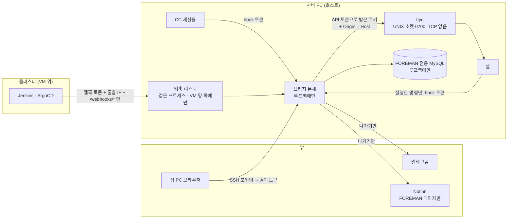

# 배치와 보안 판단

> 이 글은 FOREMAN의 브리지와 DB를 클러스터 밖 호스트에 둔 이유, 밖으로 열지 않은 이유, 비밀값과 권한을 규칙이 아니라 구조로 막은 방법을 다룬다.

**감시하는 장비는 감시받는 대상과 같이 죽으면 안 된다. 그래서 브리지와 DB를 클러스터 밖 호스트에 두었다. FOREMAN은 뚫리면 서버 셸이 열리는 물건이다. 그래서 터널 설계까지 써 놓고 밖으로 열지 않았고, 밖에서는 텔레그램만 받는다. 비밀값은 "새면 무엇이 열리나"로 골랐다. 문마다 열쇠를 따로 두고, 셸은 포트 없이 소켓에 묶고, 웹훅은 다른 문으로만 받는다.** 그래도 비밀값은 세 번 출력 · 로그에 찍혔다. 셋 다 값을 그대로 찍는 도구(조사 출력 · 라이브러리 로그 · CLI 디버그)를 거쳐서였다 [log:01_kickoff_result.md] [log:stage7_terminal_result.md] [log:stage8_cicd_result.md].

전체 구조는 → 「한눈에 — FOREMAN이 무엇인가」, 승인 정책은 → 「에이전트 관제 — 상태 · 승인 · 입력」, Jenkins 토큰 판단과 적재 쪽 마스킹은 → 「관찰 파이프라인 — 조용한 고장을 잡는다」에 있다.

## 1. 문제 — 무엇을 지키고, 무엇과 떨어뜨려야 했나

- **감시 대상이 흔들리는 순간을 기록해야 한다.** 11-02에 사고 두 건이 보였다. 호스트 서비스 하나가 한 달 넘게 567,740번 다시 시작했고, milvus 컨테이너가 17분 동안 크래시 루프를 돌았다 [log:infra_20261102_milvus-port-forward.md] [c:8b52522]
  - 감시 장비가 클러스터 안에 있으면, 클러스터가 흔들리는 바로 그때 적재가 멈추고 화면이 꺼진다 [c:8b52522]
- **FOREMAN이 쥔 권한이 크다.** 대시보드에서 실행 중인 Claude Code(CC) 세션에 글을 넣고(tmux 입력 주입), 되돌릴 수 없는 명령의 승인 버튼을 누르고, 호스트 셸(터미널 패널)을 연다 [c:1fe16c2]
  - 앞단 인증 하나가 깨지면 보는 화면이 아니라 서버를 내주는 셈이다 [c:1fe16c2]
- **공유 서버다.** 여러 계정이 같은 서버를 쓴다. 여기서 셸이 열리면 피해가 이 프로젝트에서 끝나지 않는다 [c:1fe16c2]
- **비밀이 많고, 같은 계정에서 AI 세션이 돈다.** DB 비밀번호, 브리지 토큰들, 텔레그램 봇 토큰, Notion 토큰이 한 호스트에 있다 [log:stage1_bridge_db_result.md] [log:stage12_scribe_result.md]
  - 파일 권한 600은 다른 계정을 막는다. 하지만 이 계정에서 도는 CC 세션 · 로그 · 트랜스크립트로 새는 길은 남는다 [log:stage8_cicd_result.md]

## 2. 판단 — 무엇을 고르고 무엇을 버렸나

### 2-1. 어디에 둘 것인가

| 고른 것 | 버린 것 | 이유 | 근거 |
|---|---|---|---|
| 브리지는 호스트 프로세스, DB는 호스트 도커의 **FOREMAN 전용** MySQL | 클러스터(k8s)에 올리기 | 감시하는 쪽과 감시받는 쪽의 장애 범위를 나눈다. 재부팅 때 VM 4대와 클러스터가 다 올라오기를 기다리지 않는다 | [c:8b52522] [log:stage1_bridge_db_result.md] |
| 브리지는 파드가 될 수 없다고 보고 호스트에 | 파드 + hostPID · hostPath | 여기서 k8s 노드는 VM이다. 파드의 "호스트"는 서버 PC가 아니라 VM이라, 서버 PC의 CC 프로세스도 트랜스크립트도 tmux 소켓도 보이지 않는다. 우회하려면 파드에서 호스트로 ssh해야 하고, 그러면 사용자 계정의 ssh 키가 클러스터 Secret에 들어간다 | [c:8b52522] |
| 새 DB 인스턴스 | 기존 MySQL에 얹기 | 클러스터의 운영 DB는 호스트에서 바로 붙을 수 없다. 호스트의 개발용 DB는 다른 프로젝트가 초기화할 때 FOREMAN 기록이 같이 사라지고, FOREMAN이 쓰면 그쪽 측정값이 오염된다 | [c:8b52522] |
| (위 결정 안에서) | `kubectl port-forward` · NodePort로 클러스터 DB 쓰기 | port-forward는 파드가 재시작되면 끊겨 감독 프로세스가 따로 필요하다. 567,740번 재시작한 그 서비스와 같은 모양이다. NodePort는 연결은 되지만 장애 범위 문제가 그대로다 | [c:8b52522] |
| 수집부 · UI를 나누지 않는다. 배포는 systemd, 시험은 GitHub Actions | UI만 파드로 떼어 CI/CD에 태우기 | 실시간 상태 · 승인 대기 · 터미널이 모두 브리지 프로세스나 호스트에 묶여 있다. 떼어낼 수 있는 것은 정적 JS 약 1,260줄뿐이고, 옮기면 노출 면만 커진다 | [c:eefa1ad] |
| 파이썬 가상환경도 전용 | 다른 LLM 작업과 같은 환경 공유 | 같은 장애 범위 논리. 다른 작업이 패키지를 바꿔도 브리지가 깨지지 않게 | [log:stage1_bridge_db_result.md] |

### 2-2. 밖으로 열 것인가

| 고른 것 | 버린 것 | 이유 | 근거 |
|---|---|---|---|
| **열지 않는다.** 밖에서는 텔레그램(턴 종료 · 승인 대기 · 파이프라인 실패 · 적재 막힘)만 | Cloudflare 터널 + Access(사람 인증) + 브리지 토큰 | 뚫리면 서버 셸이다. 밖에서 필요한 정보는 이미 텔레그램으로 온다. "그거 하나 보려고 터널을 유지할 값어치가 없다"(11-03 사용자 결정) | [c:1fe16c2] [docs:02_cloudflare_tunnel.md] |
| 집 PC에서는 SSH 포워딩으로 붙는다 | 학교망 · 인터넷에 포트 열기 | 브리지 본체는 루프백(127.0.0.1)에만 열린다. SSH 인증을 통과한 사람만 닿는다 | [log:stage1_bridge_db_result.md] |
| 다시 열면 **읽기 전용 화면 + 패스키 · mTLS** | 지금 화면을 Access 뒤에 그대로 | 터미널 · 입력 · 승인 버튼이 없는 화면만 연다. 승인은 그때도 텔레그램 · 서버 앞에서 | [c:1fe16c2] [docs:02_cloudflare_tunnel.md] |

- 못 해서 안 연 것이 아니다. 같은 서버의 다른 두 서비스는 이미 터널로 공개했고, CI/CD 도구도 Access 뒤에 열어 두었다. 열었을 때 잃을 것과 얻을 것을 따져 열지 않았다 [c:1fe16c2]

### 2-3. 비밀과 권한을 어떻게 나눌 것인가

| 고른 것 | 버린 것 | 이유 | 근거 |
|---|---|---|---|
| **쓰임마다 토큰을 따로**: 대시보드 API · CC hook · CI/CD 웹훅 | 토큰 하나 | hook 토큰이 새도 API · 입력 주입은 못 쓴다. 웹훅 토큰이 새도 가짜 빌드 이벤트를 넣는 정도다 | [log:stage1_bridge_db_result.md] [log:stage8_cicd_result.md] |
| 비밀은 "새면 무엇이 열리나"로 고른다 | 쓰기 편한 쪽 | Jenkins를 API로 조회하려던 토큰이 실은 배포 경로 전체의 열쇠였다 → 「관찰 파이프라인 — 조용한 고장을 잡는다」 | [log:stage8_cicd_result.md] [c:3af65b8] |
| 터미널(ttyd)은 **UNIX 소켓**(디렉토리 0700)에만. TCP 포트 없음 | 루프백 포트에 묶기(설계 지시) | 루프백 포트는 같은 PC의 다른 계정 · 다른 프로세스도 붙는다. ttyd에는 자체 인증이 없다 | [log:stage7_terminal_result.md] |
| 사람이 쳐야 하는 비밀(sudo 암호 · 레지스트리 로그인)은 **사람이 터미널 패널에서 친다** | CC에게 암호를 넘기기 | CC가 부탁하면 브리지가 명령을 미리 채우되 비밀번호 자리는 비운다. CC는 마스킹된 결과만 받는다 | [log:stage7_terminal_result.md] |
| Notion은 **브리지가 API로 직접** 올리고, 통합은 FOREMAN 페이지에만 연결 | 서기 세션이 Notion 커넥터로 쓰기 | 사용자: "권한을 코드가 아니라 구조로 막는 게 맞고" → 「서기 — 근거가 확인되는 문서」 | [log:stage12_scribe_result.md] [c:cd23b1d] |
| 점검 역할 세션은 **plan 모드**로 띄운다 | 첫 글에 "고치지 마라"고 쓰기 | 읽기 전용을 말이 아니라 CC 권한 모드로 건다 | [log:stage11_foreman_dispatch_result.md] [log:stage11_roles_result.md] |

## 3. 구조 · 흐름

### 3-1. 문과 열쇠

| 문 | 누가 들어오나 | 열쇠 | 새면 무엇이 열리나 | 근거 |
|---|---|---|---|---|
| 대시보드 API · WebSocket | 사람(SSH 포워딩) | API 토큰. HTTP는 헤더, WS는 연결 뒤 첫 메시지(주소는 로그에 남아서 쿼리스트링에 넣지 않는다) | 전부 — 그래서 루프백에만 둔다 | [log:stage1_bridge_db_result.md] [c:1ec1bfd] |
| hook | CC 세션 · 셸 | hook 토큰 | 가짜 상태 이벤트. API · 입력 주입은 못 쓴다 | [log:stage1_bridge_db_result.md] [log:stage7_terminal_result.md] |
| 터미널 | 대시보드 안의 틀(iframe) | API 토큰으로 받은 쿠키(HttpOnly · SameSite=Strict · 브리지 메모리에만) + Origin = Host | 호스트 셸 | [log:stage7_terminal_result.md] |
| CI/CD 웹훅 | 클러스터의 Jenkins · ArgoCD | 웹훅 토큰 + VM 망 출발 IP + 경로 | 가짜 빌드 · 배포 이벤트 | [log:stage8_cicd_result.md] |
| DB | 브리지 | 앱 계정 비밀번호, 루프백 | FOREMAN 기록 | [log:stage1_bridge_db_result.md] |
| Notion | (밖으로 나가기만) | 내부 통합 토큰 | FOREMAN 페이지 아래뿐 | [log:stage12_scribe_result.md] |

- 토큰은 설정에서 비밀 타입으로 읽는다. 출력 · 로그에 값이 찍히지 않고, 32자보다 짧으면 브리지가 뜨지 않는다 [c:23e93e6]. 비교는 시간 차이가 나지 않는 비교로 한다 [c:1ec1bfd]
- 비밀 파일은 600이고 커밋하지 않는다. 견본 파일만 커밋한다. 백업 폴더는 700이다 [log:stage1_bridge_db_result.md] [log:infra_20261102_host-changes.md]

### 3-2. 비밀이 지나가지 않는 길

규칙으로 "찍지 마라"고 하는 대신, 비밀이 처음부터 지나가지 않게 길을 냈다.

- **셸 기록은 키 입력이 아니라 "실행한 명령"만** 받는다. 셸이 명령을 마칠 때 명령 · 종료 코드 · 위치를 알린다. WebSocket을 지나는 키 입력을 읽으면 sudo 암호까지 지나간다 [log:stage7_terminal_result.md]
  - 셸 기록 파일은 디스크에 남기지 않는다. 공백으로 시작한 명령도 기록한다 — 기록을 피하는 길이 되지 않게 [log:stage7_terminal_result.md]
  - 명령줄에 들어간 비밀(`--password 값`, `mysql -p값`, URL의 `user:암호@` …)은 마스킹한다 [log:stage7_terminal_result.md]
- **도구 결과 본문은 DB에 넣지 않는다**(길이 · 오류 여부만). 형식을 모르는 비밀은 마스킹이 못 잡는다 → 「관찰 파이프라인 — 조용한 고장을 잡는다」 [log:stage2_transcript_result.md]
- **CC의 세션 간 통신 토큰 파일은 열지 않는다.** 프로세스 생존은 같은 폴더의 상태 파일만 읽어 판정한다 [log:stage2_transcript_result.md]
- **웹훅 리스너는 같은 프로세스지만 다른 문이다.** VM 망 쪽 주소에만 열고, `/webhooks/*` 밖은 404, 출발 IP가 VM 망이 아니면 거절한다 [log:stage8_cicd_result.md]
  - 출발 IP를 따로 보는 이유: 리눅스는 다른 인터페이스로 들어온 패킷도 받는다(weak host). 주소에 묶는 것만으로는 부족하다 [log:stage8_cicd_result.md]

## 4. 겪은 문제와 풀이

### 4-1. 터널 설계를 다 써 놓고 열지 않았다

- 처음 설계는 6단계 뒤에 터널 + Access로 밖에서 보는 것이었다. 설계서는 순서까지 못 박았다 — Access 정책을 확인하기 전에는 터널을 띄우지 않는다 [docs:02_cloudflare_tunnel.md]
  - 같은 서버의 다른 터널은 먼저 띄우고 나중에 Access를 걸었다. 그 사이 무인증이었고, 그때는 모델 목록 조회 정도라 감수했다. FOREMAN은 명령을 주입하는 엔드포인트라 "무인증 구간이 1초라도 있으면 안 된다"고 적었다 [docs:02_cloudflare_tunnel.md]
  - Access는 앞단만 막는다. 서버 안에서 루프백에 바로 붙는 길은 못 막아서, 브리지 자체 토큰을 따로 두었다 [docs:02_cloudflare_tunnel.md]
- 대시보드와 터미널 패널(6 · 7단계)까지 만들고 나니 화면에 터미널 · 입력 · 승인 버튼이 다 들어와 있었다. 밖에서 필요한 것은 이미 텔레그램으로 왔다. 그래서 열지 않기로 했다(11-03) [c:1fe16c2]
- 설계서는 지우지 않고 "보류 — 필요해지면"으로 남겼다. 다시 열 조건(읽기 전용 + 강한 인증)을 머리에 적었다 [docs:02_cloudflare_tunnel.md]

### 4-2. "루프백에 묶어라"보다 좁게 — 터미널

- 설계 지시는 "ttyd를 127.0.0.1에 묶는다"였다. 루프백 포트는 이 PC의 다른 계정도 붙을 수 있고, ttyd에는 자체 인증이 없다(Basic 인증뿐) → UNIX 소켓 + 디렉토리 0700으로 내 계정만 닿게 했다 [log:stage7_terminal_result.md]
- 브라우저는 브리지를 거쳐서만 닿는다. 틀 안의 터미널은 인증 헤더를 붙일 수 없어 쿠키를 쓴다 [log:stage7_terminal_result.md]
  - 쿠키만으로는 다른 사이트가 사용자 브라우저의 쿠키로 셸 WebSocket을 여는 것(cross-site WebSocket hijacking)을 못 막는다 → Origin이 Host와 같아야 받는다 [log:stage7_terminal_result.md]
  - 다른 사이트가 이 화면을 틀에 넣어 클릭을 훔치지 못하게 같은 출처의 틀에서만 보인다 [log:stage7_terminal_result.md]
- 처음엔 패널을 열 때만 쿠키를 받았다. 대시보드가 인증될 때마다 같은 토큰으로 자동으로 받게 바꿨다 — 사람은 토큰을 한 번만 넣는다 [c:8f53b18]

### 4-3. 웹훅을 받아야 하는데 브리지는 루프백에만 있다

- CI/CD 알림은 클러스터 안(VM)에서 온다. 루프백에만 열린 브리지에는 닿지 않는다 [log:stage8_cicd_result.md]
- 브리지 본체를 넓게 열지 않고, 같은 프로세스에 VM 망 쪽 전용 리스너를 하나 더 두었다. 경로 · 출발 IP · 별도 토큰 세 겹이다 [log:stage8_cicd_result.md]
- 클러스터 노드에서 실제로 쳐 봤다. 토큰 없이 401, 다른 경로 404, 브리지 본체 포트는 닿지 않음 [log:stage8_cicd_result.md]
- 출발 IP는 짐작하지 않고 적용 때 쟀다. 파드의 주소가 아니라 노드의 VM 망 주소로 나왔다(NAT) [log:stage8_cicd_result.md]

### 4-4. 비밀값이 세 번 찍혔다

| 언제 | 무엇이 | 어디로 | 길 | 한 것 | 근거 |
|---|---|---|---|---|---|
| 11-02 킥오프 조사 | CC 세션 간 통신 토큰 | 조사 출력(이 세션 대화) | 파일 내용을 그대로 찍은 조사 명령 | 기록에 옮기지 않음. 브리지는 그 파일을 열지 않게, 도구 결과 본문은 저장하지 않게 | [log:01_kickoff_result.md] [log:stage2_transcript_result.md] |
| 11-02(4단계부터) | 텔레그램 봇 토큰 | 브리지 로그, 그리고 한 번 화면 | 로깅 기본값이 HTTP 라이브러리의 요청 로그까지 켰다. 봇 토큰이 URL 안에 있다 | 그 로거를 WARNING으로, 로그 10곳 지움, 사용자가 재발급(옛 토큰 폐기) | [log:stage7_terminal_result.md] [c:8f53b18] |
| 11-03(8단계) | CI/CD 웹훅 토큰 | 도구 출력(이 세션 대화) | ArgoCD CLI의 디버그 로그가 요청 헤더를 통째로 찍었다 | 피해 범위(가짜 이벤트, VM 망 안에서만)를 따진 뒤 교체 | [log:stage8_cicd_result.md] [c:8efb8cd] |

- 셋 다 **값을 그대로 찍는 도구를 지나서**였다. 규칙("찍지 마라")은 세 번 다 그 자리에 없었다. 그래서 구조 쪽을 바꿨다 — 저장하지 않는 길, 열지 않는 파일, 새도 되는 무게의 토큰 [log:stage2_transcript_result.md] [log:stage8_cicd_result.md]
- 세 번째에서 판단이 작동했다. 같은 실수로 Jenkins 관리자급 토큰이 찍혔다면 스크립트 콘솔 · 저장된 자격 증명 · 인프라 저장소 쓰기 키까지 열렸다. 웹훅 토큰이라 급하지 않게 바꿀 수 있었다 [log:stage8_cicd_result.md]
- 교체 순서는 사람이 바로잡았다. 설명 없이 받는 쪽 설정부터 바꾸려다 멈췄다 — "ArgoCD가 가진 건 옛날 게 되고, Jenkins도 같은 토큰 쓰고 있는데". 보내는 쪽을 먼저, 받는 쪽을 맨 끝에 두어 틈 없이 바꿨다 [log:stage8_cicd_result.md]
- 바꾼 뒤 확인은 값이 아니라 해시 앞 12자리로 했다. 세 곳이 같고, 옛 토큰은 401 [log:stage8_cicd_result.md]

### 4-5. 호스트에 둔 것이 실제로 쓸모 있었던 날

- 11-06 정전 뒤 클러스터 안의 Jenkins는 init 단계에서 계속 실패했다 [log:infra_20261106_jenkins-harbor-after-outage.md]
- FOREMAN의 DB는 도커 재시작 정책으로 클러스터와 상관없이 먼저 올라왔다. 데이터 표 점검(CHECK TABLE) 모두 이상 없음 [log:infra_20261106_systemd-bridge.md]
- 그러나 **브리지는 뜨지 않았다.** 손으로 띄우던 방식이었다. 사용자 단위 systemd 유닛으로 바꿨다 — sudo 없이, 로그인하지 않아도 부팅 때 뜨게(linger). 밀린 12줄은 기동 뒤 0.3초에 따라잡았다 [log:infra_20261106_systemd-bridge.md] [c:1cfd0c0]
  - 배치를 정할 때(11-02) 유닛은 "6단계 즈음"으로 미뤄 두었다. 정전이 오기 전까지 만들지 않았다 [log:stage1_bridge_db_result.md]

## 5. 결과 · 숫자

| 무엇 | 값 | 근거 |
|---|---|---|
| 인터넷으로 연 입구 | 0. 터널 없음. 브리지 본체는 루프백, 웹훅 리스너만 VM 망 쪽 | [c:1fe16c2] [log:infra_20261102_host-changes.md] |
| 쓰임별 토큰 | 3개(API · hook · 웹훅). 32자 미만이면 기동 거부 | [log:stage1_bridge_db_result.md] [log:stage8_cicd_result.md] [c:23e93e6] |
| 웹훅 리스너 확인(클러스터 노드에서) | 토큰 없이 401 · 다른 경로 404 · 본체 포트 닿지 않음 | [log:stage8_cicd_result.md] |
| 빌드 알림 시험 빌드 2개 | 빌드 로그에 토큰 0번 | [log:stage8_cicd_result.md] |
| 터미널 | TCP 리슨 없음, 쿠키 없이 401 · 쿠키로 200 | [log:stage7_terminal_result.md] |
| 적재 데이터의 비밀값 | `.env.*`의 비밀값 5개가 든 행 0 | [log:stage2_transcript_result.md] |
| Notion 범위 | 범위 밖 페이지는 통합이 읽지도 못함(404). 코드를 우회해 휴지통 요청을 직접 보내도 Notion이 404로 거부 | [log:stage12_scribe_result.md] |
| DB 복원 연습(네트워크 없는 임시 컨테이너) | 테이블 9 · FK 11 · 인덱스 34 · 행 수 · 한글 바이트가 운영과 일치 | [log:stage1_bridge_db_result.md] |
| DB 재시작 · 멈춤 | 상태 503 약 5초 → 저절로 200. 멈춘 동안 들어온 이벤트는 버리지 않고 순서대로 들어감 | [log:stage1_bridge_db_result.md] |
| 비밀값 노출 | 3번(세션 간 토큰 · 텔레그램 봇 토큰 · 웹훅 토큰). 바꾼 것은 둘(텔레그램 · 웹훅) | [log:01_kickoff_result.md] [log:stage7_terminal_result.md] [log:stage8_cicd_result.md] |

- 정직하게: 외부 공격으로 시험해 본 적은 없다. 위 확인은 모두 이 서버 안 · 클러스터 노드에서 친 요청이다 [log:stage8_cicd_result.md] [log:stage7_terminal_result.md]

## 6. 한계 · 다음

- **재부팅 검증을 하지 않았다.** 재부팅은 사용자가 시킬 때만 한다. 브리지 유닛이 정말 부팅으로 뜨는지는 그 뒤에야 안다. 유닛은 도커를 기다리지 않아, DB가 늦게 뜨면 기동 실패 → 재시도에 기댄다 [log:infra_20261106_systemd-bridge.md]
- **같은 계정 안의 AI 세션은 구조로 막지 못한다.** 파일 권한은 다른 계정만 막는다. CC 세션이 비밀 파일을 읽는 것은 막지 않고, 밖으로 보내는 것만 승인을 묻는다 → 「에이전트 관제 — 상태 · 승인 · 입력」 [log:stage8_cicd_result.md] [c:87ed97b]
- **서버 PC 자체가 꺼진 것은 FOREMAN이 알릴 수 없다.** 알릴 주체가 같은 서버에 있다. 서버 밖에서 서버를 지켜보는 감시는 만들지 않았다 [log:infra_20261106_systemd-bridge.md]
- **디버그 엔드포인트가 아직 켜져 있다**(11-06 설정 파일 기준). API 토큰 뒤에 있지만, 1단계에서 "터널을 열기 전에 끈다"고 정해 두었고 터널을 열지 않아 그대로다 [log:stage1_bridge_db_result.md]
- **세션 간 통신 토큰은 바꿨다는 기록이 없다.** 기록에 옮기지 않았을 뿐이다 [log:01_kickoff_result.md]
- **밖에서는 볼 수 없다.** 다시 열 조건(읽기 전용 화면 + 패스키 · mTLS)은 정했지만, 설계서 본문은 아직 그 조건으로 고쳐 쓰지 않았다 — 머리에 보류 표시와 조건만 있다 [docs:02_cloudflare_tunnel.md]
- **클러스터 안을 조회하는 길이 아직 없다.** 만들려면 클러스터 읽기 토큰이 필요하고, 그 토큰의 무게부터 따져야 한다 → 「관찰 파이프라인 — 조용한 고장을 잡는다」 [log:infra_20261106_jenkins-harbor-after-outage.md]
- 이 글에는 화면 사진이 없다. 보안 구조는 화면에 드러나는 것이 없어서 찍지 않았다
