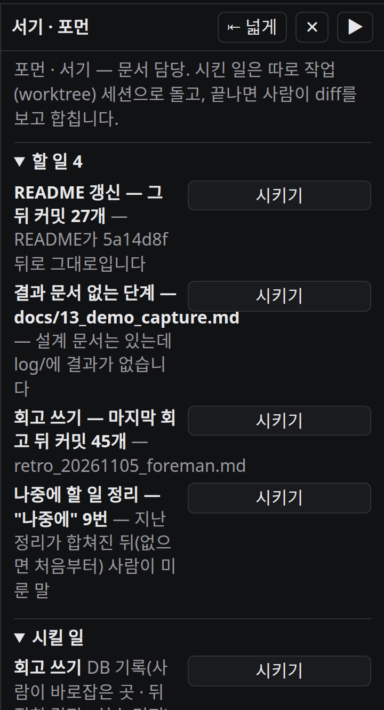
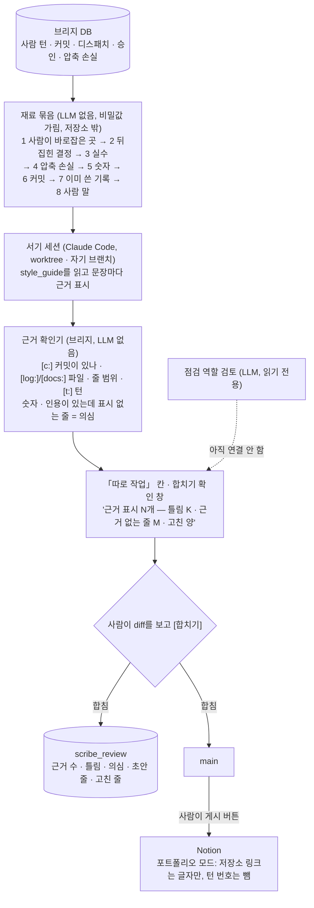
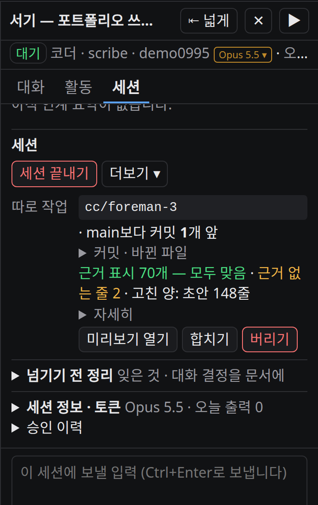

# 서기 — 근거가 확인되는 문서

> 이 글은 AI가 쓴 회고 · 포트폴리오 글을 근거 표시 · 기계 확인 · 사람 합치기 세 겹으로 믿을 수 있게 만든 과정을 다룬다.

**문서 담당 에이전트 "서기"는 문장마다 근거 표시(커밋 · 결과 기록 · 설계 문서 — 이 글의 줄 끝에 붙은 대괄호가 그것이다)를 달고, 브리지가 LLM 없이 그 표시가 실제로 있는지 확인하며, 사람이 diff를 보고 [합치기]를 눌러야 저장소에 들어간다. 첫 회고의 근거 표시 178개는 모두 맞았고, 확인기를 붙인 뒤 합친 포트폴리오 네 편은 근거 69~76개 중 틀린 것이 0개였다. 다만 확인기는 "표시가 가리키는 것이 있는가"까지만 보고, "그 근거가 문장을 뒷받침하는가"는 아직 사람이 본다.** [log:stage12_scribe_result.md] [c:ff0fbb7]

## 1. 문제 — AI가 "됐다"고 쓴 것이 실제로는 아니었다

- 이 프로젝트에서 가장 자주 나온 실수는 AI가 "됐다"고 보고한 것이 실제로는 안 돼 있던 일이다. 11-05 하루에만 사람이 세 번 짚었다 [log:retro_20261105_foreman.md]
  - 설계 대조표에 ✅로 적힌 복도가 화면에는 없었다 · 고쳤다고 보고한 소품이 그대로 겹쳐 있었다 · 있다고 한 배지는 만든 적이 없었다 [log:retro_20261105_foreman.md]
  - 공통점: 문서나 앞선 보고에 적힌 것을 실제와 다시 맞대지 않았다 [log:retro_20261105_foreman.md]
- 문서를 AI에게 맡기면 같은 일이 글에서 일어난다. 그럴듯한 숫자 · 커밋 · 인용이 확인 없이 들어간다
  - 이 프로젝트가 잡으려는 **조용한 고장**의 문서판이다. 틀린 문장은 스스로 알리지 않는다. 전체 기준은 → 「한눈에 — FOREMAN이 무엇인가」 [c:63b5897]
- 문서가 바깥으로 나가면 더 그렇다. 회고를 포트폴리오로 쓰기로 하자 사람이 짚었다 [log:stage12_scribe_result.md]
  - "지금은 사람이 diff 보는 게 유일한 관문이잖아. 포트폴리오로 쓸 거면 근거가 틀리면 안 되니까" [log:stage12_scribe_result.md]
- 양도 사람이 다 읽기 어렵다. 첫 회고의 재료만 57,386자였다(사람 턴 51 · 커밋 48 · 세션 9 · 압축 손실 142) [log:stage12_scribe_result.md]

## 2. 판단 — 무엇을 고르고 무엇을 버렸나

| 고른 것 | 버린 것 | 이유 | 근거 |
|---|---|---|---|
| 프로젝트마다 문서 담당 하나(역할 `scribe`) | 여러 프로젝트를 떠도는 포트폴리오 작성 캐릭터 | 문서는 그 저장소의 규칙 · 기록을 읽어야 쓴다. 포트폴리오는 서기가 하는 일 중 하나다 | [docs:12_scribe.md] |
| 실제 Claude Code 세션 · git worktree · 자기 브랜치 | `claude -p` 한 번 | 여러 파일을 읽고 diff를 만들어야 한다. worktree면 [합치기]가 곧 검토 관문이 된다 — 새 장치를 만들 필요가 없다 | [docs:12_scribe.md] |
| 재료는 브리지가 LLM 없이 모은 "재료 묶음", 정정 · 뒤집힌 결정 · 실수를 앞에 | 서기가 처음부터 탐색 | 사람이 바로잡은 곳이 읽는 사람이 보고 싶은 **판단**이다. AI 회고는 쉽게 "소통이 중요했다"로 흐른다 | [docs:12_scribe.md] [log:stage12_scribe_result.md] |
| 모든 주장에 근거 표시 + LLM 없는 확인기 | 다른 LLM이 사실 확인 | 표시가 있는지는 git · 파일 · DB로 확정된다. 모델에게 맡길 이유가 없다. LLM 검토(점검 역할)는 그 위에 얹을 자리로 남겼다 | [docs:12_scribe.md] [c:ff0fbb7] |
| 확인기는 막지 않고 알린다 | 틀린 근거가 있으면 합치기 거부 | 근거 없는 줄은 의심일 뿐이다(위 줄에 근거가 달린 하위 항목 등). 판단은 사람이 한다 | [log:stage12_scribe_result.md] |
| 사람이 누를 때만 일한다. 브리지는 "할 일"만 센다 | 커밋 N개마다 자동 실행 | 초안이 쌓이면 검토 빚이 된다. 같은 저장소의 다른 세션과 README에서 충돌도 난다 | [docs:12_scribe.md] |
| 원본은 git, Notion은 게시판. 브리지가 Notion API로 직접 올린다 | 서기 세션이 Notion 커넥터로 쓰기 | 사용자: "권한을 코드가 아니라 구조로 막는 게 맞고, LLM이 17KB를 옮겨 적다가 바꿀 위험도 없고" | [log:stage12_scribe_result.md] [c:cd23b1d] |

## 3. 구조 · 흐름

- **근거 표시 세 가지(+ 내부용 하나)** [docs:style_guide.md]
  - `c:` 커밋 해시 · `log:` 결과 기록 · `docs:` 설계 문서. 파일은 줄 범위(`파일:115-138`)까지 확인한다 [c:ff0fbb7]
  - `t:`는 DB의 대화 턴 번호다. 내부 회고에만 쓰고 바깥 글에는 쓰지 않는다 [docs:style_guide.md]
  - 예시를 대괄호로 쓰면 확인기가 진짜 표시로 읽어 "틀림"으로 띄운다. 그래서 이 글의 예시는 대괄호 없이 쓴다 [c:ff0fbb7]
- **근거 없는 줄 판정**: 숫자나 인용이 있는데 표시가 없는 본문 줄. 표 · 제목 · 인용 블록 · 코드 · 사진 줄 · 20자 미만은 뺀다 [c:ff0fbb7] [c:f4c3d1a]
- **고친 양**: 서기 세션에서 사람이 **두 번째로** 말한 때(첫째는 일감) 전의 커밋은 초안, 뒤는 고침으로 센다 [log:stage12_scribe_result.md]
  - 이 숫자가 줄어드는지가 "하루 끝 회고 초안을 자동으로 띄울지"를 정하는 기준이다 [docs:12_scribe.md]
- **합치기 전에 잰다.** 합치면 브랜치가 지워져 다시 잴 수 없다 [log:stage12_scribe_result.md]
- 서기는 픽셀 화면의 서기실에 앉아 있고, 머리 위에 LLM 없이 센 "할 일 N"이 뜬다. 누르면 시킬 일(회고 · 문서 점검 · README 갱신 · 규칙 파일 정리 · 나중에 할 일 정리 · 포트폴리오)을 고른다 [c:294acaa] [c:63b5897]
- 같은 문서 일감 · 같은 파일 일감을 동시에 열지 못하게 하는 규칙은 → 「포먼 디스패처 — 같은 일을 하는 세션을 알아채기」 [c:d537dcf]
- 이 글도 같은 길로 나간다. worktree 서기 세션이 쓰고, 확인기를 거쳐, 사람이 diff를 본 뒤 합친다

## 4. 겪은 문제와 풀이

### 4-1. 첫 회고는 근거를 손으로 맞댔다

- 첫 일감은 FOREMAN 11-05 하루 회고였다. 정답을 사용자가 알고 있어 수준을 재기 좋았다 [docs:12_scribe.md]
- 그때는 확인기가 없었다. 서기가 재료 · 기록 · git · 트랜스크립트와 손으로 맞댔다 [log:retro_20261105_foreman.md]
- 확인기를 만든 뒤 그 회고에 처음 돌렸다: **근거 표시 178개 모두 맞음, 근거 없는 줄 19** [log:stage12_scribe_result.md]
  - 의심 19개는 대부분 위 줄에 근거가 달린 하위 항목이었다. 다만 "디스패치는 5건이다"처럼 숫자에 근거가 빠진 줄도 있었다 [log:stage12_scribe_result.md]
  - 손으로 맞댄 것이 틀리지 않았다는 확인이자, 손으로는 숫자 줄 몇 개를 놓친다는 확인이었다

### 4-2. 설계 문서의 숫자와 DB가 달랐다

- 설계 문서에는 "11-05 사람 턴 34개 · 9.3만 자"라고 적혀 있었다. DB는 51개 · 2.3만 자였다 [docs:12_scribe.md] [log:stage12_scribe_result.md]
  - 회고 기간이 달랐고(사용자가 꼽은 버그가 다음 날 새벽이라 넓혔다), DB는 비밀값을 가린 본문이다 [log:stage12_scribe_result.md]
- 회고에는 DB 숫자를 쓰게 했다 [log:stage12_scribe_result.md]
- 문체 기준도 숫자는 DB · git · 측정 파일에서 온 것만 쓰게 한다 [docs:style_guide.md]

### 4-3. 재료 범위가 틀리면 서기는 "할 것 없음"이 맞는 답이 된다

- 「나중에 할 일 정리」를 처음 눌렀을 때 재료 범위가 "README 마지막 변경 뒤"였다. 사람 턴이 0개였고, 서기는 바꿀 것이 없다고 했다 — 재료로는 맞는 답이었다 [log:stage12_scribe_result.md]
  - 사람: "처음부터 뽑을 게 없었던 거고 … 범위를 더 넓게" [log:stage12_scribe_result.md]
- 원인: README는 로드맵 표 같은 다른 일로 자주 바뀐다. 기준점으로 틀렸다 [log:stage12_scribe_result.md]
- 고침: 기준점을 "지난번 정리 세션이 **합쳐진** 때"로. 버린 정리는 세지 않고, 미룬 말이 0개면 세션을 띄우지 않는다(빈손으로 Opus 세션을 쓰지 않게) [c:0fc0a4b]
- 다시 돌리니 미룬 말 28개를 처음부터 보고 README 「나중에 할 일」 표에 4줄을 더했다 [c:29ae70e] [log:stage12_scribe_result.md]

### 4-4. 사진 설명이 "근거 없는 줄"로 잡혔다

- 「한눈에」 글에서 의심이 2개 떴다. 둘 다 사진 설명 줄(``)이었고 내용은 사진과 맞았다 [c:f4c3d1a]
- 사진 설명의 근거는 사진 자체다. 사진 줄을 의심에서 뺐다 [c:f4c3d1a]
- 확인기를 고치기 전에 합친 글은 기록에 의심 2로 남아 있다(아래 표). 지우지 않았다 [c:f4c3d1a]

### 4-5. 게시하면 mermaid 그림이 매번 풀렸다

- Notion API로는 코드 블록을 "미리보기(그림)"로 정할 수 없다. 다른 칸을 보내면 거부한다 [log:stage12_scribe_result.md]
- 처음에는 language 칸까지 빠져 mermaid가 일반 글로 올라갔다 [c:c610b50]
- 그래서 다시 게시를 "지우고 새로"에서 **자리 지키며 갈아 끼우기**로 바꿨다. 같은 자리 · 같은 종류 블록은 내용만 고쳐 블록 id가 남는다 — 사람이 한 번 미리보기로 바꾼 그림이 다시 게시해도 남는다 [c:63b5897]
  - 실제 Notion 시험: 유지 2 · 내용 고침 2 · 바꿈 1 · 더함 1, 첫 줄과 mermaid 블록의 id 그대로 [log:stage12_scribe_result.md]
- 바깥 판은 저장소가 비공개라 링크 없이 해시 · 파일 이름만 글자로 남기고, 턴 번호는 뺀다 [c:c610b50]

## 5. 결과 · 숫자

**합칠 때 남은 검토 기록(DB `scribe_review`)**

| 글 | 근거 표시 | 틀림 | 근거 없는 줄 | 초안 줄 | 고친 줄 | 커밋 |
|---|---|---|---|---|---|---|
| 한눈에 | 70 | 0 | 2(사진 설명, 4-4) | 148 | 0 | [c:8e82420] |
| 압축 손실을 재고 메우기 | 76 | 0 | 0 | 164 | 0 | [c:d526259] |
| 에이전트 관제 | 76 | 0 | 1 | 164 | 0 | [c:40ddc7d] |
| 포먼 디스패처 | 69 | 0 | 0 | 131 | 0 | [c:06c3e52] |

| 무엇 | 값 | 근거 |
|---|---|---|
| 첫 회고(손으로 맞댐) 확인 | 근거 178개 모두 맞음 · 의심 19 | [log:stage12_scribe_result.md] |
| 첫 회고 재료 묶음 | 57,386자(사람 턴 51 · 커밋 48 · 세션 9 · 디스패치 5 · 압축 손실 142) | [log:stage12_scribe_result.md] |
| 서기 세션 | 10개(11-06 기준) | DB `character_session` |
| Notion에 게시한 글 | 5편(회고 1 · 포트폴리오 4), 회고는 블록 135개 | DB `doc_publish`, [log:stage12_scribe_result.md] |
| 실제로 돌려 합친 문서 일감 | 회고 · 나중에 할 일 정리 · 규칙 파일 정리 · 포트폴리오 4편 | [c:b9213fa] [c:29ae70e] [c:5cd15f9] |
| 시험 | 파이썬 432 · JS 43 통과(12c 시점) | [log:stage12_scribe_result.md] |

- 정직하게: **고친 줄 0은 "초안이 완벽했다"는 뜻이 아니다.** 네 편 모두 사람이 세션 안에서 고쳐 달라고 말하지 않고 diff를 본 뒤 그대로 합쳤다는 뜻이다. 확인기 쪽을 고친 것(4-4)은 이 숫자에 잡히지 않는다 [c:f4c3d1a] [log:stage12_scribe_result.md]
- 표본은 네 편이다. 고친 양이 시간에 따라 줄어드는지는 아직 말할 수 없다

## 6. 한계 · 다음

- **확인기는 근거가 "있는지"만 본다.** 가리킨 결과 기록 파일이 있으면 통과한다. 그 파일이 문장의 숫자를 정말 말하는지는 보지 않는다 — 지금은 사람의 diff 확인이 그 몫이다 [c:ff0fbb7]
- **숫자가 DB 값과 맞는지는 기계로 보지 않는다.** 숫자마다 출처가 달라 일반 규칙으로 못 잡는다. 근거 없는 줄로 의심만 띄운다 [log:stage12_scribe_result.md]
- **점검 역할(읽기 전용 LLM) 검토는 연결하지 않았다.** 근거 없는 주장 · 뒤집힌 결정을 지금 것처럼 쓴 곳 · 빠진 실수를 원문과 맞대 짚을 자리다. 비용이 1.5배라 회고 · 포트폴리오에만 쓸 생각이다 [docs:12_scribe.md]
- **하루 끝 회고 자동 초안은 닫아 두었다.** 고친 양 기록이 쌓여 기준 아래로 내려간 뒤에 연다 [docs:12_scribe.md]
- 설계한 일감 중 인계 요약 다듬기 · 압축 손실 반영은 서기 일감으로 만들지 않았다. 압축 손실 쪽은 세션 탭이 맡는다 → 「압축 손실을 재고 메우기」 [log:stage12_scribe_result.md]
- Notion 「작업 기록」 데이터베이스(날짜 · 단계 · 커밋 수 · 토큰)는 아직 없다 [log:stage12_scribe_result.md]
- 서기실 화면 사진은 이 글에 없다. 이번에는 찍지 않았다
