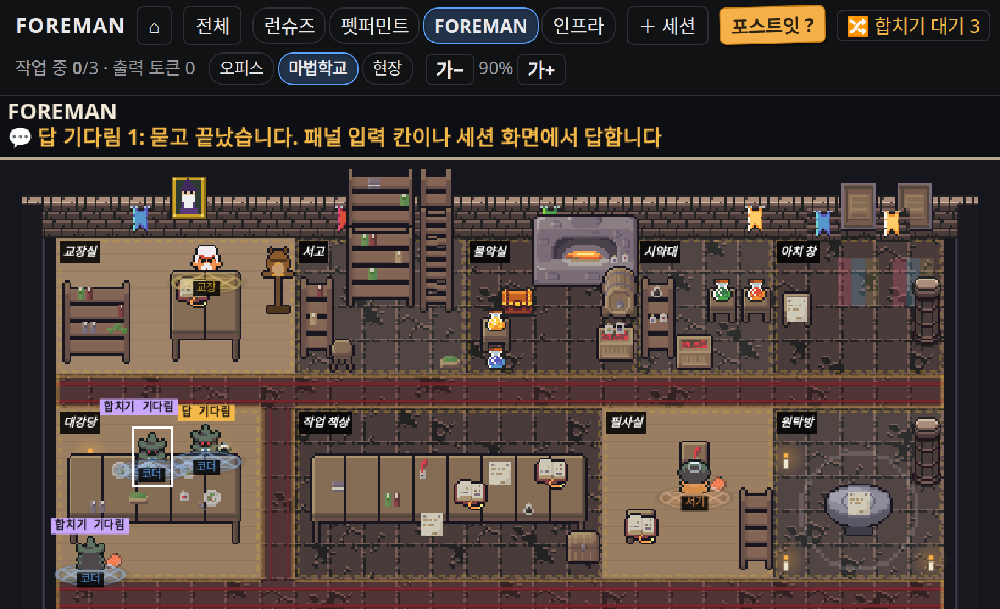

<!--
다루는 곳: bridge/mergeprep.py, bridge/coder_room.py, bridge/inspector_close.py, bridge/worktree.py, bridge/api/coder.py, bridge/static/js/coder.js, bridge/static/js/handoff.js, bridge/static/js/render.js, config/handoff.toml
읽은 커밋: 33839db
-->

# 합치기 카드와 코더 창

> 이 글은 작업방에서 따로 일한 세션이 일을 마쳤을 때 뜨는 합치기 카드와, 방마다 있는 코더 캐릭터의 「맡길 일」 창을 다룹니다.

**세션이 일을 마치면 브리지가 합칠 수 있는지 미리 재 보고 카드를 띄웁니다. 사람(또는 관리자 세션)은 카드를 보고 [합치기]만 누르면 되고, 아직 합치지 않은 일은 캐릭터 머리 위와 코더 창에 남아 잊히지 않습니다.**

같은 저장소에서 여러 세션이 동시에 코드를 고치면 서로의 변경을 밟습니다. 그래서 FOREMAN은 이미 그 프로젝트에 살아 있는 세션이 있으면 새 세션을 작업방(worktree, 같은 저장소를 따로 꺼낸 작업 폴더)에 띄우고, 그 세션은 자기 브랜치(`cc/<이름>`)에만 커밋합니다 → 「새 세션 창」. 합치고 시험하는 관리자 세션만은 예외로 늘 원본 폴더에 뜹니다. 따로 일한 결과는 언젠가 원본(main)에 합쳐야 하는데, 합치기를 잊으면 브랜치가 조용히 남습니다. 이 화면은 그 「언젠가」를 브리지가 대신 알아채 카드로 올리고, 사람이 누를 때까지 화면 여러 곳에 남겨 두는 일을 합니다.

## 일을 마침 판정

브리지는 세션이 응답을 마치는 순간과, 놓친 것을 줍기 위해 1분마다 한 번씩 작업방 세션을 살핍니다. 세션이 살아 있으면서 일하지 않고(열린 턴, 뒤에서 도는 일, 권한 거부로 멈춤이 모두 없음), 또는 세션이 이미 끝났고, 그리고 브랜치에 합칠 커밋이 있고 커밋하지 않은 변경이 하나도 없으면 「일을 마침」으로 봅니다 [code:bridge/mergeprep.py]. 마지막 응답이 사람에게 묻는 말로 끝났어도 일은 마친 것으로 보고, 카드에 「세션이 묻는 말이 있습니다」를 함께 싣습니다. 묻는 말 때문에 카드가 아예 뜨지 않으면 사람은 합칠 일이 있다는 것조차 모르기 때문입니다.

일을 마쳤다고 보면 브리지는 원본을 건드리지 않고 `git merge-tree`로 시험 삼아 합쳐 봅니다. 충돌이 나는지, main이 그 사이에 앞서 나갔는지, 어떤 파일이 바뀌었는지를 이 단계에서 미리 재어 카드에 담습니다 [log:plan_structure_20261111.md]. 카드는 DB에도 남겨서 브리지를 다시 띄워도 되살아납니다 [log:mergeprep_db_20261113.md].

## 합치기 카드

![합치기 카드입니다. 「합치기 승인」 옆에 「승인 기다림」 배지, 그 아래 「커밋 3개 · 바뀐 파일 4개 · 충돌 없음」, 규칙 문서 때문에 「승인해야 할 파일 1개」, 「코드로 걸린 문서 2, 안 고침 1」, 문서 점검 줄이 있고, 펼친 「자세히」에 main이 앞선 것과 걸린 문서 두 줄이, 맨 아래 [합치기] [나중에]가 있습니다 〔실제 화면〕](img/07_merge_card.png)

카드는 그 세션 패널의 「세션 정리」 탭 맨 위에 「합치기 승인」이라는 이름으로 뜹니다. 첫 줄에는 상태 배지와 브랜치 이름, 둘째 줄에는 커밋 수, 바뀐 파일 수, 충돌 여부가 있고, 커밋과 파일 목록은 그 수에 마우스를 올리면 보입니다. 사람이 판단할 때 필요한 것은 「걸린 파일이 무엇인가」 정도라서, 세션이 끝낸 까닭이나 main이 앞섰는지 같은 나머지는 「자세히」 안에 접어 둡니다 [code:bridge/static/js/handoff.js]. 이번에 바뀐 코드를 설명하는 문서가 있으면 「📄 코드로 걸린 문서 N, 안 고침 M」 한 줄도 보입니다. 코드를 고친 세션이 그 문서도 함께 고치기로 해서, 고치지 않은 문서가 몇 개인지 승인하기 전에 바로 알 수 있게 했어요. 코드는 그대로이고 설계 문서나 규칙 문서만 바뀌어 걸린 문서는 「📄 문서로만 걸린 문서」 줄로 따로 셉니다. 둘을 한 수로 보이면 문서만 고친 날 수가 크게 불어나 코드 쪽 밀림까지 함께 지나치게 되거든요. 어느 문서의 어느 줄인지는 「자세히」에 있습니다 [code:bridge/docrefs.py]. 걸린 문서를 셀 때는 합칠 곳(main)의 문서 설정을 씁니다. 그래서 그 브랜치가 문서 설정 파일을 바꿨으면 「이 브랜치가 설정을 바꿨습니다」 경고 한 줄을 더해, 합친 뒤에 수가 달라질 수 있다는 것을 알립니다. 조용히 다른 설정으로 세면 나중에 수가 왜 달랐는지 찾을 수 없기 때문입니다 [code:bridge/mergeprep.py] [code:bridge/static/js/handoff.js]. 문서 점검 결과도 한 줄로 보입니다. 그 브랜치로 문서 점검을 돌려 「이 브랜치로 새로 생긴 틀린 것」이 몇 개인지 알려 주고, 있으면 노랑으로 처음 몇 줄을 「자세히」에 적습니다. 점검을 돌리지 못했을 때는 0으로 보이지 않고 못 돌렸다고 알려 줍니다. 새 시험 파일이 어느 문서에도 덮이지 않았다는 사실을 합치기 전에 바로 알아차리게 하려고 넣었어요 [code:bridge/mergeprep.py].

[합치기]를 누르면 브리지가 한 번 더 잽니다. 카드를 만든 뒤 커밋이 바뀌었으면 합치지 않고 카드를 새로 만듭니다. 충돌이 없으면 살아 있는 세션은 끝내고 main에 합치며, main이 앞섰으면 그 위로 다시 얹습니다(rebase). 충돌이 있으면 합치지 않고, 세션이 살아 있으면 그 세션에게 「main을 가져와 풀라」고 보내고, 끝났으면 관리자 세션에게 넘깁니다. 끝낸 뒤에 충돌을 알면 풀 세션이 없으므로, 살아 있는 세션은 끝내기 전에 임시 폴더에서 rebase가 되는지 먼저 봅니다 [code:bridge/mergeprep.py] [docs:11_worktree.md]. 합치기는 push까지 가지 않습니다. 지금은 네 프로젝트 모두 커밋을 하나로 묶어 합치게 해 두어서, 합친 뒤 카드에는 「main에 커밋 N개를 하나로 합쳤습니다. push는 아직입니다.」 두 가지만 초록으로 남고, 시험과 push는 관리자가 합니다. [나중에]는 카드를 치우되, 세션이 새로 커밋하면 다시 띄웁니다.

## 누가 승인하나

승인자는 프로젝트마다 정합니다. 지금은 네 프로젝트 모두 「관리자」로 두어서, 카드가 생기면 그 프로젝트의 관리자 세션에 알리고 관리자가 승인합니다. 이때 사람 화면에는 「관리자 세션이 승인합니다. 사람이 누를 것은 없습니다.」만 보입니다 [code:config/handoff.toml] [log:merge_approver_20261112.md]. 관리자 세션에 카드를 알리지 못하면 그 카드는 사람 승인으로 바뀌고, 그 사실을 텔레그램으로 바로 알립니다. 다만 규칙 문서(CLAUDE.md 등), 설정 파일, DB 마이그레이션처럼 늘 사람이 봐야 하는 파일이 바뀌었거나(FOREMAN에서는 원고 쓰는 기준 문서도 여기에 들어갑니다. 원고 기준은 사람이 정하는 것이기 때문입니다), 파일을 지웠거나, 자원 크기(cpu, memory 등)를 바꿨으면 그 카드는 사람 승인으로 올라가고, 카드에 「승인해야 할 파일 N개」와 파일 이름이 뜹니다. 커밋 글에 force push처럼 이력을 다시 쓰는 말이 있거나, 서브모듈(저장소 안에 붙인 다른 저장소)이 바뀐 카드도 같은 까닭으로 사람 승인으로 올라갑니다. 관리자가 그 카드를 다른 길로 돌아 합치려 해도 서버가 거부합니다 [code:bridge/mergeprep.py]. FOREMAN 프로젝트에서는 한 가지 예외가 더 있습니다. 읽고 알아보기만 하는 조사 세션이 `log/`에 새 파일만 더했고, 충돌이 없고, 세션이 묻는 말이 없고, 늘 사람이 봐야 하는 까닭도 없으면, 브리지가 승인 없이 합치고 그 세션을 끝냅니다 [code:bridge/inspector_close.py]. 서기실의 [전체]가 줄을 세워 띄운 서기 세션도 같은 길을 씁니다. 그 편 원고 하나(와 기록)만 고쳤고 문서 점검에 새 틀림이 없으면 카드 없이 합칩니다. 원고 수십 편을 고칠 때 편마다 카드가 올라오지 않게 하려는 것입니다. 이때 문서 점검에 새 틀림이 있으면 그 편은 줄의 실패로, 사람 승인 까닭이 있으면 미룬 것으로 넣고 줄은 다음 편으로 넘어갑니다. 다른 파일이 섞였으면 지금처럼 카드로 올리고 줄은 그 카드가 합쳐지기를 기다립니다 [code:bridge/mergeprep.py] [code:bridge/scribe_queue.py]. 줄 자체는 → 「서기실」.

바뀐 파일 가운데 승인 규칙 파일이나 승인을 묻는 안전장치 자신의 파일이 있으면, 승인자가 누구든 카드에 「🛡 규칙 파일이 바뀝니다: approval.toml」처럼 파일 이름이 한 줄 더 뜨고, 전체 경로는 그 줄에 마우스를 올리면 보입니다. 어느 파일을 규칙 파일로 볼지는 브리지가 지금 쓰고 있는 승인 규칙의 보호 목록으로 정합니다. 이 줄은 합치기를 막지도, 승인자를 바꾸지도 않습니다. 규칙 파일은 합친 뒤 브리지를 다시 띄워야 효과가 나기 때문에, 언제 무엇이 바뀌는지 놓치지 않게 알려 두는 표시입니다. 카드가 생길 때 가는 「⑂ 합치기 준비됨」 텔레그램 알림에도 같은 🛡 줄이 붙고, 실제로 합치면 🛡 알림이 한 번 더 갑니다. 🛡 줄이 붙은 이 두 알림은 일상 알림을 모아 보내는 저녁 9시 하루 묶음으로 미루지 않고 바로 갑니다. 바뀌었는지 확인하지 못했을 때는 조용히 「없음」으로 넘기지 않고, 「규칙 파일이 바뀌는지 확인하지 못했습니다」와 그 까닭을 같은 자리에 적습니다.

## 합치기 기다림이 보이는 곳

사람 승인을 기다리는 카드는 평소 그 프로젝트 관리자 머리 위 「사용자 답 기다림」으로 올라갑니다. 관리자 세션이 없거나 올리지 못했을 때만 그 작업 세션 캐릭터 머리 위에 보라색 「합치기 기다림」이 뜹니다. 어느 쪽이든 머리줄에 「합치기 대기 N」 막대가 생기고, 막대를 누르면 가장 오래 기다린 카드의 패널이 열립니다 [code:bridge/static/js/render.js] [log:coder_merge_wait_20261111.md]. 한 캐릭터에 여러 표시가 겹치면 하나만 보이고, 권한 거부나 답 기다림처럼 세션이 막혀 있는 표시가 합치기 기다림보다 먼저 보입니다. 겹칠 때의 전체 순서는 → 「머리 위 표시와 띠」.

## 끝내기 메뉴와 「브랜치 이름」 칸

작업방 세션의 「세션」 칸 [끝내기 ▾]는 세 갈래입니다. 「합치고 끝내기」는 고친 것을 main에 합치고 끝내는데, 끝내기 전에 커밋하지 않은 변경이 있는지 먼저 보고 막습니다. 끝낸 뒤에 알면 그 세션에게 커밋을 시킬 수 없어서입니다. 「커밋만 하고 끝내기」는 지금까지를 작업방 브랜치에 커밋해 두고 세션만 끝내는 「쉬게 하기」이고, 「그냥 끝내기」는 아무것도 하지 않고 세션만 끕니다 [code:bridge/static/js/handoff.js] [log:stage11_worktree_result.md].

끝난 작업방 세션은 「브랜치 이름」 칸에서 main보다 몇 커밋 앞섰는지, 커밋하지 않은 변경이 있는지를 보이고 [합치기]와 [버리기]를 줍니다. 쉬게 한 세션에는 「쉬는 중: 합치기 기다림」과 며칠째인지가 붙고, 같은 일을 이어 하려면 [이어서]로 그 작업방에서 대화를 다시 붙입니다. 화면 파일을 고친 세션이면 [미리보기 열기]로 그 브랜치의 화면을 새 탭에서 볼 수 있습니다.

## 코더 창: 맡길 일

방마다 코더 캐릭터가 하나 있습니다. 코더 세션이 없으면 자리에서 쉬고, 코더 세션이 뜨면 뜬 수만큼 책상으로 가서 일합니다. 코더를 누르면 패널에 그 방의 「맡길 일」과 「지금 일」이 뜹니다 [log:coder_resident_20261109.md].

![FOREMAN 방입니다. 대강당에서 쉬는 코더 머리 위에 「맡은 일 1: 합치기 기다림 · 2일째」가 떠 있고, 오른쪽 코더 창의 「맡길 일 1」에는 쉬게 한 일 「합치기 기다림: 포스트잇 창 접힌 칸 기억」과 그 브랜치 `cc/foreman-2`, [세션 열기]가, 「지금 일 0」에는 지금 도는 코더 세션이 없다는 말이 있습니다 〔시연 재생〕](img/07_merge_coder.png)

맡길 일은 브리지가 이미 아는 신호를 모아 센 것이고, 새로 판단하지 않습니다. 쉬게 해 두고 아직 합치거나 버리지 않은 일, 세션이 끝난 뒤 브리지가 훑어 찾은 어긋난 것(주인 없는 작업방, 커밋 안 된 변경, 남은 브랜치), 파이프라인 실패, 빌드 알림 없음, 승인 대기, 권한 거부가 여기에 들어갑니다 [code:bridge/static/js/coder.js] [code:bridge/coder_room.py]. 쉬게 한 일은 하루가 지나면 「N일째」가 붙어 오래 묵은 것이 눈에 띕니다. 줄마다 [세션 열기]를 누르면 그 세션의 「세션 정리」 탭으로 바로 갑니다. 이 길이 없으면, 끝난 지 오래된 세션의 [합치기]는 화면 어디에서도 닿을 수 없게 됩니다 [log:portfolio_publish_20261106.md]. 커밋도 변경도 없이 비어 있는 작업방은 맡길 일이 아니라 「치울 것」으로 따로 모아 [버리기] 하나로 정리합니다.

[기술문서: 합치기](../notion/07_merge.md)
