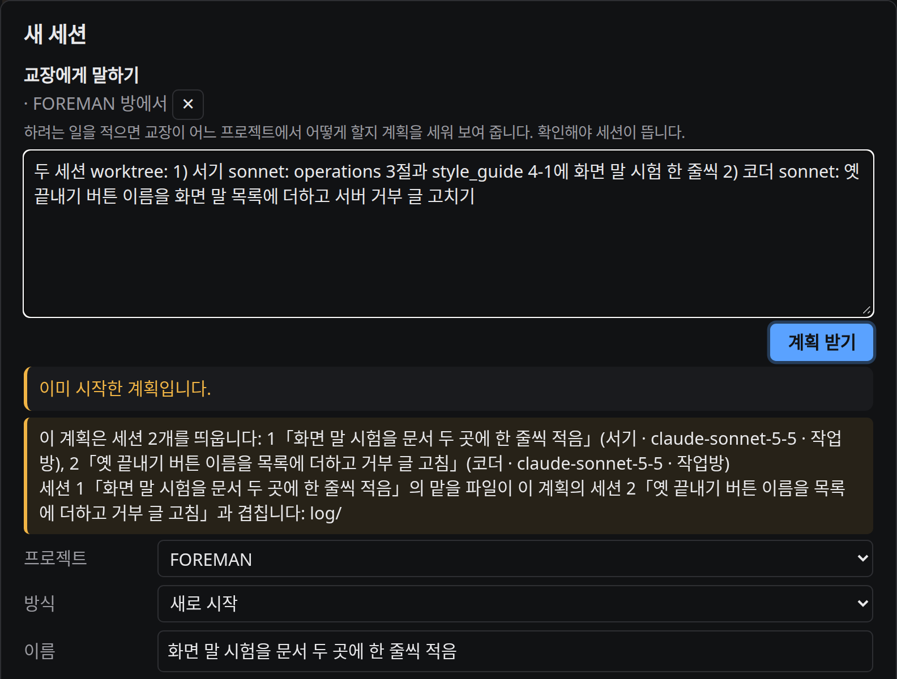
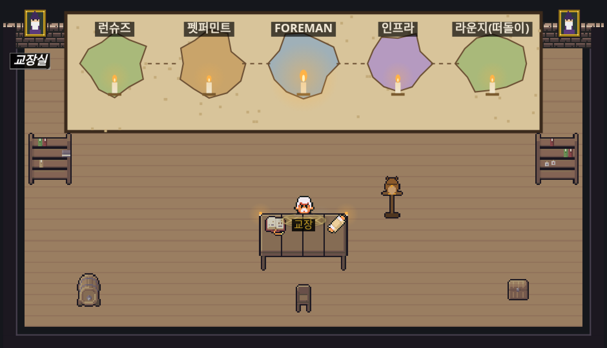

<!--
다루는 곳: bridge/static/js/foremanchat.js, bridge/static/js/fmpanel.js, bridge/foreman.py, bridge/foreman_note.py, bridge/overlap.py, bridge/handover.py, bridge/wake.py, bridge/api/foreman.py
읽은 커밋: ce8a60c
-->

# 교장 계획 창과 감독실

> 이 글은 하려는 일을 말하면 교장이 계획을 세워 주는 창과, 그 계획을 들고 있는 감독실을 다룹니다.

**하려는 일을 한 줄로 적으면 교장이 어느 프로젝트에서, 새 세션을 띄울지 아니면 이미 그 일을 하는 세션에 이어서 보낼지를 정한 계획을 냅니다. 사람이 계획 카드를 보고 고친 뒤 [이대로 시작]을 눌러야 세션이 뜹니다. 같은 일을 이미 하는 세션이 있거나 고칠 파일이 겹치면, 세션을 띄우기 전에 계획 카드에서, 띄운 뒤에는 세션 패널에서 알려 줍니다.**

한 서버에서 여러 프로젝트의 AI 작업 세션(Claude Code를 띄운 창 하나하나)이 함께 돌면, 누가 이미 무엇을 하고 있는지를 사람이 기억해야 합니다. 같은 일을 두 세션에 시키면 아무도 알려 주지 않은 채 시간과 사용량이 두 배로 들고, 같은 파일을 둘이 고치면 나중에 합칠 때 부딪힙니다. 이 창은 그 겹침을 세션을 띄우기 전에 알아채는 자리입니다 [docs:11_foreman_dispatch.md].

계획을 세우는 캐릭터는 테마마다 이름이 다릅니다. 오피스에서는 팀장, 마법학교에서는 교장, 현장에서는 소장이고, 이 글은 마법학교 이름인 교장으로 부릅니다. 교장은 부를 때만 떠서 계획 하나를 내고 끝나며, 파일을 읽을 수만 있습니다(→ 「알려진 한계」). 세션을 띄우는 것, 이미 있는 세션에 글을 보내는 것은 모두 사람이 [이대로 시작]을 누른 뒤에 브리지(화면 뒤에서 세션을 지켜보고 다루는 서버 프로그램)가 합니다 [code:bridge/foreman.py].

## 감독실 [⌂]

머리줄의 [⌂]를 누르면 현장 전체를 내려다보는 감독실로 갑니다. 테마마다 교장실, 팀장실, 소장실로 이름이 바뀝니다. 벽 현황판에는 프로젝트마다 표시가 하나씩 있어 그 프로젝트가 지금 어떤지 한눈에 보입니다. 마법학교에서는 지도 위 촛불이 작업 중이면 밝게, 승인을 기다리면 붉게 타고, 실패하면 꺼져 연기가 납니다. 오피스에서는 모니터 화면의 색, 현장에서는 공정표 자석의 색이 같은 일을 합니다 [code:bridge/static/js/office.js].

교장은 감독실 책상에도 있고, 프로젝트 방마다 있는 교장실에도 있습니다. 감독실의 교장을 누르면 프로젝트를 정하지 않은 채로, 프로젝트 방의 교장을 누르면 그 프로젝트로 계획 창이 열립니다. 교장이 계획을 세우는 동안에는 책상에서 일하는 동작을 하고, 실패가 부른 자동 제안(아래) 가운데 하루 안에 세워 두고 [시작]을 기다리는 것이 있으면 머리 위에 「시작할 일 N」이 뜹니다. 사람이 말해 세운 계획은 이 수에 들지 않습니다 [docs:14_dispatcher_note_wake.md].

## 교장 패널: 진행 중인 일

![FOREMAN 방에서 교장을 누른 화면입니다. 오른쪽 패널에 「교장에게 말하기」 단추, 줄마다 [내리기]가 붙은 「FOREMAN 진행 중인 일 2」, 펼친 「끝난 일 30」이 있고, 끝난 일 줄마다 어떻게 끝났는지(예: 자동, 세션 574 합침)와 [되살리기]가 붙어 있습니다 〔실제 화면〕](img/08_foreman_plan_panel.png)

교장을 누르면 오른쪽 패널에 그 교장이 들고 있는 것이 보입니다. 맨 위는 「진행 중인 일」입니다. 교장은 세션이 없어 대화를 기억하지 못하므로, 프로젝트마다 지금 도는 일 줄기(무엇을, 어느 세션들이, 어디까지)를 짧게 적어 두고 계획을 세울 때마다 함께 읽습니다. 줄을 더하거나 고치자는 것은 교장이 계획에 제안으로 붙이고, 사람이 [이대로 시작]을 누를 때 켜 둔 제안만 반영됩니다. 한 프로젝트에 약 2,000토큰(토큰은 AI가 글을 세는 단위로, 한글 한두 글자쯤)까지만 담고, 넘친 줄은 지우지 않고 접어 둡니다 [code:bridge/foreman_note.py].

적어 둔 줄이 사실처럼 남아 있으면 그것이 조용한 고장입니다. 그래서 줄마다 출처와 마지막 확인 시각이 붙고, 진행 중인 일 줄 가운데 확인한 뒤 사흘이 지났거나 커밋이 150개 이상 쌓인 줄은 「낡음: 확인 필요」로 따로 묶어 계획을 세울 때 믿지 않게 넣습니다. 사람은 [아직 진행 중]으로 확인 시각을 새로 하거나 [내리기]로 뺍니다. 붙은 세션이 모두 끝나고 합치거나 버려서 남은 일이 없으면 브리지가 그 줄을 「끝난 일」로 옮기고 어떻게 끝났는지를 붙입니다. 끝나지 않았는데 옮겨졌으면 [되살리기]로 되돌립니다. 그 아래 「지난 요청」에는 사람이 시킨 요청과 그때 띄운 것, 사람이 계획에서 고친 칸이 쌓여 다음 계획에 함께 들어갑니다 [code:bridge/static/js/fmpanel.js].

## 계획 받기와 계획 카드

패널의 「교장에게 말하기」 단추(테마마다 그 캐릭터 이름이 붙습니다)나 머리줄 [+ 세션]을 누르면 가운데에 「새 세션」 창이 열리고, 맨 위가 교장에게 말하는 칸입니다. 「런슈즈 발볼 검증 이어서」처럼 하려는 일을 적고 [계획 받기]를 누르면 보통 20초쯤 뒤 계획 카드가 뜹니다. 그동안 브리지는 AI 없이 프로젝트 목록, 규칙 파일, 문서 목록, 진행 중인 일, 지난 요청, 살아 있는 세션마다 최근에 받은 사람 요청 셋과 답 첫머리, 옮기기용 요약, 빌드 상황을 모아 교장에게 넘깁니다. 규칙 파일, 문서 목록, 진행 중인 일, 지난 요청은 요청에 이름이 나온 프로젝트(그 방에서 말했으면 그 방)만 넣고, 나머지 프로젝트는 최근 커밋과 세션만 요약해 넣습니다. 이름이 하나도 없으면 모든 프로젝트를 자세히 넣습니다. 세션 제목만으로는 「이어 하기」와 「새로 하기」를 가르지 못해서 최근 요청까지 넣습니다 [log:stage11_foreman_dispatch_result.md].

계획 카드는 칸마다 사람이 고칠 수 있습니다. 먼저 보이는 것은 프로젝트, 방식, 이름, 넣을 첫 글이고, 역할(코더, 디자이너, 서기, 조사 등)과 모델, 읽기 전용 여부, 작업방(worktree, 같은 저장소를 따로 꺼낸 작업 폴더) 여부, 맡을 파일은 [자세히]에 접혀 있되 접힌 줄에 맡을 파일을 뺀 지금 값이 한 줄로 보입니다. 방식은 넷 가운데 하나입니다.

| 방식 | 하는 일 |
|---|---|
| 새로 시작 | 새 세션을 띄우고 첫 글을 넣습니다 |
| 옮기기용 요약 넣고 시작 | 다른 세션이 남긴 요약을 첫 글 뒤에 붙여 새 세션을 띄웁니다 |
| 살아 있는 세션에 보내기 | 같은 일을 이미 하는 세션이 있으면 새로 띄우지 않고 그 세션 입력 칸에 글만 보냅니다 |
| 되묻기(시작하지 않음) | 요청만으로 정하기 어려우면 띄우지 않고 묻는 말만 냅니다 |

살아 있는 세션에 보낼 때는 글을 넣은 뒤 그 세션의 입력 칸이 비었으면 「보냈습니다.」를 띄우고, 입력 칸에 글이 그대로 남아 있거나 입력 칸을 읽지 못했을 때만 「보냈지만 제출을 확인하지 못했습니다.」가 뜹니다 [code:bridge/foreman.py] [code:bridge/inject.py]. 제출을 확인하는 방식과 까닭은 → 「알려진 한계」 6절 「세션에 글을 넣는 길은 tmux 하나입니다」.

![계획 카드 아래쪽입니다. 「세션 2개입니다」와 세션마다 띄울지 켜고 끄는 칸, 펼친 「왜 이렇게 판단했나 · 확신도 80%」, 그리고 [버리기] [다시 물어보기] [관리자에게 보내기] [이대로 시작] 줄이 있습니다. 이미 시작한 계획이라 [다시 물어보기]만 빼고 단추가 잠겨 있습니다 〔실제 화면〕](img/08_foreman_plan_card_more.png)

한 요청으로 세션을 여럿 띄울 수도 있습니다. 「두 세션으로, 하나는 문서, 하나는 코드」처럼 말하면 카드에 세션 칸이 여럿 생기고, 세션마다 이름, 역할, 모델, 맡을 파일, 첫 글을 따로 고치고 띄울지 말지를 켜고 끕니다. 다만 코드를 고친 뒤 그 코드를 설명하는 문서만 맞추는 서기 세션은 교장이 따로 내지 않습니다. 코더 세션이 같은 브랜치에서 그 문서도 함께 고치고, 그 규칙은 브리지가 코더의 첫 글 끝에 붙여 주기 때문입니다. 맨 아래 「왜 이렇게 판단했나」에는 교장이 든 까닭과 확신도가 있고, 확신도가 70%보다 낮으면 처음부터 펼쳐집니다. 교장이 틀렸거나 계획을 받지 못했을 때는 창 아래 「계획 없이 직접 띄우기」를 펼쳐 프로젝트와 이름, 시작 방식을 직접 고릅니다. 새 세션 창의 칸은 → 「새 세션 창」 [code:bridge/static/js/foremanchat.js].

## 겹침 알림

교장이 낸 계획은 그대로 쓰지 않고 브리지가 사실과 다시 맞춰 봅니다. 없는 프로젝트를 골랐으면 되묻기로, 끝난 세션에 보내자고 했으면 새로 띄우기로 바꾸고, 바꾼 것마다 카드 맨 위 노란 칸에 적습니다. 맡을 파일도 이때 맞대 봅니다. 이 계획 안의 다른 세션, 이 프로젝트에 살아 있거나 아직 합치지 않은 세션이 맡은 파일, 하루 안에 세웠지만 아직 시작하지 않은 다른 계획과 겹치면 「맡을 파일이 … 과 겹칩니다」가 뜹니다. 겹친다고 막지는 않고 사람이 보고 정합니다(→ 「알려진 한계」). 겹치는지 보지 못했으면 「보지 못했습니다」로 따로 적어, 겹침이 없는 것처럼 보이지 않게 합니다 [code:bridge/foreman.py].

![세션 982(「코더 — 브리지 복구」) 패널 위에 뜬 띠입니다. 「🔁 겹칠 수도: 세션 983「코더 — 적재 막힘 조사」과 요청 낱말이 겹칩니다. 말에 나왔을 뿐일 수 있습니다.」와 [세션 983 보기] [나중에]가 있고, 아래 대화에 기록 적재 막힘의 원인을 봐 달라는 요청이 보입니다 〔시연 재생, 세션과 요청은 시연용〕](img/08_foreman_plan_overlap.png)

계획 없이 이미 떠 있는 세션에 일을 시키는 경우도 있어, 세션을 띄운 뒤에도 겹침을 봅니다. 사람이 세션에 글을 넣으면 브리지가 같은 프로젝트의 다른 살아 있는 세션이 최근 받은 요청과 맞대 봅니다. 드문 낱말(예: `jenkins-0` 같은 이름)이 겹치면 세션 패널 위에 「겹칠 수도」 띠가 뜨고, 그 세션이 요청에 나온 파일을 실제로 고쳤으면 「겹침」, 두 세션이 최근 같은 파일을 실제로 고쳤으면 빨간 「같은 파일」 띠가 뜹니다. 다른 프로젝트 세션에 거의 같은 글을 또 넣었으면 잘못된 창에 붙였을 수 있다고 알리고 [이 세션 작업 중단] 단추를 함께 냅니다. 낱말만 겹친 것은 띠로만 알리고, 실제로 같은 파일을 고친 것과 다른 프로젝트에 같은 글을 넣은 것은 휴대폰 알림도 보냅니다 [code:bridge/overlap.py] [log:infra_20261106_jenkins-harbor-after-outage.md]. 띠가 뜨는 세션 패널은 → 「세션 패널: 대화와 활동」.

## 실패가 부른 자동 제안

![실패 이벤트가 부른 계획을 연 창입니다. 맨 위에 「실패 이벤트가 부른 제안입니다」와 알림 글(한 세션의 기록 적재가 14분째 같은 자리에서 다섯 번 실패), 「교장이 계획만 세웠습니다. [이대로 시작]을 눌러야 시작합니다.」가 있습니다. 아래에는 교장이 낸 계획(FOREMAN, 새로 시작, 「적재 막힘 원인 조사」)과 「이미 버린 계획입니다.」가 보입니다 〔시연 재생, 실패와 계획은 시연 값이고 창은 실제 화면 코드〕](img/08_foreman_plan_wake.png)

빌드 실패, 빌드 알림 없음, 웹훅 끊김, 인프라 무응답, 기록 적재 막힘처럼 사람에게 알림이 가는 실패가 생기면, 브리지는 알림과 같은 때에 교장을 불러 원인을 살펴볼 세션 계획을 미리 세워 둡니다. 같은 실패는 12시간에 한 번, 하루 다섯 번까지만 부릅니다. 계획은 텔레그램 알림과 감독실 교장 머리 위 「시작할 일 N」으로 알리고, 누르면 위처럼 실패 알림 글이 붙은 계획 창이 열립니다. 이때도 세션은 사람이 [이대로 시작]을 눌러야 뜹니다. 계획을 세우지 못했으면 그것도 알립니다 [code:bridge/wake.py] [log:stage14_dispatcher_note_wake_result.md]. 알림은 → 「텔레그램 알림」.

## 관리자에게 보내기

[관리자에게 보내기] 단추는 설정에서 이 기능을 켰을 때만 보이고, 지금은 켜져 있습니다. 프로젝트마다 그 프로젝트를 맡은 관리자 세션이 있으면, 계획 카드의 [관리자에게 보내기]로 사람이 고친 계획을 그 관리자에게 넘길 수 있습니다. 관리자는 사람 대신 세션을 띄우고, 합치고, 시험하는 세션입니다. 넘기면 관리자 입력 칸에 계획 요약과 시작 명령이 들어가고, 관리자가 그 계획대로 띄우면 교장 [시작]과 같은 길이라 기록이 그대로 이어집니다. 관리자가 없으면 단추가 잠기고 호버에 까닭이 나오며, 넘긴 뒤 15분 안에 띄우지 않으면 텔레그램으로 한 번 알립니다. 넘긴 계획을 다시 열면 「관리자에게 넘긴 계획입니다. 관리자가 아직 띄우지 않았습니다」가 보이고, 사람이 직접 [이대로 시작]을 눌러도 됩니다 [code:bridge/handover.py] [log:coder_c_wave2_20261111.md].

[기술문서: 교장과 관리자](../notion/09_dispatcher.md)
