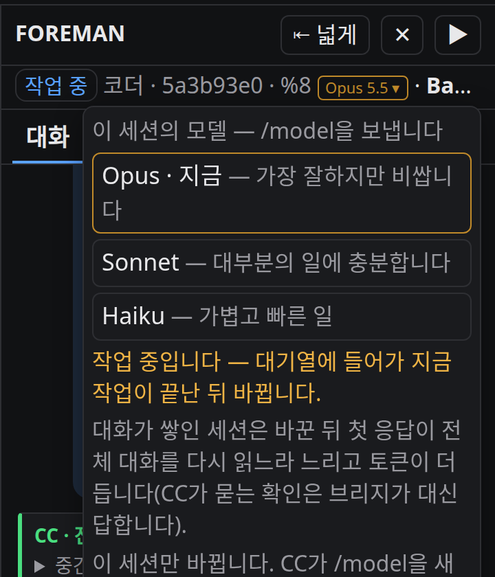
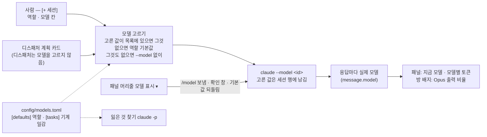
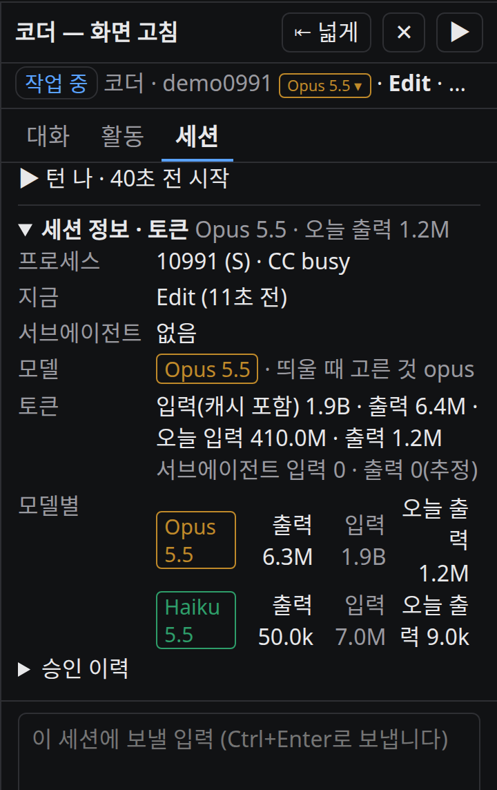

# 모델 고르기와 비용

> 이 글은 여러 Claude Code 세션과 기계 일감(`claude -p`)에 Opus · Sonnet을 어떻게 나눠 쓰는지, 싼 모델로 충분한지를 정답과 맞대 정한 방법, 그리고 실제로 쓴 토큰 숫자를 다룬다.

**판단이 드는 일과 사람이 읽는 글은 Opus, 양이 많고 결과를 사람이 다시 보는 기계 일감은 Sonnet으로 나눴다. "Sonnet으로 충분한가"는 감으로 정하지 않고, 사람(또는 Opus)이 한 결과를 정답으로 두고 같은 입력으로 맞대 재현율 · 정밀도 · 비용을 본 뒤 사람이 정했다 — 압축 손실 판정은 Opus 손 점검 35.4만 토큰 · 13.5분을 Sonnet 1.99달러 · 7.2분(재현율 0.71 · 정밀도 0.91)으로 바꿨다.** 다만 실제로 쓴 토큰은 아직 거의 다 Opus다(출력의 99.5%). 모델 고르기는 이제 막 들어갔고, Sonnet 기본값 대부분은 맞대 보지 않았다 [log:stage12_model_choice_result.md] [log:handoff_v2_d_result.md] [log:foreman_compaction_loss_20261105.md].

전체 구조는 → 「한눈에 — FOREMAN이 무엇인가」, 압축 손실 판정의 시도별 수치는 → 「압축 손실을 재고 메우기」, 디스패처가 Sonnet인 이유와 판단 과정은 → 「디스패처 — 같은 일을 하는 세션을 알아채기」에 있다.

## 1. 문제 — 모든 세션이 같은 모델로 떴고, 어디서 쓰는지 보이지 않았다

- 모델을 고르는 곳이 없었다. 모든 세션이 Claude Code 설정의 기본값(Opus)으로 떴다 [log:stage12_model_choice_result.md]
- Opus가 어디에 쓰이는지 화면에 보여야 한다는 요청이 있었다. 서기(문서 담당)가 일감마다 모델을 고르려면 어차피 필요한 일이라 서기보다 먼저 넣었다 [log:stage12_model_choice_result.md] [c:05e9004]
- 사람이 아닌 브리지가 부르는 일감(`claude -p`)이 생겼다. 요청마다 한 번 도는 디스패처, 압축으로 잊은 지시를 찾는 판정이다 [docs:11_foreman_dispatch.md] [docs:11_handoff_v2.md]
  - 압축 손실 판정을 처음 손으로 할 때는 그 세션의 모델(Opus) 에이전트 둘이 35.4만 토큰 · 13.5분을 썼다. 버튼으로 만들면 세션마다 반복된다 [log:foreman_compaction_loss_20261105.md]
- 모델 바꾸기 자체도 조용히 틀어질 수 있었다. Claude Code의 `/model`은 그 세션만이 아니라 새 세션의 기본값까지 저장한다(4-1) [log:stage12_model_choice_result.md]

## 2. 판단 — 무엇을 고르고 무엇을 버렸나

| 고른 것 | 버린 것 | 이유 | 근거 |
|---|---|---|---|
| 역할별 기본값: 코딩 · 서기 Opus, 점검 · CI/CD Sonnet | 모든 세션 Opus(그때까지의 상태) | 코딩은 판단, 서기는 사람이 읽는 글이다. 점검 · CI/CD를 Sonnet으로 둔 것은 이번에 처음 정한 값이고 맞대 보지 않았다 | [log:stage12_model_choice_result.md] [docs:12_scribe.md] |
| 기계 일감은 **정답과 맞대 고른다** | 감으로, 또는 "비싼 쪽이 안전" | 같은 입력 · 같은 맥락에서 재현율 · 정밀도 · 비용을 숫자로 본다. 고르는 것은 사람이 한다 | [log:handoff_v2_d_result.md] |
| Sonnet 3차 결과로 확정, **Opus 판정 비교는 하지 않음** | Opus로도 같은 판정을 돌려 비교 | 정밀도가 높아 없는 것을 만들지 않고, 놓친 것은 사람이 보탠다. 결과는 사람 승인을 거쳐야 문서에 들어간다 | [log:handoff_v2_d_result.md] |
| 실제로 쓴 모델은 **응답마다 남은 `message.model`**로 보인다 | 띄울 때 고른 값만 보인다 | 세션 안에서 `/model`로 바꿀 수 있다. 고른 값과 실제가 다를 수 있다 | [log:stage12_model_choice_result.md] |
| 모델 id는 별칭(opus · sonnet · haiku) | 버전까지 박은 id | Claude Code가 그때의 최신으로 푼다. 대신 바뀌어도 설정은 그대로다(6절) | [log:stage12_model_choice_result.md] |
| 모델은 설정 파일(`config/models.toml`)로 뺐다 | 코드에 박기 | 역할 기본값 · 기계 일감 모델을 코드 고치지 않고 바꾼다 | [c:05e9004] [c:606ab25] |
| 다른 회사 모델(Codex)을 붙이기 전에 **같은 일을 Sonnet으로 먼저 맞댄다** | 바로 설치 | 설치 · 권한 잠금 · 따로 청구가 다 드는 일이다. Sonnet으로 충분하면 붙이지 않는다 | [log:later_codex_bridge.md] |

## 3. 구조 · 흐름

### 3-1. 어디에 무엇을 쓰나

| 자리 | 모델 | 정한 방법 | 근거 |
|---|---|---|---|
| 코딩 세션 | Opus | 역할 기본값 | [log:stage12_model_choice_result.md] |
| 서기 세션(회고 · 포트폴리오) | Opus | 역할 기본값 — 사람이 읽는 글 | [docs:12_scribe.md] [log:stage12_scribe_result.md] |
| 점검 · CI/CD 세션 | Sonnet | 역할 기본값 — 처음 정한 값, 맞대기 안 함 | [log:stage12_model_choice_result.md] |
| 디스패처(요청마다 `claude -p` 한 번 — 사람이 부르거나 실패 이벤트가 부름) | Sonnet | 설계 — 입력 10~25k 토큰짜리 계획(+ 노트 최대 약 2k), 승인 없이는 아무것도 시작하지 않는다. 자동 기상은 하루 5번까지 | [docs:11_foreman_dispatch.md] [docs:14_dispatcher_note_wake.md] |
| 압축으로 잊은 것 찾기(`claude -p`, 묶음 여러 번) | Sonnet | **정답과 맞대 확정**(사용자) | [log:handoff_v2_d_result.md] |
| 서기의 가벼운 일감(동기화 · 다듬기) | Sonnet 권장 | 어림만 — 실제로 돌려 맞대지 않았다 | [docs:12_scribe.md] |

### 3-2. 세션을 띄울 때 모델이 정해지는 길

- 역할을 바꾸면 모델이 그 역할의 기본값으로 따라간다. 사람이 모델을 직접 고른 뒤에는 따라가지 않는다 [log:stage12_model_choice_result.md]
- 목록에 없는 id · 셸에 넣을 수 없는 id는 버리고, API로 보내도 거부한다 [log:stage12_model_choice_result.md]
- 세션을 [새로 띄우기]로 바꿀 때 원래 세션의 역할 · 모델을 이어받는다 [log:stage12_model_choice_result.md]

### 3-3. 정답과 맞대 모델을 정하는 방법

압축으로 잊은 것 찾기에서 쓴 순서다. Codex 비교도 같은 방법으로 하기로 했다 [log:handoff_v2_d_result.md] [log:later_codex_bridge.md].

1. **정답을 고정한다** — 사람이 확인한 결과, 없으면 비싼 모델로 손으로 한 결과. 여기서는 Opus 에이전트 둘의 손 점검 142항목 [log:handoff_v2_d_result.md]
2. **입력을 같게 한다** — 추출 결과(구간 8개의 프롬프트 · 요약 전문)가 정답과 글자 그대로 같은지 먼저 확인했다. 지금의 규칙 파일은 점검 뒤 고쳐졌으므로 정답 때의 맥락을 그대로 넣었다. 판정 품질만 보려고 [log:handoff_v2_d_result.md]
3. **항목이 아니라 단위로 맞댄다** — 모델마다 항목을 고르는 결이 달라 1:1로 못 맞춘다. 프롬프트 단위의 재현율 · 정밀도, 상태별 개수, 저장소 위치를 찾은 수로 본다 [log:handoff_v2_d_result.md]
4. **빠짐을 기계로 센다** — 싼 모델이 조용히 얇게 훑지 않게, 묶음의 모든 입력이 결과에 나왔는지 센다 [log:handoff_v2_d_result.md]
5. **비용 · 시간을 같이 적고 사람이 고른다** — 결과가 바로 쓰이지 않고 사람 승인을 거치는지도 판단에 넣는다 [log:handoff_v2_d_result.md]

판정 품질을 올린 세 번의 시도(묶음 크기 · 빠짐 세기 · 지시 다듬기)는 → 「압축 손실을 재고 메우기」에 있다. 여기서는 모델 결정에 쓴 숫자만 옮긴다.

| | 정답(Opus 에이전트 2개, 손) | Sonnet 3차(`claude -p`, 20개씩 5묶음) |
|---|---|---|
| 항목 | 142 | 168 |
| 잃은 프롬프트 재현율 · 정밀도 | — | 0.71 · 0.91 |
| 잃은 것 중 저장소 위치를 찾음 | 56 | 50 |
| 비용 · 시간 | 35.4만 토큰 · 13.5분 | 1.99달러 · 7.2분 |

- 사용자 결정(11-06) — "재현율 0.71이면 충분해. 정밀도 0.91이라 없는 걸 만들어내지 않으니까, 놓친 건 내가 보다가 추가하면 되고" [log:handoff_v2_d_result.md]
- Opus 비교를 하지 않은 이유도 사용자가 정했다 — "$10 쓸 가치가 없고, 어차피 c에서 내가 승인하니 마지막 관문이 사람이잖아" [log:handoff_v2_d_result.md]
- 설정 `[tasks] losscheck = "sonnet"`으로 남겼다. 확인 창에는 "프롬프트 20개당 약 0.4달러 · 1.5분"으로 비용을 미리 보인다 [c:606ab25] [log:handoff_v2_d_result.md]

## 4. 겪은 문제와 풀이

### 4-1. `/model`이 새 세션의 기본값까지 바꿨다

- 패널에서 "이 세션만" 모델을 바꾸려고 `/model <id>`를 보냈다. Claude Code는 이것을 사용자 설정의 기본값으로도 저장한다("saved as your default for new sessions") [log:stage12_model_choice_result.md]
  - 브리지가 띄우는 세션은 `--model`을 넘기므로 영향이 없다. 터미널에서 그냥 띄우는 세션이 말없이 다른 모델로 뜬다
- 풀이: 브리지가 보내기 전 값을 기억했다가, 바뀐 것을 확인한 뒤 그 키만 되돌린다(없었으면 지운다) [c:4047a49] [log:stage12_model_choice_result.md]

### 4-2. 옛 줄을 새 결과로 읽어 너무 일찍 "되돌릴 것 없음"으로 끝났다

- 처음에는 "마지막 `/model` 뒤에 'Set model to'가 있나"로 바뀐 것을 확인했다 [log:stage12_model_choice_result.md]
- 시험 세션 화면에 앞선 시험의 같은 줄이 남아 있었다. 새 명령이 그려지기 전에 옛 줄을 읽고 끝냈고, 그 뒤 저장된 `"model": "sonnet"`이 남았다. 다음 요청은 그 값을 원래 값으로 읽었다 [log:stage12_model_choice_result.md]
- 풀이: 보내기 전에 스크롤 기록까지 그 줄의 수를 세 두고, **늘어났을 때만** 바뀐 것으로 본다. 시험 중 바뀐 기본값 둘은 지워 원래 상태(키 없음)로 되돌렸다 [log:stage12_model_choice_result.md]

### 4-3. 대화가 쌓인 세션에서 모델을 바꾸면 전체를 다시 읽는다

- Claude Code가 확인 창을 띄운다 — 지금 대화는 지금 모델로 캐시돼 있고, 바꾸면 전체 기록을 다시 읽는다 [log:stage12_model_choice_result.md]
- 사람이 이미 패널에서 골랐으므로 커서가 "Yes"에 있을 때만 브리지가 Enter를 누른다. 목록에 "바꾼 뒤 첫 응답은 느리고 토큰이 든다"를 적었다 [log:stage12_model_choice_result.md]
- 작업 중이면 명령이 대기열에 들어간다. 지금 일이 끝난 뒤 실행되므로 뒤에서 최대 30분 따라가며 확인 창 · 되돌리기를 한다 [log:stage12_model_choice_result.md]

### 4-4. 토큰을 두 번 세지 않기

- 한 API 메시지가 트랜스크립트에서 여러 줄로 나뉘고 줄마다 같은 사용량이 붙는다. 토큰은 메시지 id 단위로 센다(상세는 → 「관찰 파이프라인 — 조용한 고장을 잡는다」) [log:01_kickoff_result.md]
- 서브에이전트 토큰은 원래 메시지에서 나온다. 모델별 집계는 메시지만 묶어 서브에이전트 합을 다시 더하지 않는다 [log:stage12_model_choice_result.md]
- Claude Code가 만든 가짜 응답(`<synthetic>`)은 모델별 집계에서 뺐다 [log:stage12_model_choice_result.md]
- 방 배지의 "오늘 출력"은 본 대화만 센다. 그래서 Opus 비율은 모델별 합끼리 내고 "서브에이전트 포함"이라고 적었다 [log:stage12_model_choice_result.md]

### 4-5. 기계 일감의 비용은 세션 집계 밖에 있다

- `claude -p`는 세션 기록을 남기지 않게 띄운다. 그래서 세션 토큰 표에 잡히지 않는다 — 회고를 쓸 때 Sonnet 판정 1.99달러가 모델별 표에 없었다 [log:retro_20261105_foreman.md]
- 잃은 것 찾기는 묶음마다 Claude Code가 돌려주는 비용을 받아 점검 행에 합으로 남기고 진행 중에도 보인다 [log:handoff_v2_d_result.md]
- 디스패처는 걸린 시간과 넣은 맥락 길이만 남기고 토큰 · 비용은 남기지 않는다. 아직 고치지 않았다(6절)

## 5. 결과 · 숫자

DB 모델별 토큰 — 10-12 ~ 11-06(KST), 서브에이전트 포함, `<synthetic>` 제외. 11-06 오후에 `message` 표를 직접 집계했다(파일 근거 없음).

| 모델 | 메시지 | 출력 | 캐시 읽기 | 캐시 쓰기 | 캐시 안 된 입력 |
|---|---|---|---|---|---|
| Opus 5.5 | 19,765 | 1,749만(서브에이전트 92만) | 54.1억 | 7,044만 | 4.1만 |
| Opus 4.8 | 178 | 48만 | 6,571만 | 85만 | 2.5만 |
| Haiku 5.5 | 155 | 9.4만 | 700만 | 71만 | 330 |
| Sonnet 5.5 | 6 | 472 | 23만 | 3.1만 | 14 |

- **출력의 99.5%가 Opus다.** Opus 4.8은 첫날(10-12)에만 있다. Haiku는 띄울 때 고른 적이 없고(시험 세션 셋 빼고), Claude Code 내부 호출(제목 붙이기 등)로 보인다. 세션 Sonnet 6개는 실제로 띄워 본 점검 시험 세션 하나다 [log:stage12_model_choice_result.md]
- 서브에이전트 출력 토큰은 믿기 어려운 값이라는 것을 처음에 확인해 두었다. 위 서브에이전트 출력은 참고로만 본다 [log:01_kickoff_result.md]
- 캐시 읽기가 출력의 약 300배다. 긴 세션은 응답마다 쌓인 맥락을 다시 읽는다 — 모델만큼 맥락 길이가 비용을 정한다. 대화 중 모델을 바꾸면 이 캐시를 버리고 다시 읽는 이유이기도 하다(4-3)

세션 · 기계 일감:

| 무엇 | 숫자 | 근거 |
|---|---|---|
| 모델을 골라 띄운 세션 | 코딩 Opus 8 · 서기 Opus 12, 점검 Sonnet 1(시험, 숨김). 모델 칸이 빈 코딩 세션 42개는 모델 고르기 전에 띄웠거나 터미널에서 띄워 붙인 것(Claude Code 기본값) — DB 집계 | — |
| 실제로 띄워 확인 | 점검 역할 → `claude --model sonnet`, 화면 "Sonnet 5.5", 세션 행 role inspector · model sonnet. 끝낸 뒤 숨김(시험) | [log:stage12_model_choice_result.md] |
| 디스패처 | 5건 모두 Sonnet. 계획이 나온 건 평균 약 20초, 넣은 상황 약 1만 자 — DB 집계. 설계 어림은 요청당 입력 10~25k · 출력 1~2k 토큰 | [docs:11_foreman_dispatch.md] [docs:12_scribe.md] |
| 압축 손실 판정 | Opus 손 점검 35.4만 토큰 · 13.5분 → Sonnet 1.99달러 · 7.2분, 재현율 0.71 · 정밀도 0.91 | [log:foreman_compaction_loss_20261105.md] [log:handoff_v2_d_result.md] |
| 시험 | 모델 고르기 때 Python 376(+4) · JS 32 | [log:stage12_model_choice_result.md] |

## 6. 한계 · 다음

- **Sonnet 기본값 대부분은 맞대 보지 않았다.** 정답과 맞대 정한 것은 압축 손실 판정 하나다. 점검 · CI/CD 세션, 디스패처, 서기의 가벼운 일감은 설계 판단이나 처음 정한 값이다 [log:stage12_model_choice_result.md] [docs:12_scribe.md]
  - 디스패치는 5건뿐이라 정확도도 못 쟀다 → 「디스패처 — 같은 일을 하는 세션을 알아채기」 [c:06c3e52]
- **실제 사용은 거의 다 Opus다.** 역할 기본값이 들어간 뒤 점검 · CI/CD 세션을 실제 일로 띄운 기록이 없어, 모델을 나눠 얼마나 아꼈는지는 아직 숫자가 없다
- **정답도 모델(Opus) 판정이다.** 참값이 아니다. 재현율 0.71은 잃은 프롬프트 열에 셋을 놓친다는 뜻이고, 뒤집힌 결정을 섞을 수 있어 사람 승인에 기댄다 [log:handoff_v2_d_result.md]
- **압축이 있는 실제 세션에서 판정 버튼을 누른 기록은 아직 없다.** 1.99달러는 손으로 돌린 같은 세션의 값이다 [log:handoff_v2_d_result.md]
- **비용이 한 곳에 모이지 않는다.** 세션은 토큰만 있고 달러가 없다. 기계 일감은 세션 표 밖이고, 디스패처는 토큰 · 비용을 남기지 않는다. 디스패처 모델도 설정 파일이 아니라 코드 기본값이다 [log:retro_20261105_foreman.md]
- **별칭을 쓰므로 Claude Code가 새 모델을 내면 기본값이 말없이 바뀐다.** 응답마다 실제 모델을 보이므로 화면에는 드러나지만, 바뀌었다고 알리지는 않는다
- 다음 — 다른 회사 모델(Codex). 쓸 데는 둘이다: 양이 많은 반복 일을 떠넘기기, 같은 모델끼리 같은 것을 놓치지 않게 다른 모델의 의견 받기. 붙이기 전에 같은 일을 Sonnet으로 먼저 맞댄다. 리뷰는 같은 회사 모델끼리 맹점이 겹칠 수 있어 Sonnet이 충분해도 Codex를 따로 볼 이유가 남는다. 설치는 하지 않았다 [log:later_codex_bridge.md] [c:14811ae]
