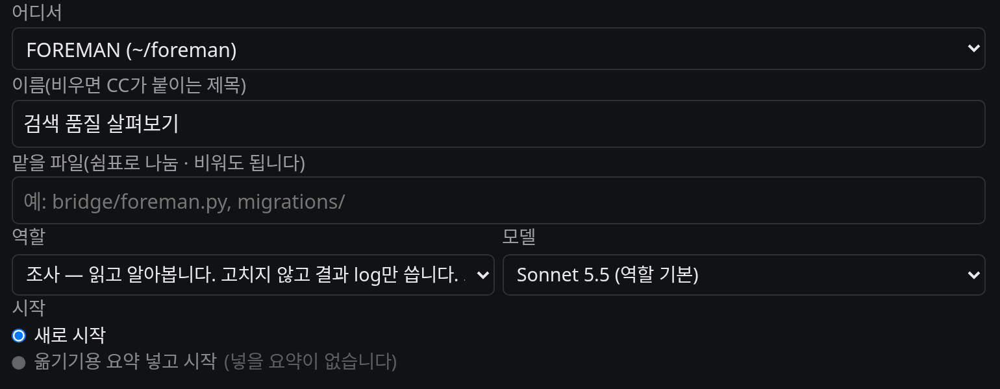

<!--
다루는 곳: bridge/static/js/newsession.js, bridge/static/js/modelpick.js, bridge/static/js/roles.js, bridge/roles.py, bridge/model_choice.py, bridge/worktree.py, bridge/handoff.py, bridge/api/handoff.py, config/models.toml
읽은 커밋: 9a7c22d
-->

# 새 세션 창

> 이 글은 머리줄 [+ 세션]으로 여는 창에서 프로젝트, 역할, 모델을 골라 화면에서 바로 세션을 띄우는 길을 다룹니다.

**셸에 가서 폴더를 옮기고 `claude`를 치는 대신, 창 하나에서 어디서 무엇을 맡겨 어떤 모델로 띄울지 고르고 [띄우기]를 누르면 됩니다. 브리지는 이미 같은 프로젝트에 세션이 돌고 있으면 새 세션을 저절로 작업방에 띄워 서로의 변경을 밟지 않게 합니다.**

![[+ 세션] 창 — 위는 감독에게 말하기, 아래는 펼친 「계획 없이 직접 띄우기」입니다. 어디서, 이름, 맡을 파일, 역할과 모델, 시작 방식을 고르고 [띄우기]를 누릅니다. 경로는 시연용입니다 〔시연 재생〕](img/09_new_session_window.png)

[+ 세션]을 누르면 창 위쪽에 「감독에게 말하기」 칸이 먼저 보입니다. 하려는 일을 말로 적으면 감독이 어느 프로젝트에서 어떤 역할로 할지 계획을 세워 보여 주는 길이고, 그 이야기는 따로 다룹니다 → 「교장 계획 창과 감독실」. 이 글은 그 아래 접혀 있는 「계획 없이 직접 띄우기」, 곧 사람이 칸을 직접 골라 바로 띄우는 길입니다. 계획이 틀렸거나 무엇을 띄울지 이미 정해 두었을 때 씁니다.

## 어디서

「어디서」 칸은 FOREMAN이 아는 프로젝트(저장소 폴더) 목록이고, 지금 보고 있는 방의 프로젝트가 먼저 골라져 있습니다. 목록 맨 끝의 「프로젝트 없이 폴더 고르기(떠돌이)」를 고르면 폴더를 한 단계씩 들어가며 고를 수 있고, 최근에 쓴 폴더도 단추로 나옵니다. 고를 수 있는 폴더는 집 폴더와 `/tmp` 아래뿐이고, 화면은 폴더 이름만 받아 볼 뿐 파일 내용은 읽지 않습니다 [code:bridge/api/handoff.py]. 프로젝트 없이 띄운 세션은 지도에서 떠돌이 라운지에 섭니다.

「이름」을 비워 두면 Claude Code가 첫 대화를 보고 붙이는 제목을 씁니다. 「맡을 파일」은 이 세션이 고칠 파일이나 폴더를 쉼표로 적는 칸입니다. 비워도 되지만, 적어 두면 띄우기 기록에 남고 다른 살아 있는 세션이나 계획과 겹칠 때 띄운 뒤 바로 알려 줍니다 [code:bridge/static/js/newsession.js].

## 역할과 기본 모델

「역할」은 이 세션이 무엇을 하는지입니다. 역할 이름과 한 줄 설명은 파이썬과 화면 코드에 한 곳씩만 두고, 시험이 둘이 어긋나지 않는지 봅니다 [code:bridge/roles.py] [code:bridge/static/js/roles.js] [docs:roles.md]. 역할을 고르면 「모델」 칸이 그 역할의 기본 모델로 따라갑니다. 사람이 모델을 직접 바꾼 뒤에는 역할을 바꿔도 따라가지 않습니다 [code:bridge/static/js/modelpick.js].

| 역할 | 하는 일(창에 보이는 설명) | 기본 모델 |
|---|---|---|
| 코더 | 코드를 고치거나 만듭니다 | Opus 5.5 |
| 디자이너 | 화면을 고칩니다. js, css, 테마, 캐릭터, 호버 글 | Opus 5.5 |
| 관리자 | 합치고 시험하고 push하고 기록합니다 | Opus 5.5 |
| 서기 | 문서를 쓰고 맞춥니다 | Opus 5.5 |
| 조사 | 읽고 알아봅니다. 고치지 않고 결과 log만 씁니다 | Sonnet 5.5 |

기본값은 설정 파일에 있습니다 [code:config/models.toml]. 모델 칸에는 Opus 5.5, Opus 5, Sonnet 5.5, Haiku 5.5, Fable 5.2가 있고, 맨 위 「CC 설정 따르기」를 고르면 모델을 정하지 않고 Claude Code의 설정대로 띄웁니다. 목록에 없는 모델 이름을 API로 보내면 서버가 거부합니다 [code:bridge/model_choice.py] [log:stage12_model_choice_result.md].

띄운 뒤에 모델을 바꾸려면 그 세션 패널 머리줄의 모델 표시를 누릅니다. 그 메뉴는 그 세션 하나만 바꾸고, [+ 세션]으로 따로 띄우는 세션은 그 값을 따르지 않습니다.

## 작업방은 저절로

창에는 작업방을 켜고 끄는 칸이 없습니다. 브리지가 정합니다. 고른 프로젝트에 이미 살아 있는 세션이 하나라도 있으면, 새 세션은 작업방(worktree, 같은 저장소를 따로 꺼낸 작업 폴더)에서 자기 브랜치로 뜹니다. 아무도 없으면 원본 폴더에서 뜹니다 [code:bridge/handoff.py] [code:bridge/worktree.py]. 같은 폴더에서 두 세션이 동시에 파일을 고치면 서로의 변경을 덮어쓰거나, 남이 만든 변경을 자기 것으로 커밋하기 쉽기 때문입니다. 작업방 세션의 머리줄에는 「작업방 foreman-5」처럼 이름이 붙고, 일을 마치면 합치기 카드가 뜹니다 → 「합치기 카드와 코더 창」.

관리자 역할만은 예외로 늘 원본 폴더에서 뜹니다. 합치고 push하는 자리가 원본이기 때문입니다. 그래서 원본 폴더에 이미 관리자가 살아 있으면 두 번째 관리자는 띄우지 않고, 작업방 안에서 관리자를 띄우려 해도 「관리자는 원본 폴더에서만 띄웁니다」라고 거부합니다. 이 거부는 tmux 창이나 작업방을 만들기 전에 해서, 거부된 뒤에 빈 자리가 남지 않습니다 [code:bridge/handoff.py].

## 옮기기용 요약 넣고 시작

「시작」에서 「옮기기용 요약 넣고 시작」을 고르면, 다른 세션이 남긴 요약을 새 세션의 첫 입력으로 넣고 띄웁니다. 요약은 고른 프로젝트의 것만 세션별로 묶여 나오고, 가장 최근 것이 저절로 골라지지 않습니다. 사람이 세션을 직접 골라야 하고, 고르면 넣을 글 전체를 창 안에 먼저 보여 줍니다. 그 프로젝트에 넣을 요약이 하나도 없으면 이 칸은 꺼지고 「(넣을 요약이 없습니다)」가 붙습니다 [code:bridge/static/js/newsession.js]. 요약 속 「읽을 곳」이 틀렸으면 세션을 띄우기 전에 거부합니다. 요약을 만드는 쪽 이야기는 → 「세션 정리: 인계와 옮기기」.

## 띄운 뒤

[띄우기]를 누르면 브리지가 tmux 안에 세션을 만들고 `claude`를 실행한 뒤, 첫 입력이 들어가기 전에 세션 행을 먼저 만듭니다. 그래서 창이 닫히자마자 지도에 캐릭터가 서고 그 패널이 열립니다 [code:bridge/handoff.py]. 처음 쓰는 폴더라 Claude Code가 「이 폴더를 믿을지」 묻는 창을 띄우면, 브리지는 그것을 알아채 어느 tmux 창에서 답하면 되는지 알리고 5분 동안 뒤에서 기다렸다가 이어 갑니다. 45초 안에 세션을 찾지 못하면 그 사실을 창에 노란 글로 남깁니다. 띄우기가 조용히 실패해 사람이 빈 화면만 보고 기다리는 일이 없게 한 것입니다.

[기술문서: 세션 띄우기](../notion/06_sessions.md)
