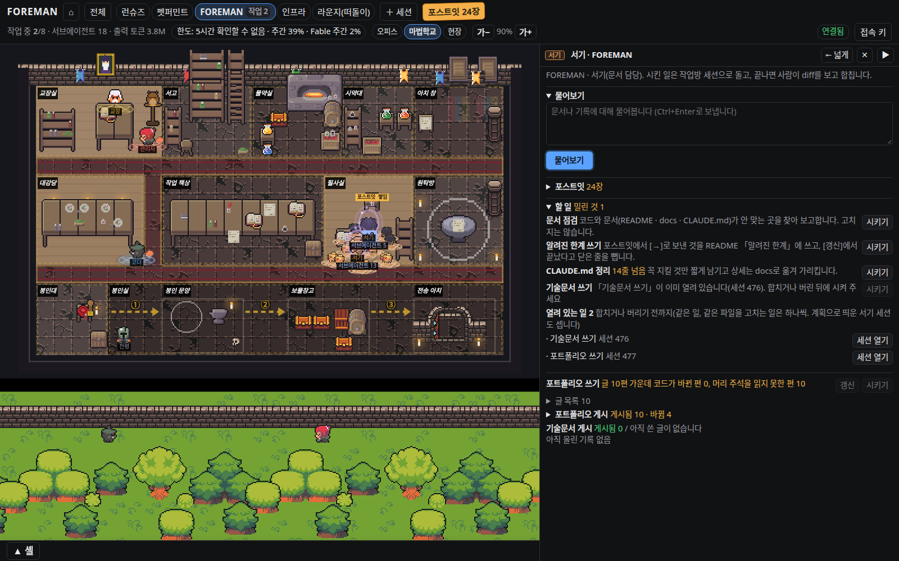

<!--
다루는 곳: bridge/static/js/scribe.js, bridge/scribe_room.py, bridge/scribe_queue.py, bridge/scribe_ask.py, bridge/notion.py, bridge/docsync.py, bridge/manuscript.py, bridge/api/scribe.py, bridge/api/publish.py, config/notion.toml
읽은 커밋: fb7121b
-->

# 서기실

> 이 글은 문서 담당 서기에게 문서 일을 시키고, 문서에 대해 묻고, 글을 Notion에 올리는 서기실 창을 다룹니다.

**프로젝트마다 문서를 맡은 서기가 있고, 서기를 누르면 서기실 창이 열립니다. 브리지가 AI 없이 센 밀린 문서 일이 한 목록으로 보이고, [시키기]를 누르면 서기 세션이 작업방에서 그 일을 한 뒤 사람이 고친 내용을 보고 합칩니다. 세션을 띄우지 않고 문서에 대해 한 번 묻는 [물어보기]와, 포트폴리오와 기술문서를 Notion에 올리는 게시도 같은 창에 있습니다.**

이 프로젝트에서 글은 네 군데에 남습니다. 언제 무엇을 했는지는 GitHub 커밋 기록이, 세션이 일할 때 읽는 지금 상태와 결정의 까닭은 저장소의 `docs/`가, 사람이 읽는 가장 자세한 설명은 Notion 기술문서가, 비개발자도 읽는 화면 소개는 이 포트폴리오가 맡습니다 [docs:12_scribe.md]. 코드가 바뀌면 이 글들도 따라 바뀌어야 하는데, 코드를 고치는 세션이 문서까지 늘 챙기지는 못합니다. 서기는 그 틈을 맡는 문서 담당 세션이고, 서기실은 서기에게 무엇이 밀려 있는지 보여 주고 일을 시키는 창입니다.

서기가 고친 것은 바로 저장소에 들어가지 않습니다. 서기 세션은 작업방(worktree, 같은 저장소를 따로 꺼낸 작업 폴더)에서 일하고, 끝나면 사람이 바뀐 줄(diff)을 보고 합칠지 정합니다. 합치기가 곧 사람의 검토입니다 [code:bridge/scribe_room.py]. 합치는 화면은 → 「합치기 카드와 코더 창」.

## 서기 자리

서기는 프로젝트 방마다 정해진 자리(마법학교에서는 필사실)에 늘 앉아 있습니다. 서기 세션이 떠 있지 않아도 자리는 비지 않고, 시킨 일이 돌면 그 서기 세션 캐릭터가 같은 자리에서 일합니다. 사람이 볼 것이 생기면 자리 위에 말풍선이 뜹니다. 밀린 문서 일이 있으면 「문서 할 일 N」, 포스트잇이 쌓이면 「포스트잇 쌓임」입니다. 서기나 말풍선을 누르면 오른쪽 패널에 서기실 창이 열립니다 [code:bridge/static/js/office.js]. 머리 위 표시는 → 「머리 위 표시와 띠」.

## 할 일과 시키기

![서기실 창 위쪽입니다. 「물어보기」 칸, 접힌 「포스트잇 44장, 확인 전 3」, 「할 일 밀린 것 1」 아래 문서 점검, 알려진 한계 쓰기, CLAUDE.md 정리(17줄 넘음), 기술문서 쓰기(코드가 바뀐 편 39)와 줄마다 [시키기]가 있습니다. CLAUDE.md 정리와 기술문서 쓰기는 열려 있는 일과 같은 파일을 고쳐 [시키기]가 잠겼습니다. 그 아래 「열려 있는 일 1」과 [세션 열기], 「포트폴리오 쓰기」와 펼친 편 목록(사진에는 전 이름 「글 목록 17」, 편마다 「코드 바뀐 커밋 N」이나 「그대로」와 [고쳐 쓰기])이 있습니다 〔실제 화면〕](img/10_scribe_room_panel.png)

「할 일」은 서기에게 시킬 수 있는 일 한 목록입니다. 줄마다 일 이름과 하는 일 한 줄, 그리고 밀린 정도가 붙습니다. 이 밀린 정도는 AI가 아니라 브리지가 기계로 셉니다. 규칙 파일(CLAUDE.md)이 정한 줄 수를 넘으면 「14줄 넘음」, 단계 설계 문서는 있는데 결과 기록이 없으면 「결과 없는 단계 N개」, 기술문서가 다루는 코드가 바뀌었으면 「코드가 바뀐 편 N」처럼 뜹니다. 숫자가 없으면 지금 밀린 것이 없다는 뜻입니다. 세지 못했을 때는 0으로 보이지 않고 「읽지 못했습니다」로 보입니다 [code:bridge/static/js/scribe.js].

| 일 | 하는 것 |
|---|---|
| 문서 점검 | 코드와 문서(README, docs, CLAUDE.md)가 안 맞는 곳을 찾아 보고합니다. 고치지는 않습니다 |
| 알려진 한계 쓰기 | 포스트잇에서 [한계로] 보낸 것을 사람이 고른 편의 「알려진 한계」에 까닭과 함께 씁니다. 무엇이 한계인지는 원고 쓰는 기준이 정하고, 한계가 아닌 줄은 쓰지 않고 까닭을 알립니다 |
| CLAUDE.md 정리 | 꼭 지킬 것만 짧게 남기고 자세한 것은 docs로 옮겨 가리킵니다 |
| 기술문서 쓰기 | 코드를 읽고 Notion 기술문서 원고를 씁니다(원고 폴더를 따로 둔 프로젝트만). 포트폴리오 쓰기처럼 [갱신]과 펼치는 편 목록으로 한 편만 골라 고쳐 쓰게 할 수도 있습니다 |
| 포트폴리오 쓰기 | 보여줄 화면이 있으면 화면마다, 없으면 결정마다 편 목록을 정해 비개발자도 읽을 글을 씁니다(아래) |

[시키기]를 누르면 서기 세션이 작업방으로 떠 그 일을 맡고, 그 일은 「열려 있는 일」에 올라갑니다. 합치거나 버리기 전까지 열려 있는 일과 같은 일, 또는 같은 파일을 고치는 일은 [시키기]가 잠기고 호버에 까닭이 나옵니다(위 사진의 기술문서 쓰기). 서로 다른 파일을 고치는 일은 몇 개든 동시에 시킬 수 있습니다. 열려 있는 일의 [세션 열기]는 그 서기 세션의 [세션 정리] 탭을 열어, 화면에서 사라진 끝난 세션이라도 여기서 찾아 합치거나 버리게 합니다 [docs:12_scribe.md].

## 물어보기

맨 위 「물어보기」 칸은 세션을 띄우지 않고 문서와 기록에 대해 한 번 묻는 곳입니다. 「이 기능은 어느 문서에 있나」, 「README가 지금 코드와 맞나」처럼 적고 [물어보기]를 누르면 보통 20초쯤 뒤 답이 칸 아래에 뜹니다. 서기는 저장소 파일, 최근 포스트잇, 최근 사흘 커밋을 읽고 답하며, 파일을 읽는 도구만 받고 고치는 도구는 받지 않습니다. 답에서 어긋남을 찾았으면 답 아래 [이 답대로 문서 고치기]로 그 답을 고칠 목록 삼아 서기 세션에 맡깁니다. 앞서 물은 것은 기억하지 않으므로, 이어서 일할 것은 [시키기]로 합니다 [code:bridge/scribe_ask.py] [log:scribe_ask_20261110.md].

## 포트폴리오 쓰기

「포트폴리오 쓰기」 줄은 이 포트폴리오 글이 지금 화면과 얼마나 어긋났는지를 「글 N편 가운데 코드가 바뀐 편 M」으로 보입니다. 편마다 글 맨 위 숨은 주석에 그 편이 설명하는 코드 경로와 글을 쓸 때 읽은 커밋이 적혀 있고, 브리지는 그 뒤에 그 경로를 바꾼 기능 추가나 고침 커밋만 셉니다. [편 목록]을 펼치면 편마다 「코드 바뀐 커밋 n」, 「그대로」, 「셀 수 없음」이 붙습니다. 주석이 없는 옛 편은 바뀌지 않은 것으로 치지 않고 「머리 주석을 읽지 못한 편」으로 따로 셉니다. [갱신]은 코드가 가장 많이 바뀐 편을, 편마다 [고쳐 쓰기]는 그 편을 서기에게 다시 쓰게 하고, 편 없이 [시키기]를 누르면 서기가 보여줄 화면이 있으면 화면마다, 없으면 결정마다 편 목록부터 정합니다 [code:bridge/manuscript.py] [code:bridge/scribe_room.py] [log:foreman-7_scribe_design_20261115.md].

코드가 바뀐 편이 여럿이면 [전체]를 누릅니다. 바뀐 편을 줄로 세워 한 편씩 서기에게 맡기고, 한 편이 저장소에 합쳐진 뒤에 다음 편을 띄웁니다. 한꺼번에 띄우면 두 편이 같은 문장을 각자 고칠 수 있고, 편마다 올라오는 판단거리가 한꺼번에 쏟아지기 때문입니다. 그 편 글 하나만 고쳤고 문서 점검에 새 틀림이 없으면 합치기 카드 없이 합쳐지고, 다른 파일을 고친 편은 지금처럼 카드로 갑니다. 줄 칸에는 지금 편과 남은 편, 실패한 편과 그 까닭이 보이고, [멈추기]를 누르면 지금 편이 끝난 뒤 멈춥니다. 서기가 편마다 남긴 「사람이 정할 것」과 사람 승인이라 미룬 카드는 줄이 끝나면 한 번에 모아 보여 줍니다. 기술문서 쓰기 줄에도 같은 [전체]가 있습니다 [code:bridge/scribe_queue.py] [code:bridge/static/js/scribe.js].

## 게시: 포트폴리오와 기술문서

![FOREMAN 방 서기실 창에서 펼친 「포트폴리오 게시 게시됨 17」입니다. 편마다 게시 상태(게시됨, 휴지통)와 올린 커밋, 올린 때가 있고, 게시된 편에는 [내리기] [열기]가, 휴지통 편에는 [게시] [열기]가 붙습니다. 휴지통 줄은 편을 새로 짜면서 내린 옛 편의 페이지입니다 〔실제 화면〕](img/10_scribe_room_publish.png)

글의 원본은 git 저장소이고 Notion은 게시판입니다. 「포트폴리오 게시」를 펼치면 편마다 Notion에 올라간 상태와 올린 커밋이 보입니다. 저장소에 합친 뒤 글이 바뀌었으면 「원본이 바뀜」이 뜨고, [다시 게시]를 누르면 main에 커밋된 원본을 같은 Notion 페이지에 덮어써 주소가 그대로 남습니다. 내용이 같으면 건너뜁니다. 포트폴리오는 바깥 독자용이라 저장소 링크와 근거 표시를 떼고 올립니다. 글 안에서 화살표와 제목으로 다른 편을 가리킨 곳은 Notion에서 그 편 페이지로 눌러 갈 수 있게 걸립니다. 가리킨 편이 아직 올라가지 않았으면 그 편을 올리는 순간 다시 걸리고, 그런 제목을 가진 편이 없거나 둘이면 글자로 둔 채 게시 결과 줄에 「링크로 못 바꾼 참조」로 알려 줍니다 [code:bridge/notion.py] [code:bridge/static/js/scribe.js]. [내리기]는 Notion 페이지를 휴지통으로 보내 30일 안에 되살릴 수 있고, 저장소에서 지운 편의 페이지는 [원본 없는 페이지 내리기]로 한꺼번에 치웁니다. 버튼을 눌러야만 올라가고 저절로 올라가지 않습니다 [code:bridge/notion.py] [docs:12_scribe.md].

이 칸은 서기실을 연 프로젝트의 게시 목록을 읽고, 게시와 다시 게시, 내리기, 원본 없는 페이지 내리기도 그 프로젝트의 Notion 페이지로 보냅니다. 그 프로젝트의 원본 커밋에 portfolio 폴더가 없으면 「아직 없음」으로 보이고, 원본 커밋을 읽지 못하면 없다고 넘기지 않고 읽지 못했다고 보입니다. Notion 안에서 포트폴리오를 둘 자리가 설정에 정해지지 않은 프로젝트는 상태만 보이고, [게시]와 [다시 게시] 버튼이 그 까닭과 함께 막힙니다. 자리가 없을 때 아무 곳에나 올라가지 않게 서버도 같은 까닭으로 게시를 거절합니다.

「기술문서 게시」는 프로젝트마다 다르게 돕니다. 지금 FOREMAN과 인프라 저장소는 사람이 읽을 기술문서 원고를 따로 쓰고, 그 원고는 [Notion에 올리기]를 눌러야만 올라갑니다. 누르면 새로 올릴 편, 바뀐 편, 지워진 편과 「쓴 뒤 다루는 코드가 바뀐 편」을 먼저 확인 창에 보입니다. 런슈즈와 펫퍼민트는 저장소의 `docs/`를 그대로 올리고, docs 커밋을 GitHub에 올린(push) 뒤 한동안 조용하면 바뀐 파일만 저절로 갈아 끼우며 [지금 맞추기]로 바로 올릴 수도 있습니다. 어느 쪽이든 사람이 Notion에서 직접 고친 페이지는 덮지 않고 알리며, 덮으려면 [Notion 수정 버리고 덮기]를 따로 누릅니다 [code:bridge/docsync.py] [log:foreman-4_techdoc_portfolio_path_20261115.md].

Notion 쪽 연결은 프로젝트 문서를 모아 둔 「프로젝트」 페이지 전체에 걸려 있어, 사람이 쓴 페이지도 Notion 권한으로는 막히지 않습니다. 그래서 FOREMAN이 만든 페이지 밖을 건드리지 못하게 막는 것은 브리지입니다. 브리지는 고치거나 지우거나 옮기기 전에 매번 그 페이지가 자기가 만든 페이지인지, 그 프로젝트 페이지 아래인지 Notion에서 부모를 따라 올라가 다시 확인합니다 [code:bridge/notion.py].

## 포스트잇

서기실 가운데 「포스트잇 N장」은 머리줄 포스트잇과 같은 목록입니다. 미뤄 둔 할 일을 적고, 끝났는지 코드를 보고 확인하는 일은 → 「포스트잇」.

[기술문서: 서기와 문서](../notion/10_scribe.md)
