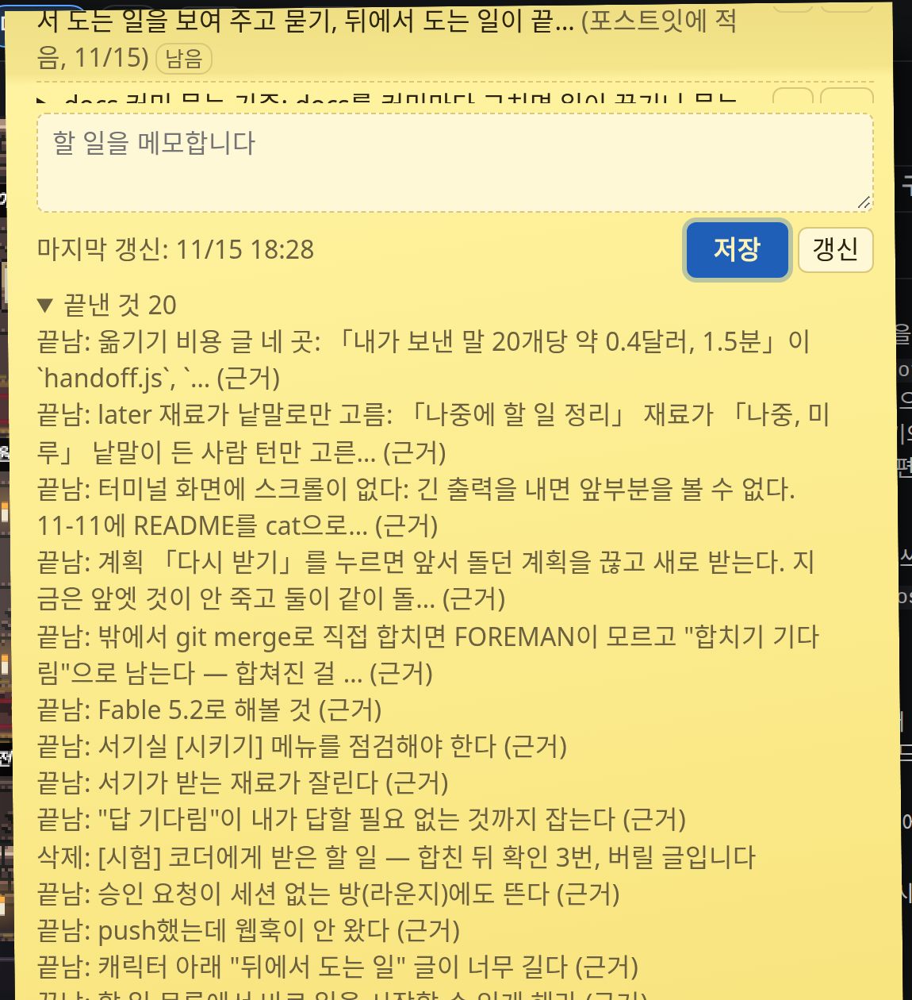

<!--
다루는 곳: bridge/static/js/postit.js, bridge/postit.py, bridge/api/postit.py, bridge/todofile.py, migrations/0034_postit_repo_log.sql
읽은 커밋: 8cfa257
-->

# 포스트잇

> 이 글은 미뤄 둔 일을 받아 두고, 저장소의 할 일 목록(TODO)이나 알려진 한계로 보내는 포스트잇을 다룹니다.

**「나중에 하자」고 미룬 일은 대화 속에 묻혀 잊히기 쉽습니다. 포스트잇은 프로젝트마다 미룬 일을 받아 두는 받은 편지함이자, 저장소의 할 일 목록을 보는 창입니다. 사람이 직접 적은 것, 대화에서 미루자고 한 것, 세션을 옮길 때 남은 일이 먼저 여기로 들어오고, 사람이 줄마다 할 일이면 [TODO로], 안 하기로 한 것이면 [한계로] 보냅니다. [갱신]을 누르면 조사 세션이 코드를 보고 이미 끝난 것을 찾아 주고, 지우는 것은 사람이 줄마다 합니다.**

![머리줄 「포스트잇 24장」 단추(주황)와 펼친 노란 종이. 프로젝트 고르기(FOREMAN), 「FOREMAN 할 일 24장」, 줄마다 할 일 첫 줄과 출처, 날짜, [갱신] 판정(남음)과 [x] [→] 단추. 아래 메모 칸과 「마지막 갱신」, [저장] [갱신], 접힌 「끝낸 것 20」 〔실제 화면〕](img/11_postit.png)

여러 세션과 일하다 보면 「그건 나중에 정하자」, 「이건 포스트잇에 올려 둬」 같은 말이 하루에도 여러 번 나옵니다. 그 말이 대화 안에만 있으면 세션이 끝나거나 대화가 요약될 때 함께 사라지고, 아무도 그 일이 남았다는 것을 모릅니다. 포스트잇은 그런 일을 대화 밖에 붙들어 두는 곳입니다. 다만 할 일의 원문은 저장소마다 할 일 파일(`docs/TODO.md`) 한 곳에만 둡니다. 두 곳에 적으면 한쪽만 지우게 되기 때문입니다. 그래서 포스트잇은 가볍게 받아 두는 곳이고, 할 일로 남길 것만 골라 그 파일로 보냅니다. 머리줄의 종이 단추와 서기실의 「포스트잇」이 같은 목록을 봅니다 [code:bridge/postit.py] [docs:12_scribe.md].

## 머리줄 단추와 세 묶음

머리줄 [+ 세션] 옆 종이 단추에는 지금 보는 방(감독실이면 모든 방을 합친)의 아직 안 보낸 포스트잇 수가 「포스트잇 N장」으로 뜹니다. 누르면 노란 종이가 펼쳐지고, 맨 위에서 어느 프로젝트를 볼지 고릅니다. 종이 안은 세 묶음입니다. 「아직 안 보낸 것」은 포스트잇 줄이고, 줄마다 할 일의 첫 줄, 어디서 왔는지(포스트잇에 적음, 대화에서 올림, 대화에서 찾음, 옮기기 미완), 올린 날짜가 붙으며 줄을 누르면 전체 글이 펼쳐집니다. 「할 일」은 그 저장소 할 일 파일의 항목을 번호와 한 줄 제목으로 보여 주고, 내용은 옮겨 적지 않습니다. 「30일 넘은 것」은 올린 지 30일이 넘은 할 일입니다. 할 일 파일이 없거나 번호를 붙이지 않는 꼴이면 그렇다고 적힙니다 [code:bridge/static/js/postit.js] [code:bridge/todofile.py].

포스트잇이 조용히 쌓이지 않도록, 할 일이 20장 이상이거나, 가장 오래된 것이 7일 지났거나, 마지막 [갱신] 뒤(한 번도 안 했으면 가장 오래된 것부터) 7일이 지나면 단추가 주황으로 바뀌고 서기 자리 위에 「포스트잇 쌓임」 말풍선이 뜹니다. 세 문턱은 서기 설정 파일 한 곳에서 읽고, 값이 틀리면 기본값으로 돌면서 브리지 기록에 경고를 남깁니다. 왜 쌓였다고 보는지는 단추 호버에 적힙니다. 개수를 읽지 못했을 때는 0으로 보이지 않고 「포스트잇 ?」와 「읽지 못했습니다」로 보입니다 [code:bridge/postit.py].

## 적기

「아직 안 보낸 것」 바로 아래 「할 일을 메모합니다」 칸에 적고 [저장](Ctrl+Enter)을 누르면 한 장이 붙습니다. 한 장에 8,000자까지 적을 수 있고, 이때는 저장소를 건드리지 않습니다. 서기실 안 「포스트잇」에서 적어도 같은 목록에 붙습니다 [code:bridge/static/js/postit.js].

## 대화에서 미룬 것 줍기

사람이 대화 중에 「포스트잇에 올려라」나 「나중에 할 일에 넣어라」라고 말하면, FOREMAN 프로젝트에서는 그 말을 들은 관리자 세션이 그 자리에서 브리지에 포스트잇 한 장을 올립니다. 이 줄에는 「대화에서 올림」과 근거가 된 대화 턴 번호가 붙습니다 [docs:12_scribe.md].

관리자가 올리기를 잊을 수 있으므로, 브리지가 2분마다 사람이 한 말을 그물처럼 훑습니다. 관리자가 그 턴에서 직접 올릴 틈을 두려고 30분이 지난 말만 보고, 브리지가 뜬 뒤 처음 한 번만 지난 말을 모두 훑고 그다음부터는 최근 이틀 치만 봅니다. 「포스트잇에 넣어」, 「나중에 정하자」, 「미루자」, 「지금은 두자」 같은 문장 꼴을 AI 없이 찾고, 걸렸는데 포스트잇이 생기지 않은 말은 「확인 전」 표시를 달아 흐리게 올립니다. 사람이 맞으면 [저장]으로 받아들이고, 아니면 [x]로 지웁니다. 사람이 붙여 넣은 긴 지시서 안의 미룬 말도 보고, 브리지가 띄운 세션의 첫 지시 글이나 합치기 카드 글은 빼고 봅니다. 지난 기록에 돌려 보았을 때 걸린 20개 가운데 17개가 진짜 미룬 말이었고, 진짜 미룬 말 17개는 모두 걸렸습니다. 다만 문장 꼴을 같은 기록에 맞춰 짰으므로 새 말투에는 이보다 덜 걸릴 수 있습니다 [code:bridge/postit.py] [docs:12_scribe.md].

세션을 새 세션으로 옮길 때 「문서에 넣을 것 고르기」에서 끝내지 못한 일로 고른 것도 「옮기기 미완」으로 붙습니다. 옮기기는 → 「세션 정리: 인계와 옮기기」.

## [갱신]: 끝났는지 코드를 보고 판정

할 일은 쌓이기만 하고, 이미 다른 세션이 끝낸 일이 그대로 남아 있기도 합니다. [갱신]을 누르면 확인 창을 거쳐 원본 폴더에 조사 세션 하나가 뜹니다. 조사는 읽고 알아보기만 하고 고치지 않는 역할입니다. 조사 세션은 열린 포스트잇과 README 「알려진 한계」 줄을 하나씩 코드와 맞대 보고 줄마다 「끝남」, 「남음」, 「모름」 가운데 하나로 판정합니다. 조사 세션이 마지막 답에 판정을 정해진 꼴로 적으면 브리지가 2분 안에 읽어 종이에 붙입니다. 도는 동안에는 「조사 세션 N이 코드를 보는 중입니다」, 결과 없이 끝나면 「지난 [갱신]이 결과 없이 끝났습니다」가 뜹니다 [code:bridge/postit.py].

「끝남」은 근거가 코드의 자리(파일과 줄, 또는 시험 이름)일 때만 받아들이고, 근거가 없으면 「모름」으로 내립니다. 「끝남」 판정은 종이 위쪽 「끝난 것 같음 N」에 근거와 함께 모이고, 사람이 줄마다 [닫기]로 끝냄 처리하거나 [남기기]로 남깁니다. 커밋만 보고 저절로 지우지는 않습니다. 닫은 줄은 「끝낸 것」에 근거와 함께 남아 나중에 다시 볼 수 있습니다 [docs:12_scribe.md] [log:foreman-6_postit_proposal_20261115.md].

## TODO로, 한계로, 지우기

포스트잇 줄마다 단추가 셋 있습니다. [TODO로]는 아직 할 일을 저장소 할 일 파일로 보냅니다. 브리지가 그 저장소의 번호 꼴(예: `infra-12`)로 다음 번호를 붙여 더하고 그 파일만 커밋합니다. 올리는 것(push)은 하지 않습니다. 그 할 일 파일에 아직 커밋하지 않은 변경이 있으면, 누가 그 파일을 고치는 중일 수 있으므로 건드리지 않고 못 한 까닭을 그 포스트잇 밑에 남깁니다. 저장소의 다른 파일이 바뀌어 있는 것은 막지 않습니다. 그런 파일은 커밋에 들어가지 않기 때문입니다. 넣었을 때도 어느 저장소의 어느 번호로 넣었는지와 커밋 번호가 창 아래 「저장소에 넣은 기록」에 남아서, 그 저장소에 가 보지 않아도 알 수 있습니다. 보낸 줄은 「할 일」 묶음으로 옮겨 갑니다 [code:bridge/todofile.py] [code:bridge/postit.py].

[한계로]는 안 하기로 한 일을 기술문서나 포트폴리오 편의 「알려진 한계」로 보냅니다. 편을 고르고 안 하는 까닭을 적어야 하고, 까닭 칸이 비면 [보내기]가 눌리지 않습니다. 까닭을 쓸 수 없는 일은 한계가 아니라 아직 못 한 일이기 때문입니다. 실제로 편에 쓰는 것은 서기실의 「알려진 한계 쓰기」가 맡아 서기 할 일에 「쓸 줄 N, 뺄 줄 M」으로 셉니다. 「할 일」 묶음의 항목에도 [한계로]가 있고, 이때는 서기가 편에 쓰면서 할 일 파일에서 그 항목을 지웁니다 [code:bridge/postit.py].

[x]는 안 하기로 했고 어디에도 남기지 않을 일을 지웁니다. 목록에서 사라지고 「끝낸 것」에 「삭제」로 남습니다.

할 일을 끝낸 커밋 메시지에 `(todo:infra-12)`처럼 번호를 적으면, 그 항목에 「커밋이 끝냄」 표와 [지우기] 단추가 붙고 머리줄 단추가 주황이 됩니다. 저절로 지우지는 않습니다. 번호를 잘못 적은 커밋 하나로 남의 할 일이 사라지지 않게, 사람이 [지우기]를 눌러야 지웁니다 [code:bridge/static/js/postit.js]. 서기실은 → 「서기실」.

## 코더에게 띄우기

![종이를 내려 본 모습. 「남음」 판정 옆에 「코더 추천」이 붙은 줄에는 [띄우기] 단추가 있고, 판정이 「모름」인 줄에는 없다 〔실제 화면〕](img/11_postit_coder.png)

[갱신]이 「남음」으로 보면서 코더에게 맡길 만하다고 본 줄에는 「코더 추천」이 붙고 [띄우기] 단추가 생깁니다. [띄우기]를 누르면 그 포스트잇 글로 교장 계획 창이 열리고 바로 계획을 받습니다. 세션은 여기서도 사람이 계획 카드를 보고 [이대로 시작]을 눌러야 뜹니다. 시작하면 그 세션이 이 포스트잇을 가져가, 줄에 「코더가 하는 중」이 붙고, 작업방 세션이면 합쳤을 때, 원본 폴더 세션이면 끝났을 때 「코더 세션 끝남」으로 바뀝니다. 작업방 세션을 합치지 않고 끝내면 「코더가 하는 중」으로 남고, 작업방을 버리면 다시 「열림」으로 돌아갑니다. 코더 세션이 끝나도 포스트잇은 저절로 닫히지 않고, 다음 [갱신]이나 사람이 닫습니다 [code:bridge/static/js/postit.js] [log:foreman-5_postit_20261115.md]. 계획 창은 → 「교장 계획 창과 감독실」.

[기술문서: 서기와 문서](../notion/10_scribe.md)
