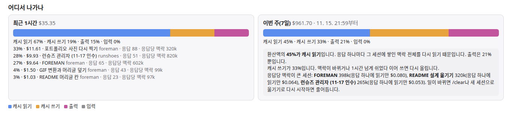
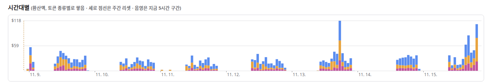
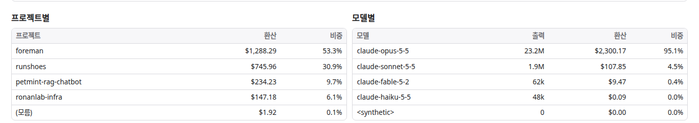
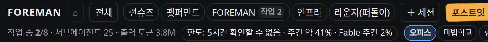

<!--
다루는 곳: bridge/static/usage.html, bridge/usage.py, bridge/api/usage.py, config/usage.toml, bridge/static/js/office.js
읽은 커밋: fb7121b
-->
# 사용량 화면

> 이 글은 Claude 구독 한도를 얼마나 썼는지 보여 주는 사용량 화면(`/usage`)과, 메인 화면 머리의 한도 칩을 다룹니다.

**구독 한도를 지금 몇 % 썼는지, 이 속도면 언제 다 쓰는지, 그 사용이 어느 세션과 어느 모델에서 나가는지를 한 화면에서 봅니다.**

Claude 구독에는 5시간 한도와 주간 한도가 있고, 다 쓰면 리셋될 때까지 멈추거나 추가 요금으로 넘어갑니다. 여러 AI 세션을 동시에 돌리면 한도가 생각보다 빨리 닳는데, Claude Code 안에서 `/usage`를 쳐야만 지금 몇 %인지 보이고, 그 %가 어느 세션 때문인지는 어디에도 나오지 않습니다. 사용량 화면은 이 둘을 한곳에 모읍니다. 한쪽은 Claude Code가 알려 주는 한도 %이고, 다른 쪽은 FOREMAN이 세션 기록에서 직접 센 토큰입니다. 둘을 나란히 두니 「지금 몇 %인가」와 「무엇이 그 %를 쓰고 있나」를 함께 볼 수 있습니다 [code:bridge/usage.py] [docs:15_usage.md].

## 한도 카드

한도 카드는 한도마다 하나씩, 5시간 세션, 주간 전체, 주간 Fable(모델별로 따로 있는 주간 한도) 셋입니다. 카드 맨 위 큰 숫자가 지금 쓴 비율입니다. 이 값은 FOREMAN이 10분마다 `claude -p "/usage"`를 실행해 읽습니다. 이 명령은 모델을 부르지 않는 로컬 명령이라 비용이 들지 않고, 어떤 세션의 화면도 가리지 않습니다. 10분을 기다리기 싫으면 화면 위 [지금 읽기]로 바로 한 번 더 읽습니다. 읽은 사이에도 세션은 계속 일하므로, 마지막으로 읽은 % 위에 그 뒤 FOREMAN이 본 사용량을 더해 추정한 값을 보입니다. 추정이 측정과 0.5%p 이상 벌어지면 숫자 앞에 「약」이 붙고, 그 아래 줄에 「측정 39% · 그 뒤 추정 +2.8%p」처럼 측정과 추정이 나뉘어 적힙니다 [code:bridge/usage.py] [code:bridge/static/usage.html] [code:config/usage.toml].

카드 아래쪽에는 리셋 시각과 남은 시간, 이번 구간에 FOREMAN이 본 사용을 API 정가로 바꾼 환산액, 최근 1시간 속도, 그리고 「이 속도면 언제 100%」가 있습니다. 마지막 줄은 최근 1시간 속도가 그대로 이어진다고 보고 100%가 되는 시각을 셈한 것입니다. 그 시각이 리셋보다 먼저면 빨간 글씨로 「리셋 전입니다」를, 리셋이 먼저 오면 흐린 글씨로 「리셋이 먼저입니다」를 붙여 걱정할 일인지를 한눈에 가립니다. 환산액은 진짜 청구 금액이 아니라 토큰 종류(입력, 출력, 캐시 읽기, 캐시 쓰기)와 모델마다 다른 무게를 한 줄로 더하기 위한 단위입니다. Anthropic은 한도를 토큰 수로 밝히지 않으므로, 계산이 많이 드는 만큼 한도도 많이 닳는다고 보고 API 정가 비율로 무게를 맞췄습니다. 다만 Fable 모델은 가격을 어디서 가져왔는지 출처를 찾지 못해, 짐작한 값을 넣지 않고 가격 칸을 비워 두었습니다. 가격이 없는 토큰은 0원으로 세지 않고 「모름」으로 둡니다. 0원으로 세면 환산액이 아무 표시 없이 작아지기 때문입니다. 그래서 그런 토큰이 있으면 화면 맨 위 띠에 「환산이 일부 빠졌습니다.」와 빠진 모델과 토큰 수가 뜨고, 카드의 환산액 옆에도 「+ 모름」이 붙습니다 [docs:15_usage.md] [code:config/usage.toml].

「한도 하한」 줄은 측정한 %와 FOREMAN이 본 환산액으로 한도의 크기를 거꾸로 셈한 값입니다. FOREMAN은 이 PC의 Claude Code만 보고, 웹이나 앱, 다른 PC에서 쓴 양은 보지 못합니다. 그래서 거꾸로 셈한 값은 실제 한도보다 작거나 같은 하한이고, 카드 아래 「왜 하한인가」 문단이 그 까닭을 설명합니다. 가격을 비워 둔 Fable 사용도 환산액에 들어가지 않으므로, 하한은 그만큼 더 작게 나옵니다. 같은 이유로 추정 %와 「이 속도면 언제 100%」도 FOREMAN이 보는 사용만으로 센 것이라, 웹을 함께 쓰면 실제로는 더 빨리 찹니다 [code:bridge/static/usage.html] [log:stage15_usage_result.md].

Claude Code가 `/usage` 결과에서 어떤 한도 줄을 아예 빼는 때가 있습니다. 서버가 그 한도 값을 주지 않으면 줄이 사라집니다. 이때 옛 숫자를 그대로 두면 낡은 %로 알림이 나가거나 안 나가므로, 그 카드는 「확인할 수 없음」으로 바꾸고 맨 위 띠에 까닭과 마지막으로 본 값을 적습니다. 위 사진이 그 상태입니다 [docs:15_usage.md].

## 어디서 나가나

한도 카드가 「얼마나」를 보인다면 이 칸은 「어디서」를 보입니다. 왼쪽은 최근 1시간, 오른쪽은 위에서 고른 기간(이번 주, 최근 24시간, 3일, 2주)입니다. 막대는 환산액을 토큰 종류별로 나눈 것인데, 대개 가장 큰 몫은 출력이 아니라 캐시 읽기입니다. 세션은 응답 하나를 낼 때마다 그때까지 쌓인 대화 전체를 다시 읽기 때문에, 대화가 길어진 세션은 짧은 답 하나에도 큰 비용이 듭니다. 그래서 세션 목록 옆에 「응답당 맥락」(응답 한 번에 다시 읽은 토큰 수)을 함께 적고, 오른쪽 상자가 이번 기간에 가장 큰 종류와 응답당 맥락이 큰 세션을 문장으로 짚어 줍니다. 일이 바뀌었는데 그 세션을 계속 쓰고 있다면 새 세션으로 옮기기(→ 「세션 정리: 인계와 옮기기」)로 맥락을 줄이라는 안내가 같은 상자에 붙습니다 [code:bridge/static/usage.html] [code:bridge/usage.py].

그 아래 시간대별 막대는 한 시간마다 환산액을 쌓아 하루 중 언제 많이 썼는지를 보입니다. 세로 점선이 주간 리셋 시각이고, 음영이 지금 5시간 한도가 세는 구간입니다. 더 아래에는 세션별, 프로젝트별, 모델별 표와 `/usage`에서 읽은 %를 값이 바뀔 때마다 남긴 관찰 기록이 이어집니다 [code:bridge/static/usage.html].

모델별 표는 비싼 모델을 어디에 쓰고 있는지 보려고 둔 것입니다. 세션을 띄울 때 고른 모델이 아니라 응답마다 실제로 쓰인 모델로 세므로, Claude Code가 안에서 제목 짓기 같은 일에 쓰는 가벼운 모델도 따로 잡힙니다. 계획 세우기나 압축으로 잊은 것 찾기처럼 세션 밖에서 `claude -p`로 돌린 일도 따로 기록해 이 표에 더합니다. 그런 일은 세션 기록을 남기지 않아서, 따로 세지 않으면 비용이 보이지 않는 곳으로 샙니다. 가격을 비워 둔 Fable처럼 환산하지 못한 토큰이 있는 줄은 환산 칸 금액 옆에 「+ 모름」이 붙고, 마우스를 올리면 빠진 토큰 수가 보입니다 [code:bridge/usage.py] [docs:15_usage.md].

## 머리 칩과 추가 요금 배지

사용량 화면을 열어 두지 않아도 메인 화면 머리에 한도 칩이 늘 있습니다. 「한도: 5시간 약 42% · 주간 91%」처럼 한도마다 지금 %를 한 줄에 적고, 리셋 전에 100%가 될 것 같으면 「오늘 18:14 소진 예상」처럼 그 시각을 붙입니다. 마우스를 올리면 한도마다 리셋 시각과 설명 문단이 뜨고, 누르면 사용량 화면으로 갑니다. 사용량을 읽지 못하고 있으면 칩 앞에 ⚠가 붙고(화면이 브리지에서 값을 받지도 못하면 「⚠ 한도」만 남고), 호버에 읽지 못한 까닭이 적힙니다. 읽지 못한 채 옛 숫자를 계속 보이면 그것이 조용한 고장이 되기 때문입니다 [code:bridge/static/js/office.js] [docs:15_usage.md].

칩 옆에는 한도 하나라도 100%를 넘을 때만 노란 「추가 요금으로 쓰는 중」 배지가 나타납니다. `/usage`가 알려 주는 값은 100%에서 멈추는데, 그 뒤에도 FOREMAN이 본 사용이 이어져 추정 %가 100을 넘었다면 한도에 닿고도 응답이 계속 나왔다는 뜻이므로, 넘은 만큼은 구독이 아니라 추가 사용 요금으로 나간 것으로 봅니다. 배지는 이 숫자만 보고 정합니다. 100% 아래로 내려오면 배지도 사라집니다 [code:bridge/usage.py] [log:foreman-2_overage_badge_20261114.md].

한도에 가까워지면 화면 말고 휴대폰으로도 알립니다. 추정 %가 80%와 95%를 넘을 때, 그리고 이 속도면 1시간 안에 5시간 한도에 닿을 때 한도 구간마다 한 번씩 텔레그램이 나가고, 90%를 넘으면 감독실 현황판에 경고등이 깜빡입니다. `/usage`를 세 번 연달아 읽지 못해도, 5시간이나 주간 전체 한도 줄이 `/usage`에서 6시간 넘게 빠져 있어도(그동안은 그 한도의 80%, 95% 알림이 멈추기 때문입니다), Claude Code 로그인이 24시간 안에 만료될 때도 알립니다(→ 「텔레그램 알림」) [code:bridge/usage.py] [code:config/usage.toml].

[기술문서: 사용량 화면](../notion/13_usage.md)
